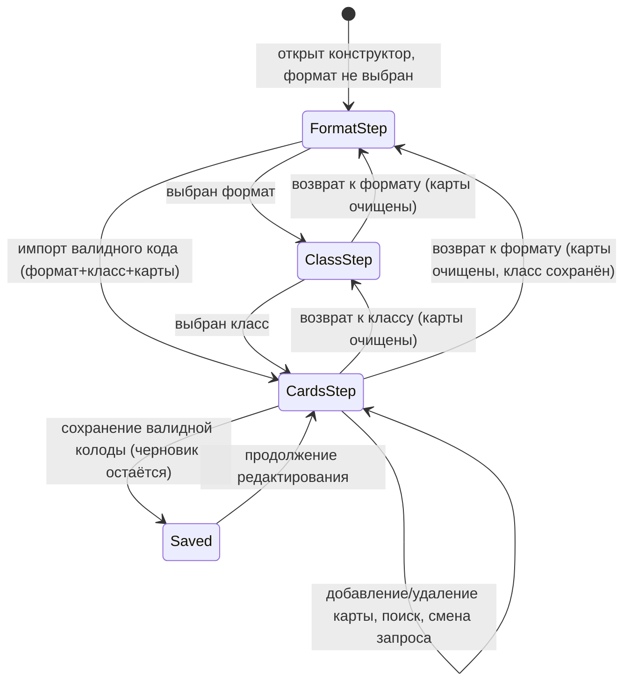
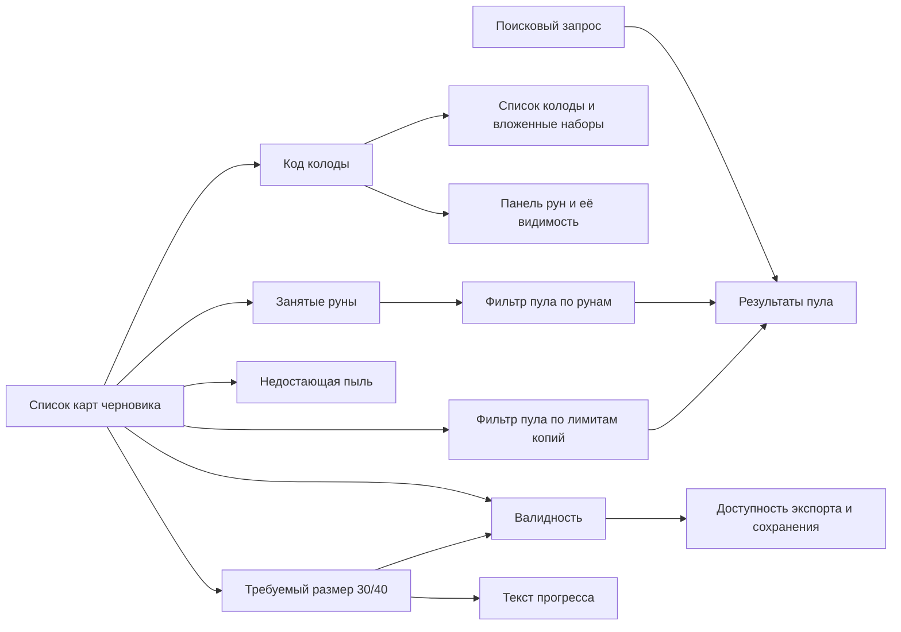

# Нейтральная функциональная спецификация HDMS — Функция № 2 «Визуальный конструктор колод»

> Документ исследовательского контура. Описывает наблюдаемое поведение назначенного донора и требования к независимой реализации HDMS. Не содержит исходного кода, внутренних имён, интерфейсных текстов и графики донора. Заполнен по шаблону `03_FUNCTION_SPEC_TEMPLATE.md`.

## 1. Паспорт

| Поле | Значение |
|---|---|
| Название задания | Пилот первичной деконструкции: визуальный конструктор колод (Constructed) |
| Номер функции / сквозная задача | Функция № 2 (только она; функции 1, 3–7 и физика игры не выполнялись) |
| Назначенный донор | Firestone (единственный донор этого пакета) |
| Canonical URL | https://github.com/Zero-to-Heroes/firestone |
| Ветка / tag | `master` (ветка по умолчанию; tag на snapshot не создавался) |
| Commit SHA | `0a30f066eb77a417637d95cec86444456f607ba1` |
| Дата коммита snapshot | 2026-02-08T20:08:36Z (author = committer) |
| Дата фиксации snapshot | 2026-11-17 (Asia/Shanghai) = 2026-11-16T21:15Z |
| Дата исследования | 2026-11-17 (Asia/Shanghai) |
| Версия приложения в snapshot | 16.12.8 (поле версии манифеста проекта) |
| Лицензия | Файл LICENSE/COPYING в дереве snapshot отсутствует; поле лицензии в манифесте не задано. Квалификация — не-OSS до подтверждения владельцем (совпадает с документом 02) |
| Версия спецификации | 1.0 |
| Статус | **Ready for review** (исследование выполнено на уровне исходников; автоматизированных тестов функции у донора не обнаружено — см. § 13, § 15) |
| Способ доступа | Read-only клон публичного репозитория в изолированную песочницу (`--depth 1 --filter=blob:none`, sparse-checkout рабочих каталогов), чтение файлов с нумерацией строк. Форки, PR, коммиты, изменения донора не выполнялись. Тесты донора не запускались (см. § 15) |

Все Evidence ID (`EV-xxx`) ссылаются на companion-документ `HDMS_F02_DeckBuilder_Evidence_Register_Firestone.md`, где для каждого утверждения указаны путь, строки и permalink на зафиксированный commit.

## 2. Назначение и границы

**Пользовательская задача.** Дать игроку возможность собрать колоду для Constructed-формата вне игрового клиента: выбрать формат и класс, набрать карты из легального пула, видеть состав и стоимость недостающих карт, получить переносимый код колоды и сохранить колоду в локальный список.

**Границы функции (что входит):**
- пошаговый мастер выбора формата и класса;
- формирование пула допустимых карт по формату, классу, лимитам копий и специальным ресурсным ограничениям;
- поиск и фильтрация пула, порядок выдачи результатов;
- добавление и удаление карт, счётчики копий и размера колоды;
- признак допустимости («валидности») колоды и прогресс набора;
- расчёт недостающих карт и стоимости их создания;
- экспорт кода колоды в буфер обмена;
- сохранение колоды в локальный список личных колод;
- импорт колоды из буфера обмена;
- возврат на предыдущие шаги мастера, состояния пустого результата и ошибки импорта.

**Что явно исключено (Out of scope этого пакета):**
- визуализация мана-кривой (функция № 3 — отдельное задание; в изученном конструкторе график кривой не отображается, EV-104);
- общие UI-паттерны companion-приложения, доступность и responsive как самостоятельная тема (функция № 7);
- сбор матчевой статистики, реплеи, мета-колоды, архетипы, рейтинги (соседние разделы того же раздела приложения);
- режимы Arena / Duels / Battlegrounds / Mercenaries / Tavern Brawl и их конструкторы;
- игровая физика, правила матча и эффекты карт;
- удаление/переименование/версионирование уже сохранённых колод (выполняется в соседнем разделе списка колод; в конструкторе таких операций нет — EV-105);
- серверная популяционная аналитика и любые закрытые сервисы.

**Соседние функции и зависимости:** список личных колод (приёмник сохранённых колод, EV-092), коллекция карт (источник данных о владении, EV-079), каталог карточных данных (EV-040), удалённый конфиг наборов форматов (EV-038, EV-039), настройки отображения карточек (EV-100), буфер обмена платформы (EV-086, EV-093).

## 3. Термины и сущности

| Термин | Нейтральное определение | Обязательные поля/свойства | Связи |
|---|---|---|---|
| Формат | Правило набора допустимых дополнений карт | идентификатор формата; список допустимых наборов | определяет пул карт и код колоды |
| Класс колоды | Выбранный класс героя | идентификатор класса; герой по умолчанию | определяет пул карт и героя в коде колоды |
| Черновик колоды | Текущее редактируемое состояние конструктора | формат; класс; упорядоченный список идентификаторов карт (по одной записи на копию); вложенные наборы (sideboards) | источник для кода колоды, счётчиков, валидности |
| Запись списка колоды | Строка «карта + количество» для отображения | идентификатор карты; количество; стоимость; редкость; признак нехватки в коллекции; вложенные карты | производная от кода колоды |
| Пул допустимых карт | Множество карт, которые можно добавить прямо сейчас | идентификатор; имя; изображение; класс(ы); стоимость; редкость; теги; наборы | результат фильтров формата/класса/лимитов/рун/поиска |
| Лимит копий | Максимум одинаковых карт в колоде | 1 для легендарных, 2 для остальных | ограничивает добавление и состав пула |
| Размер колоды | Требуемое число карт | минимум и максимум (равны между собой) | определяет валидность и прогресс |
| Модификатор размера | Карта, меняющая требуемый размер колоды | идентификаторы (исходная и переизданная версии) | меняет минимум и максимум одновременно |
| Код колоды | Переносимая строка (deckstring) | формат; герой; пары (числовой id карты, количество); вложенные наборы | экспорт, импорт, сохранение |
| Вложенный набор (sideboard) | Привязанный к карте набор дополнительных карт | ключевая карта; пары (id, количество) | отображается под картой; участвует в коде |
| Ресурсные руны | Ограничение класса «рыцарь смерти»: 3 слота, типы рун | тип руны; количество | фильтрует пул; отображается отдельной панелью |
| Карта-«турист» | Карта, открывающая в колоде другой класс | открываемый класс; набор карты | расширяет пул карт другого класса |
| Владение | Количество экземпляров карты в коллекции пользователя | обычная/золотая/алмазная/сигнатурная копии | признак нехватки и расчёт пыли |
| Пыль | Ресурс создания отсутствующих карт | стоимость создания по редкости | итоговая сумма «не хватает» |
| Личная колода | Сохранённая пользователем колода без сыгранных матчей | код; имя; класс; формат; отметка времени; признак личной | приёмник сохранения; появляется в списке колод |
| Шаг мастера | Текущая стадия интерфейса | «формат» / «класс» / «карты» | производная от заполненности черновика |

## 4. Входы и предусловия

| Вход/условие | Тип или формат | Обязательность | Проверка валидности | Поведение при ошибке |
|---|---|---|---|---|
| Выбор формата | одно из значений, предлагаемых в UI (2 значения) | обязателен для перехода к классу | значение из фиксированного списка UI | вне списка UI не выбирается; иные форматы попадают в состояние только через импорт (EV-015, EV-095) |
| Выбор класса | идентификатор класса | обязателен для перехода к картам | список классов зависит от формата | для «классических» форматов 2 класса исключены из списка (EV-016) |
| Поисковая строка | произвольный текст, включая структурный токен класса | необязательна | разбор токенов; нераспознанное — как текст | неизвестный токен не вызывает ошибки, трактуется как текст (EV-046) |
| Клик по карте пула | идентификатор карты | — | лимит копий | при достигнутом лимите — молчаливый отказ (EV-060) |
| Клик по строке колоды | идентификатор карты | — | ожидание: карта есть в черновике | в доноре при отсутствии карты удаляется последняя запись списка (дефект, EV-061) |
| Имя колоды | строка ввода | необязательно (есть значение по умолчанию) | валидация/ограничение длины не обнаружены | пустое имя сохраняется как есть (EV-089, Not found: EV-103) |
| Содержимое буфера обмена | многострочный текст | обязателен для импорта | поиск строки, декодируемой как код колоды | при отсутствии валидного кода состояние не меняется, сообщения в конструкторе нет (EV-094, EV-095) |
| Каталог карточных данных | внешний справочник карт | обязателен | ожидание готовности при инициализации | при недоступности — ошибка в журнале, пул не строится (EV-040, EV-005) |
| Конфиг наборов форматов | удалённый JSON со списками наборов | обязателен | наличие конфигурации и формата | до загрузки пул не вычисляется (фильтр предусловий), отдельного сообщения нет (EV-030, EV-038) |
| Коллекция пользователя | список карт с количествами | необязательна | нормализация формата записей | `null` → все карты считаются имеющимися; пустой список → все считаются отсутствующими (EV-080, EV-062) |
| Настройки отображения | масштаб карточек (%), показ связанных карт, окраска стоимости | необязательны | значения по умолчанию заданы | применяются к размеру плиток и подсказкам (EV-100) |

## 5. Основной сценарий

| Шаг | Условие/событие | Действие системы | Изменение состояния | Наблюдаемый результат |
|---|---|---|---|---|
| 1 | Пользователь открывает раздел конструктора в меню раздела колод | Переключение вида раздела; конструктор монтируется | вид раздела = конструктор; черновик пуст | видна панель шагов и заголовок шага «выбор формата»; фильтры списка колод скрыты (EV-010, EV-011, EV-018) |
| 2 | Формат ещё не выбран | Показ вариантов формата и кнопки импорта из буфера | шаг = «формат» | 2 варианта формата; кнопка импорта доступна (EV-015, EV-018) |
| 3 | Клик по варианту формата | Запись выбранного формата в черновик | формат заполнен | шаг переключается на «класс»; в панели шагов появляется значок формата (EV-020, EV-014, EV-018) |
| 4 | Класс ещё не выбран | Показ списка классов, отфильтрованного по формату | шаг = «класс» | 11 классов (или 9 для «классических» форматов), разложенных по 3 рядам (EV-016, EV-017) |
| 5 | Клик по классу | Запись класса в черновик | класс заполнен | шаг = «карты»; появляется рабочая область (EV-020, EV-014) |
| 6 | Вход на шаг «карты» | Ожидание готовности настроек, конфигурации форматов, состояния и коллекции; построение пула | пул вычислен | поле имени (значение по умолчанию), поле поиска с автофокусом, панель рун (если применимо), список колоды, сетка результатов (EV-030, EV-049, EV-103) |
| 7 | Пользователь вводит текст поиска | Разбор токенов, фильтрация пула, сортировка | список результатов обновляется (окно агрегации 50 мс) | сетка карт: сначала классовые, затем нейтральные; внутри — по стоимости и имени (EV-045, EV-046, EV-047, EV-048) |
| 8 | Клик по карте в результатах (или Enter) | Добавление одной копии, если лимит не достигнут | список карт черновика +1 | строка колоды появляется/увеличивает счётчик; карта исчезает из результатов при достижении лимита (EV-060, EV-034, EV-064) |
| 9 | Каждое изменение черновика | Пересборка кода колоды, пересчёт лимитов, валидности, прогресса, пыли, рун | производные значения обновлены | список колоды отсортирован по стоимости/имени; отметки нехватки; сумма пыли (EV-068, EV-065, EV-066, EV-075, EV-037) |
| 10 | Колода набрана до требуемого размера и валидна | Разблокировка экспорта и сохранения | валидность = true | вместо текста прогресса показываются кнопки копирования кода и сохранения (EV-085, EV-067) |
| 11 | Клик «скопировать код» | Запись кода в буфер обмена (платформенный или браузерный путь) | временная метка подтверждения | подтверждение на кнопке ~2 с, затем возврат исходной подписи (EV-086) |
| 12 | Клик «сохранить» (при валидной колоде) | Создание записи личной колоды и запись в локальное хранилище | список личных колод +1 | подтверждение на кнопке ~2 с; колода появляется в списке колод раздела (EV-088, EV-089, EV-090, EV-092) |

## 6. Альтернативные сценарии и исключения

| Сценарий | Условие запуска | Ожидаемое поведение | Результат/ошибка |
|---|---|---|---|
| A1. Импорт вместо ручного выбора | Шаг «формат», клик по кнопке импорта | Чтение буфера, поиск кода и имени, применение формата/класса/карт | сразу шаг «карты» с заполненной колодой; имя из буфера не применяется к полю имени (EV-093, EV-094, EV-095, EV-021) |
| A2. Импорт невалидного содержимого | В буфере нет декодируемой строки | Состояние не изменяется | остаётся шаг «формат»; пользовательского сообщения об ошибке в конструкторе нет (EV-095, EV-018) |
| A3. Возврат к выбору класса | Клик по значку класса в панели шагов | Класс сбрасывается, набранные карты очищаются, формат сохраняется | шаг «класс», колода пуста, без подтверждения и без отмены (EV-019) |
| A4. Возврат к выбору формата | Клик по значку формата | Формат сбрасывается, карты очищаются, класс сохраняется | шаг «формат»; кнопка импорта снова видна; повторный выбор формата ведёт сразу к картам с сохранённым классом (EV-019, EV-014, EV-018) |
| A5. Удаление карты | Клик по строке списка колоды | Удаляется одна копия той карты, по которой выполнен клик | счётчик уменьшается; при 0 строка исчезает; карта возвращается в пул (EV-061, EV-034) |
| A6. Клик по вложенной (sideboard) карте | Строка-«потомок» в списке колоды | Ожидание: удаление относится к этой карте | в доноре карта не найдена в черновике и удаляется последняя запись списка (дефект, EV-061, EV-063) |
| A7. Быстрый набор с клавиатуры | Фокус в поиске, Enter | Добавляется первый результат | при Shift+Enter поиск очищается; при единственном результате, достигшем лимита, поиск очищается автоматически (EV-051) |
| A8. Пустой результат поиска | Ни одна карта не подходит | Показ сообщения «нет результатов» с текстом запроса | сетка скрыта, показано пустое состояние (EV-049, EV-050) |
| A9. Пустой результат без запроса | Все карты исчерпаны/отфильтрованы, поиск пуст | Ожидание: объясняющее сообщение | в доноре область остаётся пустой без сообщения (EV-050) |
| A10. Колода не добрана | Число карт вне требуемого диапазона | Экспорт и сохранение недоступны | показывается текст прогресса «набрано/требуется» (EV-085, EV-067) |
| A11. Колода с модификатором размера | В колоде есть карта-модификатор (любая из 2 версий) | Требуемый размер повышается до 40 | прогресс и валидность считаются по 40 (EV-065) |
| A12. Класс с ресурсными рунами | Герой — «рыцарь смерти» либо в колоде есть «турист» в этот класс | Панель из 3 слотов рун, заполнение по максимуму требований карт | пул дополнительно фильтруется по совместимости рун (EV-037, EV-036) |
| A13. «Турист» в другой класс | В колоде есть карта, открывающая класс X | Пул расширяется картами класса X | расширение ограничено картами одного конкретного набора (EV-031) |
| A14. Коллекция не загружена | Данные коллекции отсутствуют (`null`) | Ожидание: явное состояние неопределённости | в доноре все карты списка считаются имеющимися, пыль = 0 (EV-080, EV-062, EV-075) |
| A15. Повторное сохранение того же кода | Колода с идентичным кодом уже сохранена | Ожидание: обновление существующей записи | в доноре существующая запись обновляется и дополнительно добавляется новая → дубли (EV-090) |
| A16. Переключение вкладки раздела и возврат | Пользователь уходит в другой раздел и возвращается | Черновик сохраняется в памяти состояния | шаг и колода восстанавливаются (EV-013, EV-021, EV-022) |
| A17. Импорт формата вне UI-списка | Код колоды содержит «классический»/twist-формат | Формат применяется из кода | пул строится по соответствующему списку наборов; при пустом списке наборов пул пуст (EV-095, EV-030, EV-039) |
| A18. Ошибка загрузки изображения карты | Изображение недоступно | Плитка списка скрывает изображение, оставляя текст/стоимость | список остаётся работоспособным (EV-064) |

## 7. Правила и ограничения

| ID | Однозначная формулировка | Статус знания | Основание / Evidence ID | Неоднозначность |
|---|---|---|---|---|
| R-01 | Шаг мастера вычисляется из черновика: нет формата → «формат»; нет класса → «класс»; иначе «карты». Отдельного «шага 4» нет | Confirmed | EV-014, EV-018 | — |
| R-02 | В UI предлагаются ровно 2 формата (стандартный и вольный). Прочие форматы поддерживаются логикой пула/кода, но выбираются только импортом | Confirmed | EV-015, EV-016, EV-030, EV-095 | Третий формат присутствует в коде как отключённая опция |
| R-03 | Список классов содержит 11 значений; для «классических» форматов исключаются 2 (рыцарь смерти, охотник на демонов) | Confirmed | EV-016, EV-017 | — |
| R-04 | Пул = коллекционные карты, принадлежащие наборам выбранного формата, класса колоды или нейтральные, исключая карты типа «зачарование» | Confirmed | EV-030, EV-032 | — |
| R-05 | Карты-«туристы», находящиеся в колоде, добавляют свой открываемый класс в пул, но только для карт одного конкретного набора | Confirmed | EV-031 | набор зашит в логику, а не в конфиг |
| R-06 | Карты с одинаковым именем сворачиваются в одну запись пула: единственная допустимая версия → версия с «двойником» → версия базового набора → первая в списке | Confirmed | EV-033 | порядок «первой» зависит от порядка справочника |
| R-07 | Лимит копий: 1 для легендарной карты, 2 для остальных | Confirmed | EV-035, EV-060 | — |
| R-08 | Карта, достигшая лимита копий в колоде, полностью исключается из результатов (не «сереет») | Confirmed | EV-034 | — |
| R-09 | Требуемый размер колоды: 30 (минимум = максимум); при наличии карты-модификатора размера (любая из 2 версий) — 40 | Confirmed | EV-065 | минимум и максимум всегда равны |
| R-10 | Колода валидна, если число карт в диапазоне [мин, макс] и каждая карта встречается не более 2 раз. Отдельной проверки «не более 1 легендарной» в критерии валидности нет | Confirmed | EV-066 | расхождение с R-07 при импорте (см. E-05) |
| R-11 | Добавление карты увеличивает число копий на 1, если лимит не достигнут; иначе действие игнорируется без сообщения | Confirmed | EV-060 | — |
| R-12 | Клик по строке списка колоды удаляет одну копию соответствующей карты | Confirmed | EV-061 | при отсутствии карты в черновике удаляется последняя запись (дефект, E-01) |
| R-13 | Операция «заменить карту» (одним действием) в конструкторе отсутствует; замена = удаление + добавление | Not found | EV-049, EV-060, EV-061 | продуктовое решение для HDMS |
| R-14 | Текстовый поиск — регистронезависимое вхождение подстроки в имя, текст карты, школу заклинаний, расы, редкость, теги механик; отдельный случай — совпадение названия расы со значением «все расы» | Confirmed | EV-047 | поиск по числовым параметрам (стоимость/атака/здоровье) не реализован |
| R-15 | Структурный токен `class:<значение>` фильтрует по точному совпадению имени класса (регистронезависимо) и применяется до текстового условия | Confirmed | EV-046, EV-047 | префиксный/частичный ввод класса не поддерживается |
| R-16 | Другие структурные токены не поддерживаются; нераспознанные фрагменты объединяются через пробел в текстовый запрос | Confirmed | EV-046 | во внешних строках интерфейса присутствует подсказка о токене, не реализованном в этом конструкторе (EV-052, противоречие C-01) |
| R-17 | Пересчёт результатов поиска агрегируется в окне 50 мс (последнее значение окна) | Confirmed | EV-045 | это не «debounce» в строгом смысле |
| R-18 | Сортировка результатов: ранг класса (нейтральные — в конце) → стоимость → имя. Ранг класса у донора грубый: код первой буквы имени класса, из-за чего разные классы получают одинаковый ранг | Confirmed | EV-048 | для HDMS требуется детерминированный полный порядок классов (E-08) |
| R-19 | Список колоды сортируется по стоимости, затем по имени; вложенные карты — по стоимости | Confirmed | EV-062, EV-063 | — |
| R-20 | Панель рун содержит 3 слота; заполнение = максимум требований по каждому типу среди карт колоды; карта допустима, если сумма недостающих рун ≤ число свободных слотов | Confirmed | EV-036, EV-037 | «недостающие» считаются по типам независимо |
| R-21 | Панель рун отображается только если герой колоды — рыцарь смерти либо в колоде есть «турист» в этот класс | Confirmed | EV-037 | — |
| R-22 | Прогресс «набрано/требуется» показывается только пока колода невалидна | Confirmed | EV-067, EV-085 | нет отдельного постоянного счётчика карт |
| R-23 | Кнопки копирования кода и сохранения видны только при валидной колоде; сохранение дополнительно требует непустого кода | Confirmed | EV-085 | — |
| R-24 | Код колоды собирается из пар (числовой id, количество), героя по умолчанию для класса, формата и вложенных наборов | Confirmed | EV-068, EV-069 | неизвестный класс → герой воина по умолчанию |
| R-25 | Экспорт копирует код в буфер обмена; предварительная «нормализация» кода в snapshot является тождественной (ничего не меняет); имя колоды к копируемому тексту не добавляется, так как не передаётся в компонент копирования | Confirmed | EV-085, EV-086, EV-087 | в других разделах имя добавляется — поведение не унифицировано |
| R-26 | Сохранение создаёт запись личной колоды: класс, формат, код, имя, отметка времени, признак «личная» | Confirmed | EV-089 | архетип, скин и статистика не заполняются на этом шаге |
| R-27 | Список личных колод хранится локально (отдельный ключ хранилища) и перезаписывается при каждом изменении | Confirmed | EV-090, EV-091 | — |
| R-28 | Повторное сохранение колоды с уже существующим кодом обновляет существующую запись и одновременно добавляет новую (дублирование) | Confirmed (по коду; рантайм не проверен) | EV-090 | см. E-04 |
| R-29 | Импорт доступен только на шаге «формат» и читает только буфер обмена (файловый импорт отсутствует) | Confirmed | EV-018, EV-093 | — |
| R-30 | Разбор буфера: строки просматриваются с конца; имя — первая с конца строка с префиксом `### `; код — первая с конца строка, успешно декодируемая; поиск прекращается, когда найдены оба | Confirmed | EV-094 | имя без префикса не распознаётся |
| R-31 | Импорт устанавливает формат из кода, класс — по герою, карты — разворачиванием количеств в список копий, вложенные наборы сохраняются; имя из буфера в состояние не попадает | Confirmed | EV-095, EV-021 | см. E-03 |
| R-32 | При ошибке декодирования импорта состояние не меняется; в конструкторе отсутствует пользовательское сообщение об ошибке (диалог ошибки существует только в другом компоненте импорта) | Confirmed | EV-095, EV-096, EV-018 | см. E-02 |
| R-33 | Возврат на любой предыдущий шаг безусловно очищает набранные карты; подтверждения и отмены нет | Confirmed | EV-019 | см. E-06 |
| R-34 | Смена формата не сбрасывает выбранный класс | Confirmed | EV-019, EV-020 | возможен класс, недопустимый для нового формата (E-07) |
| R-35 | Недостающая пыль = Σ по картам max(0, требуемое количество − владение по точному id) × стоимость создания по редкости (40/100/400/1600) | Confirmed | EV-075, EV-076, EV-077 | владение учитывает все виды копий без ограничения лимитом |
| R-36 | Признак «не хватает» в строке списка колоды вычисляется иначе: владение агрегируется по всем версиям-«двойникам» карты | Confirmed | EV-062, EV-078 | расхождение с R-35 (противоречие C-02) |
| R-37 | Если данные коллекции отсутствуют (`null`), все строки списка считаются обеспеченными; если пришёл пустой список — все считаются отсутствующими | Confirmed | EV-080, EV-062, EV-079 | нет состояния «коллекция неизвестна» |
| R-38 | Размер плиток карт = базовый размер × (масштаб из настроек / 100); показ связанных карт в подсказках управляется настройкой | Confirmed | EV-100, EV-101 | — |
| R-39 | Черновик живёт в состоянии приложения: сохраняется при переключении вкладок раздела; персистентного хранения черновика не обнаружено | Confirmed (в памяти) / Inferred (сброс при перезапуске) | EV-013, EV-021, EV-022, EV-091 | восстановление после перезапуска не проверено рантаймом |
| R-40 | Пустой результат: при непустом поиске показывается сообщение «нет результатов»; при пустом поиске область результатов остаётся пустой без сообщения | Confirmed | EV-049, EV-050 | см. E-09 |
| R-41 | Enter в поле поиска добавляет первый результат; Shift+Enter очищает запрос; запрос очищается автоматически, если единственный результат достиг лимита копий | Confirmed | EV-051 | подтверждается структурой внешних строк подсказки (EV-052) |
| R-42 | Индикатор загрузки существует на уровне раздела; отдельного состояния загрузки пула/конфига в конструкторе нет | Confirmed / Not found (для конструктора) | EV-011, EV-030, EV-040 | до загрузки пула область просто пуста |
| R-43 | Аналитические события отправляются при открытии конструктора, при переключении вкладки и при копировании кода | Confirmed | EV-014, EV-010, EV-086 | состав параметров не исследовался полностью |
| R-44 | Вложенные наборы (привязанные к карте дополнительные карты) только принимаются из импорта и передаются в код колоды; создание и редактирование вложенных наборов в конструкторе отсутствует | Confirmed (поток данных) / Not found (редактирование) | EV-118, EV-021, EV-068 | пробел функциональности для модульных карт |
| R-45 | Отображаемая стоимость карты берётся из справочника; для одной конкретной модульной карты она равна сумме стоимостей её вложенных карт | Confirmed | EV-119, EV-062 | частный случай зашит в код, обобщённого правила нет |

## 8. Состояния и переходы

**Состояния мастера (по черновику):**

**Состояния рабочей области (ортогональные подсистемы):**

| Подсистема | Состояния | Переходы | Невозможные/непокрытые состояния |
|---|---|---|---|
| Пул карт | «предусловия не готовы» → «готов» → «пуст после фильтров» | готовность каталога/конфига/формата/класса; изменение колоды, рун, поиска | явное «загрузка» и «ошибка загрузки» отсутствуют (R-42) |
| Черновик | пуст → частичный → полный валидный → невалидный (например, после импорта) | добавление/удаление/импорт/возврат | «переполненный» вручную недостижим (лимиты блокируют добавление), но достижим импортом |
| Сохранение | покой → подтверждение (~2 с) → покой | клик при валидной колоде | «ошибка сохранения» не обнаружена |
| Экспорт | покой → подтверждение (~2 с) → покой | клик при валидной колоде | «ошибка буфера» в браузерном пути молчалива (EV-086) |
| Импорт | покой → применён / молчаливый отказ | клик на шаге формата | «ошибка импорта» как состояние UI отсутствует (R-32) |
| Коллекция | неизвестна (`null`) → загружена (в т.ч. пустая) | обновление источника коллекции | «ошибка коллекции» не отображается в конструкторе |

**Восстановление после ошибки:** предусмотрен только повтор действия пользователем; автоматических повторов на уровне конструктора нет (повторы есть в инфраструктуре готовности каталога карт, EV-040).

## 9. Взаимодействия и контракты

**Входящие события (от пользователя/платформы):** выбор формата; выбор класса; возврат к шагу; импорт из буфера; сохранение колоды; ввод поиска; клик по карте пула; клик по строке колоды; изменение имени; изменение настроек отображения; обновление коллекции.

**Исходящие эффекты:** запись кода в буфер обмена; запись списка личных колод в локальное хранилище; аналитические события; переключение вида раздела.

**Зависимые данные:** каталог карт (идентификаторы, числовые id, классы, стоимость, редкость, теги, наборы, «двойники», «туристы», дополнительные стоимости рун); удалённый конфиг наборов форматов; коллекция пользователя; настройки; строки интерфейса из удалённого источника локализации.

**Синхронизация (единый источник истины — список карт черновика):**

**Контракты вовне:** сохранённая личная колода должна быть пригодна для отображения в списке колод (код декодируется, класс/формат заполнены) — EV-092; экспортированный код должен декодироваться сторонними инструментами (формат кода — внешний стандарт, реализация кодирования/декодирования в репозитории донора отсутствует, см. § 15).

**Границы:** конструктор не изменяет игровое состояние, не пишет в статистику матчей и не управляет оверлеем.

## 10. Граничные случаи и ошибки

| ID | Начальное состояние | Действие/событие | Ожидаемый результат (требование HDMS) | Почему сценарий важен |
|---|---|---|---|---|
| E-01 | Колода из N карт; в списке есть вложенная карта, отсутствующая в черновике | Клик по вложенной карте | Ничего не удаляется; удаление применяется только к карте, присутствующей в колоде | В доноре удаляется последняя карта колоды (потеря данных). Confirmed: EV-061, EV-063 + проверка семантики языка (EV-107) |
| E-02 | Шаг «формат», в буфере произвольный текст | Клик «импорт» | Явное сообщение «код не распознан», состояние не меняется | В доноре отказ молчаливый (EV-095, EV-096) |
| E-03 | Буфер содержит имя и валидный код | Импорт | Имя из буфера предлагается в поле имени | В доноре имя теряется (EV-095, EV-021) |
| E-04 | Личная колода с кодом X уже сохранена | Повторное сохранение кода X | Одна запись на код (идемпотентность) | В доноре появляются дубли (EV-090) |
| E-05 | Импортирована колода с 2 копиями легендарной карты | Проверка валидности | Колода помечается невалидной | В доноре критерий валидности проверяет только «≤2» (EV-066) |
| E-06 | набрано 25 карт | Возврат к классу/формату | Подтверждение или возможность отмены | В доноре карты удаляются без подтверждения (EV-019) |
| E-07 | Формат «вольный», класс — рыцарь смерти | Возврат к формату и выбор «классического» формата | Класс сбрасывается или помечается недопустимым | В доноре класс сохраняется, пул строится по недопустимой паре (EV-019, EV-016) |
| E-08 | Пул содержит карты 3+ классов с одинаковой первой буквой | Сортировка результатов | Детерминированный порядок классов | В доноре ранг класса грубый, порядок внутри группы определяется стоимостью/именем (EV-048) |
| E-09 | Все карты пула исчерпаны, поиск пуст | Отрисовка результатов | Объсняющее пустое состояние («все доступные карты добавлены») | В доноре пустая область без текста (EV-050) |
| E-10 | Коллекция не загружена | Расчёт нехватки/пыли | Явное состояние «данные коллекции недоступны», без ложного «всё есть» | В доноре `null` трактуется как «всё есть» (EV-080) |
| E-11 | Коллекция загружена, но пуста | Расчёт нехватки/пыли | Все карты помечены отсутствующими, пыль = полная стоимость создания | Подтверждено (EV-079, EV-075) |
| E-12 | Конфиг формата содержит пустой список наборов (наблюдается для twist) | Импорт колоды этого формата | Понятное сообщение «формат не поддерживается» | В доноре пул просто пуст (EV-039, EV-030) |
| E-13 | Каталог карт недоступен (сеть/блокировка) | Открытие конструктора | Явная ошибка загрузки с инструкцией | Пул не строится; ошибка только в журнале; отдельная инструкция есть в документации донора (EV-040, EV-005) |
| E-14 | В колоде 30 карт, добавляется карта-модификатор размера | Пересчёт | Требуемый размер 40, колода снова невалидна, экспорт блокируется | Подтверждено (EV-065, EV-066, EV-085) |
| E-15 | Колода с 3 рунами одного типа | Поиск карты с требованием другого типа | Карта исключается из пула | Подтверждено (EV-036) |
| E-16 | В колоде карта с 2 рунами разных типов, свободен 1 слот | Поиск карты с требованием 2 рун третьего типа | Карта исключается (не хватает 2 > 1 свободного) | Подтверждено (EV-036) |
| E-17 | Достигнут лимит копий единственного результата поиска | Enter | Копия не добавляется, запрос очищается | Подтверждено (EV-051, EV-035) |
| E-18 | Пустое имя колоды | Сохранение | Валидация имени или подстановка значения по умолчанию | В доноре валидации не обнаружено (EV-089, EV-103) |
| E-19 | Изображение карты недоступно | Отрисовка списка/сетки | Сохранение читаемой строки (имя, стоимость, количество) | В списке колоды подтверждено; в сетке результатов изображение просто не отображается (EV-064, EV-049) |
| E-20 | Пользователь уходит из раздела и возвращается | Восстановление | Черновик восстановлен (в рамках сессии) | Подтверждено для переключения вкладок; после перезапуска — Unknown (EV-013, EV-022) |
| E-21 | Один и тот же card-name в нескольких наборах формата | Формирование пула | Одна запись на имя, версия выбирается детерминированно | Подтверждено, но последний fallback зависит от порядка справочника (EV-033) |
| E-22 | Колода содержит карту-«туриста» | Формирование пула | Карты открытого класса доступны только из разрешённого набора | Подтверждено; жёсткая привязка к набору — риск устаревания (EV-031) |
| E-23 | Импортирована колода со вложенным набором (модульная карта) | Осмотр списка колоды, клик по вложенной карте, экспорт | Вложенные карты отображаются под родительской, клик по ним не изменяет колоду, экспорт сохраняет вложенный набор; редактирование вложенных наборов либо реализовано, либо явно недоступно | В доноре вложенные наборы нельзя создать/изменить в конструкторе, а клик по вложенной карте удаляет последнюю карту колоды (EV-118, EV-061, EV-063) |

## 11. Тест-кейсы

> Все тест-кейсы ниже сформулированы нейтрально и выведены из прочитанных исходников. **Автоматизированных тестов конструктора у донора не обнаружено** (EV-003), поэтому ни один кейс не имеет статуса «Confirmed by test». Колонка Pass/fail заполняется при проверке реализации HDMS; сейчас — `Not executed`.

| Test ID | Входные данные | Начальные условия | Последовательность действий | Ожидаемый результат | Pass/fail |
|---|---|---|---|---|---|
| TC-01 | — | Конструктор открыт, черновик пуст | Открыть раздел | Шаг «формат»; предлагаются 2 формата; кнопка импорта видна (R-01, R-02, R-29) | Not executed |
| TC-02 | формат = стандартный | Шаг «формат» | Выбрать формат | Шаг «класс»; в панели шагов значок формата (R-01) | Not executed |
| TC-03 | формат = стандартный | Шаг «класс» | Подсчитать варианты классов | 11 классов (R-03) | Not executed |
| TC-04 | формат «классический» (через импорт) | Шаг «класс» | Подсчитать варианты классов | 9 классов, 2 исключены (R-03) | Not executed |
| TC-05 | класс = маг, формат = стандартный | Шаг «карты», каталог и конфиг загружены | Проверить пул | Только коллекционные карты наборов формата, класса «маг» + нейтральные, без зачарований (R-04) | Not executed |
| TC-06 | имя карты встречается в 2 наборах формата | Шаг «карты» | Найти карту по имени | Одна запись пула, версия выбрана по цепочке приоритетов (R-06) | Not executed |
| TC-07 | нейтральная не-легендарная карта | Пустая колода | Кликнуть карту 3 раза | В колоде 2 копии; третий клик не меняет состояние; после 2-й копии карта исчезает из результатов (R-07, R-08, R-11) | Not executed |
| TC-08 | легендарная карта | Пустая колода | Кликнуть карту 2 раза | В колоде 1 копия; карта исчезает из результатов (R-07, R-08) | Not executed |
| TC-09 | колода: 2 копии карты A | Шаг «карты» | Кликнуть строку A в списке колоды | 1 копия A; карта A снова в пуле (R-12) | Not executed |
| TC-10 | колода из 5 карт; в списке есть вложенная карта B, отсутствующая в колоде | Шаг «карты» | Кликнуть строку B | Колода не изменилась (E-01; в доноре — удаляется последняя карта) | Not executed |
| TC-11 | 29 карт | Шаг «карты» | Проверить элементы управления | Экспорт/сохранение скрыты; виден прогресс «29/30» (R-22, R-23) | Not executed |
| TC-12 | 30 карт, лимиты соблюдены | Шаг «карты» | Проверить элементы управления | Валидность = true; видны копирование и сохранение; прогресс скрыт (R-10, R-23) | Not executed |
| TC-13 | 30 карт + карта-модификатор размера (31 карта) | Шаг «карты» | Проверить требуемый размер | Требуется 40; колода невалидна; экспорт скрыт (R-09, E-14) | Not executed |
| TC-14 | импорт колоды с 2 копиями легендарной карты, всего 30 | Шаг «формат» | Импортировать | HDMS: колода невалидна (E-05; в доноре — валидна) | Not executed |
| TC-15 | запрос = подстрока имени | Шаг «карты» | Ввести запрос | Все результаты содержат подстроку в одном из поддерживаемых полей (R-14) | Not executed |
| TC-16 | запрос = подстрока текста карты («провокация») | Шаг «карты» | Ввести запрос | В результатах карты с этим текстом/тегом (R-14) | Not executed |
| TC-17 | запрос = `class:mage` | Класс колоды = рыцарь смерти (пул содержит нейтральные) | Ввести запрос | Только карты класса «маг», если они есть в пуле; текстовое условие пусто (R-15) | Not executed |
| TC-18 | запрос = `mana:3` | Шаг «карты» | Ввести запрос | Токен не распознан → трактуется как текст; результаты соответствуют буквальному поиску (R-16) | Not executed |
| TC-19 | запрос = несуществующая строка | Шаг «карты» | Ввести запрос | Сетка скрыта, показано «нет результатов» с текстом запроса (R-40) | Not executed |
| TC-20 | все карты пула добавлены до лимитов, запрос пуст | Шаг «карты» | Осмотреть область результатов | HDMS: объясняющее пустое состояние (E-09; в доноре — пусто без текста) | Not executed |
| TC-21 | ≥2 результата поиска | Фокус в поиске | Enter | Добавлена 1 копия первого результата; запрос сохранён (R-41) | Not executed |
| TC-22 | ≥1 результат поиска | Фокус в поиске | Shift+Enter | Добавлена 1 копия первого результата; запрос очищен (R-41) | Not executed |
| TC-23 | единственный результат — карта с 1 оставшейся копией | Фокус в поиске | Enter | Копия добавлена, запрос очищен автоматически (R-41) | Not executed |
| TC-24 | колода класса «рыцарь смерти» с картой, требующей 3 рун крови | Шаг «карты» | Осмотреть панель рун и пул | 3 слота заполнены кровью; карты с требованием других рун отсутствуют в пуле (R-20, R-21, E-15) | Not executed |
| TC-25 | колода с картой на 2 руны крови; свободен 1 слот | Шаг «карты» | Найти карту, требующую 2 руны мороза | Карта отсутствует в пуле (E-16) | Not executed |
| TC-26 | колода не-рыцаря смерти без «туриста» | Шаг «карты» | Осмотреть панель рун | Панель скрыта (R-21) | Not executed |
| TC-27 | коллекция: 0 копий легендарной карты (1600) и 1 копия редкой из 2 (100) | Колода содержит эти карты | Проверить сумму пыли | 1700 (R-35) | Not executed |
| TC-28 | коллекция = `null` | Колода из 30 карт | Проверить отметки нехватки и пыль | HDMS: явное состояние неопределённости (E-10; в доноре — всё «есть», пыль 0) | Not executed |
| TC-29 | коллекция = пустой список | Колода из 30 карт | Проверить отметки нехватки | Все строки помечены отсутствующими; пыль = сумма стоимостей создания (E-11) | Not executed |
| TC-30 | валидная колода, имя по умолчанию | Шаг «карты» | Клик «сохранить», подождать 3 с | Запись личной колоды создана (класс, формат, код, имя, время); подпись кнопки вернулась к исходной (R-26, R-27) | Not executed |
| TC-31 | та же колода уже сохранена | Шаг «карты» | Клик «сохранить» повторно | HDMS: одна запись на код (E-04; в доноре — дубли) | Not executed |
| TC-32 | валидная колода | Шаг «карты» | Клик «скопировать код», прочитать буфер | Буфер содержит декодируемый код той же колоды; подтверждение ~2 с (R-25) | Not executed |
| TC-33 | буфер: строка имени с префиксом `### ` + валидный код | Шаг «формат» | Клик «импорт» | Формат/класс/карты применены; шаг «карты»; HDMS: имя предложено в поле имени (R-30, R-31, E-03) | Not executed |
| TC-34 | буфер: произвольный текст без кода | Шаг «формат» | Клик «импорт» | Состояние не изменилось; HDMS: сообщение об ошибке (R-32, E-02) | Not executed |
| TC-35 | буфер: несколько строк, из которых 2 декодируются | Шаг «формат» | Клик «импорт» | Выбрана первая с конца декодируемая строка (R-30) | Not executed |
| TC-36 | набрано 20 карт | Шаг «карты» | Возврат к классу | Карты очищены; HDMS: подтверждение/отмена (R-33, E-06) | Not executed |
| TC-37 | формат «вольный», класс «рыцарь смерти», 10 карт | Шаг «карты» | Возврат к формату, выбрать «классический» формат | Карты очищены; HDMS: класс сброшен/помечен (R-34, E-07) | Not executed |
| TC-38 | черновик: формат+класс+15 карт | Шаг «карты» | Перейти в другую вкладку раздела и вернуться | Черновик и шаг восстановлены (R-39) | Not executed |
| TC-39 | масштаб карточек = 150 % | Шаг «карты» | Изменить настройку | Плитки увеличены в 1.5 раза относительно базового размера (R-38) | Not executed |
| TC-40 | конфиг формата с пустым списком наборов | Импорт колоды этого формата | Импортировать | HDMS: понятное сообщение о неподдерживаемом формате (E-12; в доноре — пустой пул) | Not executed |
| TC-41 | буфер с валидным кодом колоды, содержащей вложенный набор | Шаг «формат» | Импортировать, осмотреть список, экспортировать код | Вложенные карты отображены под родительской; клик по вложенной карте не меняет колоду; экспортированный код содержит тот же вложенный набор (R-44, E-23) | Not executed |
| TC-42 | колода с модульной картой и вложенными картами | Шаг «карты» | Проверить отображаемую стоимость родительской карты | Стоимость равна сумме стоимостей вложенных карт по правилу HDMS для модульных карт (R-45; в доноре правило действует только для одной конкретной карты) | Not executed |

## 12. Критерии приёмки

Реализация HDMS считается соответствующей спецификации, если наблюдаемо выполняются все пункты:

1. **AC-01.** Мастер проходит последовательность «формат → класс → карты», шаг определяется заполненностью черновика (TC-01…TC-04).
2. **AC-02.** Пул содержит только карты, легальные для пары (формат, класс) с учётом нейтральных карт и исключений (TC-05, TC-06).
3. **AC-03.** Лимиты копий соблюдаются при любом способе добавления, карты на лимите не предлагаются (TC-07, TC-08, TC-17, TC-23).
4. **AC-04.** Удаление уменьшает количество ровно той карты, по которой выполнен клик; никакие другие карты не изменяются (TC-09, TC-10).
5. **AC-05.** Требуемый размер колоды и валидность пересчитываются на каждое изменение, включая карты-модификаторы размера (TC-11…TC-14).
6. **AC-06.** Экспорт и сохранение доступны только для валидной колоды; экспортированный код декодируется и описывает ту же колоду (TC-12, TC-32).
7. **AC-07.** Сохранение идемпотентно по коду колоды и создаёт запись с именем, классом, форматом и отметкой времени (TC-30, TC-31).
8. **AC-08.** Поиск поддерживает текстовые поля и структурный фильтр класса; неизвестные токены не приводят к ошибке (TC-15…TC-18).
9. **AC-09.** Все состояния пустого результата объясняются пользователю, включая случай «все доступные карты добавлены» (TC-19, TC-20).
10. **AC-10.** Ошибки импорта и недоступность данных (каталог, конфиг, коллекция) отображаются явно и не приводят к ложным данным о владении (TC-28, TC-34, TC-40).
11. **AC-11.** Ресурсные ограничения класса (руны) и расширение пула через «туриста» работают по правилам R-20…R-22 (TC-24…TC-26).
12. **AC-12.** Расчёт недостающих карт и пыли согласован с отметками нехватки в списке колоды (TC-27…TC-29; устраняет противоречие C-02).
13. **AC-13.** Деструктивные действия (возврат назад, смена формата) либо подтверждаются, либо обратимы (TC-36, TC-37).
14. **AC-14.** Черновик восстанавливается при навигации внутри приложения; поведение при перезапуске соответствует решению владельца (TC-38, вопрос Q-06).
15. **AC-15.** Клавиатурные сценарии набора работают без мыши (TC-21…TC-23).
16. **AC-16.** Колоды со вложенными наборами корректно принимаются, отображаются и экспортируются; поведение при клике по вложенной карте безопасно, а возможность их редактирования соответствует решению владельца (TC-41, TC-42, вопрос Q-15).

## 13. Покрытие и пробелы

| Область / сценарий / механика | Статус | Доказательства | Что не покрыто |
|---|---|---|---|
| Мастер шагов, навигация, возврат | Supported partially (подтверждено кодом) | EV-010…EV-023 | нет тестов донора; рантайм не наблюдался |
| Форматы и наборы | Supported partially | EV-015, EV-030, EV-038, EV-039 | «классические»/twist не выбираются в UI; список наборов — внешние изменяемые данные |
| Классы и герой по умолчанию | Confirmed (source) | EV-016, EV-017, EV-069 | скины/альтернативные герои не поддерживаются конструктором |
| Пул карт, дедупликация, «туристы» | Confirmed (source) | EV-030…EV-034 | нет тестов; жёсткая привязка «туриста» к набору |
| Лимиты копий и валидность | Supported partially | EV-035, EV-060, EV-065, EV-066 | валидность не проверяет легендарный лимит; нет проверки классовых ограничений при импорте |
| Добавление/удаление/замена | Supported partially | EV-060, EV-061 | замены одним действием нет; дефект удаления (E-01) |
| Поиск и фильтры | Supported partially | EV-045…EV-048, EV-052 | нет фильтров по стоимости/атаке/здоровью/типу/редкости как отдельных элементов UI; нет фильтра «только моя коллекция» |
| Сортировка | Supported partially | EV-048, EV-062 | нет пользовательского выбора сортировки; грубый ранг класса |
| Счётчики и прогресс | Confirmed (source) | EV-064, EV-067 | прогресс виден только при невалидной колоде |
| Руны и ресурсные ограничения | Confirmed (source) | EV-036, EV-037 | нет тестов; поведение при >3 занятых слотах после импорта не проверено |
| Коллекция, нехватка, пыль | Supported partially | EV-075…EV-080 | два разных алгоритма владения (C-02); нет состояния «неизвестно» |
| Экспорт кода | Supported partially | EV-085, EV-086, EV-087 | нормализация — no-op; имя не включается; ошибки буфера частично молчаливы |
| Сохранение и хранение | Supported partially | EV-088…EV-092 | дубли при повторном сохранении; нет валидации имени |
| Импорт | Supported partially | EV-093…EV-096 | нет файлового импорта; нет UI-ошибки; имя теряется |
| Состояния загрузки/ошибки/пустоты | Supported partially | EV-011, EV-040, EV-049, EV-050 | нет отдельных состояний загрузки/ошибки конструктора |
| Восстановление состояния | Supported partially / Unknown | EV-013, EV-021, EV-022 | персист черновика не найден; поведение после перезапуска не проверено |
| Доступность и клавиатура | Supported partially | EV-051, EV-102, EV-103 | навигация по сетке карт с клавиатуры не обнаружена; полноценный аудит — функция № 7 |
| Вложенные наборы (модульные карты): приём из импорта и экспорт | Confirmed (source) | EV-118, EV-063, EV-068 | создание/редактирование вложенных наборов в конструкторе отсутствует |
| Вложенные наборы: создание и редактирование | **Not found** | EV-118 | нет обработчиков и элементов UI; правило отображаемой стоимости модульной карты зашито для одной карты (EV-119) |
| Автоматизированные тесты функции | **Not found** | EV-003 | в snapshot 30 тестовых файлов на весь репозиторий, ни один не относится к конструктору колод |
| Визуальная композиция, стили, анимации | Out of scope (частично просмотрено) | EV-104 | фирменный стиль не переносится; проверены только наличие состояний в стилях |
| Мана-кривая | Out of scope (функция № 3) | EV-104 | в конструкторе snapshot график не отображается |
| Другие режимы (Arena/Duels/BG) | Out of scope | EV-052 | во внешних строках локализации есть ключи иного конструктора; код в snapshot не найден |

## 14. Решения владельца

| Вопрос | Варианты | Последствия | Рекомендация аналитика | Решение владельца |
|---|---|---|---|---|
| Q-01. Какие форматы поддерживает HDMS на старте? | только 2 «живых» формата; + «классические»; + сезонные | влияет на конфиг наборов, список классов, импорт | начать с 2 форматов, но хранить правила наборов как данные, а не код | — |
| Q-02. Насколько строгой должна быть валидация колоды? | как у донора (размер + ≤2); полная (лимит легендарных, классовая легальность, руны, запреты формата) | строгая валидация блокирует экспорт «неправильных» импортированных колод | полная валидация с отдельным «предупреждением» вместо жёсткого блока для импорта | — |
| Q-03. Поведение при клике по вложенной/связанной карте в списке | игнорировать; удалять родительскую карту; отдельное меню | риск потери данных vs. предсказуемость | игнорировать удаление для карт, отсутствующих в колоде (устраняет E-01) | — |
| Q-04. Идемпотентность сохранения | одна запись на код; версионирование; разрешить дубли | влияет на список колод и статистику | одна запись на код + явное «сохранить как копию» | — |
| Q-05. Хранение черновика | только в памяти; локальный автосейв; несколько черновиков | потеря работы при перезапуске vs. сложность | локальный автосейв одного черновика | — |
| Q-06. Восстановление после перезапуска | сбрасывать; восстанавливать; спрашивать | UX и приватность локальных данных | восстанавливать с явной кнопкой «начать заново» | — |
| Q-07. Деструктивный возврат назад | как у донора (мгновенная очистка); подтверждение; отмена действия | скорость vs. безопасность | подтверждение при ≥1 карте либо undo | — |
| Q-08. Владение и пыль: единый алгоритм | точный id; агрегация по версиям карты | расчёты расходятся с отметками в списке (C-02) | агрегация по всем версиям карты для обоих расчётов | — |
| Q-09. Фильтры и сортировка пула | как у донора (поиск + фиксированная сортировка); расширенные фильтры и выбор сортировки | объём работ и сложность UI | минимум: фильтр «только имеющиеся», числовые фильтры, выбор сортировки | — |
| Q-10. Сортировка классов | грубый ранг как у донора; фиксированный канонический порядок; алфавитный | детерминированность выдачи | канонический детерминированный порядок, нейтральные в конце | — |
| Q-11. Включение имени колоды в экспортируемый текст | не включать (как у донора); включать строкой имени | совместимость с внешними инструментами и с импортом | включать имя отдельной строкой, поддержанной собственным импортом | — |
| Q-12. Ошибки импорта и загрузки данных | молчаливо (как у донора); явные состояния с действием «повторить» | доверие пользователя, поддержка | явные состояния ошибки/загрузки для пула, коллекции и импорта | — |
| Q-13. Замена карты и undo | не делать; «заменить на…» с сохранением позиции; общий undo/redo | сложность vs. скорость редактирования | общий undo/redo как базовая возможность | — |
| Q-14. Источник правил форматов | внешние данные донора; собственный справочник; ручной конфиг | юридические и актуальностные риски (лицензия донора не подтверждена) | собственный справочник правил, не копировать данные донора | — |
| Q-15. Вложенные наборы (модульные карты) | не поддерживать в конструкторе; только приём/экспорт как у донора; полноценное редактирование | объём работ и полнота поддержки современных карт | как минимум приём/экспорт + обобщённое правило стоимости; редактирование — отдельным решением | — |

## 15. Ограничения исследования и итог

**Что подтверждено источником (Confirmed):** структура мастера и переходы; правила формирования пула (формат/класс/коллекционность/тип/дубли/«туристы»); лимиты копий; размеры 30/40; критерий валидности; алгоритмы поиска, сортировки, рун; расчёт пыли и признаков нехватки; построение кода колоды; условия видимости экспорта/сохранения; сохранение в локальный список; разбор буфера и применение импорта; очистка карт при возврате; состояния пустого результата; клавиатурные сценарии; масштабирование плиток. Всё это прочитано в исходных файлах зафиксированного commit (пути и строки — в evidence register).

**Что является выводом (Inferred):** сброс черновика при перезапуске приложения (персистентного хранения черновика не найдено, а состояние инициализируется заново); практическая недостижимость «переполненной» колоды вручную; эквивалентность экспортированного кода построенному (нормализация тождественна).

**Что осталось гипотезой (Hypothesis):** фактическое появление дублей личных колод в интерфейсе списка (логика слияния+добавления прочитана, но рантайм не наблюдался); реальное поведение при импорте колоды с занятостью рун >3 слотов; влияние порядка справочника карт на выбор версии при дедупликации в спорных случаях.

**Пробел функциональности донора (Not found):** создание и редактирование вложенных наборов (модульных карт) в конструкторе отсутствует — они только принимаются из импорта и передаются в код; правило отображаемой стоимости модульной карты зашито для одной конкретной карты (EV-118, EV-119).

**Что неизвестно (Unknown):** точное поведение внешних библиотек кодирования/декодирования кода колоды и справочника карт (это отдельные npm-пакеты вне репозитория донора, они не исследовались); содержимое удалённых данных на момент будущего релиза (списки наборов и строки интерфейса версионируются отдельно от кода); фактический рантайм-вид состояний, анимации, производительность на больших пулах; поведение в Electron-/мобильных сборках; полные тексты интерфейса (сознательно не копировались).

**Какие части исходников, документации и тестов реально просмотрены:** 51 файл зафиксированного snapshot (46 TypeScript-модулей и конфигураций, 2 документа Markdown, 2 JSON-конфигурации, 1 файл стилей выборочно): исходный код конструктора, его шагов, обработчиков состояния, зависимых компонентов списка колоды/карточек/рун/пустого состояния/копирования, сервисов конфигурации форматов, коллекции, личных колод, справочника карт, настроек и инфраструктуры потоков; корневой README; документ об ошибке загрузки карточной базы; конфигурации тестов (корневая и двух библиотек) и цель тестирования одной библиотеки; полная инвентаризация тестовых файлов дерева snapshot; манифест проекта (версия, зависимости, скрипты). Полный перечень с путями, строками и permalink — в evidence register, § 2.

**Какие части не удалось проверить и почему:**
1. **Тесты конструктора отсутствуют** — в дереве snapshot 30 тестовых файлов, ни один не покрывает конструктор колод; цель тестирования библиотеки настроена с «проходить при отсутствии тестов». Запуск тестов донора не выполнялся (не требовалось и не давало бы покрытия функции). Статус покрытия функции тестами — **Not found**.
2. **Рантайм не наблюдался** — приложение не собиралось и не запускалось (Overwolf/Electron-окружение, игровые данные и сеть донора). Все утверждения о поведении основаны на чтении кода, а не на наблюдении UI.
3. **Внешние зависимости вне репозитория** — кодирование/декодирование кода колоды и справочник карточных данных подключаются как отдельные пакеты; их исходники не входили в назначенный репозиторий и не исследовались (граница донора).
4. **Удалённые данные** — конфиг наборов форматов и файл строк интерфейса получены по URL вне commit-привязки; они зафиксированы по времени получения и хешу, но могут измениться (это отражено в качестве доказательств B).
5. **Стили и визуальная композиция** — просмотрены выборочно (наличие состояний), фирменный стиль не переносится; полный визуальный/доступностный аудит относится к функции № 7.
6. **Другие сборки/платформы** — код Electron- и мобильных приложений не исследовался; выводы относятся к основному оконному приложению.

**Что должен отдельно проверить контролёр:**
- точность permalink и диапазонов строк для правил R-07, R-09, R-10, R-12, R-20, R-28, R-30, R-31, R-35, R-36 (наиболее чувствительные);
- корректность вывода о дефекте удаления (E-01) и о дублях при сохранении (E-04) — это чтения кода, а не наблюдённые баги;
- обоснованность статусов Confirmed там, где доказательство — только исходник без теста;
- отсутствие в документах фрагментов кода, внутренних имён и интерфейсных текстов донора;
- что пробелы (отсутствие тестов, внешние пакеты, рантайм) не закрыты предположениями и не заполнены сведениями других доноров.

**Готовность к независимой проверке:** документ готов к передаче контролёру. Статус — **Ready for review**, не BLOCKED: доступ к исходникам был фактическим, файлы прочитаны, snapshot зафиксирован. Главное ограничение полноты — полное отсутствие автоматизированных тестов функции у донора и отсутствие рантайм-наблюдения; оба ограничения перечислены явно и не замаскированы.
