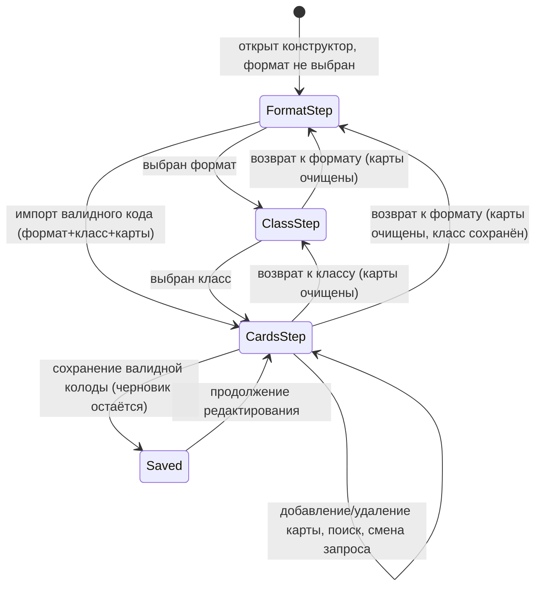
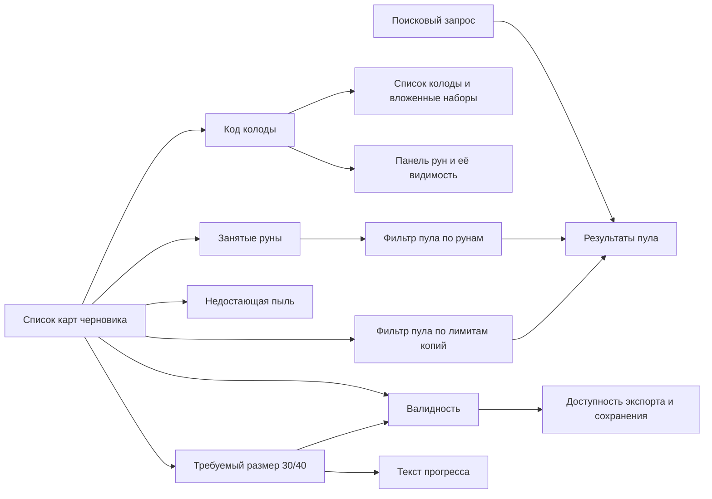

# F02 — Предыдущие исследовательские материалы (объединённый входной файл)

**Назначение:** этот документ сокращает количество вложений в Qwen до одного файла. Внутри приведены четыре исходных Markdown-документа без пропусков и без изменения их содержания.

**Важно:** два документа Iteration 1 — исходная база исследования. Документы Iteration 2 — черновые результаты предыдущего прохода. Ни один из них не является безусловно верным. Проверяй выводы по коду закреплённого snapshot и следуй корректирующему ТЗ из файла 04.

**Порядок частей:**
1. Function Spec Iteration 1 — HDMS/контроль/HDMS_F02_DeckBuilder_Function_Spec_Firestone.md
2. Evidence Register Iteration 1 — HDMS/контроль/HDMS_F02_DeckBuilder_Evidence_Register_Firestone.md
3. Function Spec Iteration 2 — HDMS/реверс/HDMS_F02_DeckBuilder_Function_Spec_Firestone_Iteration_2.md (черновик)
4. Evidence Register Iteration 2 — HDMS/реверс/HDMS_F02_DeckBuilder_Evidence_Register_Firestone_Iteration_2.md (черновик)

---

# Часть 1. Function Spec Iteration 1

**Источник:** HDMS/контроль/HDMS_F02_DeckBuilder_Function_Spec_Firestone.md
**Blob SHA:** cdde25ad8b13d2fcaba4bb4d08d239ce3e704e04

# Нейтральная функциональная спецификация HDMS — Функция № 2 «Визуальный конструктор колод»

> Документ исследовательского контура. Описывает наблюдаемое поведение назначенного донора и требования к независимой реализации HDMS. Не содержит исходного кода, внутренних имён, интерфейсных текстов и графики донора. Заполнен по шаблону `03_FUNCTION_SPEC_TEMPLATE.md`.

## 1. Паспорт

| Поле | Значение |
|---|---|
| Название задания | Пилот первичной деконструкции: визуальный конструктор колод (Constructed) |
| Номер функции / сквозная задача | Функция № 2 (только она; функции 1, 3–7 и физика игры не выполнялись) |
| Назначенный донор | Firestone (единственный донор этого пакета) |
| Canonical URL | https://github.com/Zero-to-Heroes/firestone |
| Ветка / tag | `master` (ветка по умолчанию; tag на snapshot не создавался) |
| Commit SHA | `0a30f066eb77a417637d95cec86444456f607ba1` |
| Дата коммита snapshot | 2026-02-08T20:08:36Z (author = committer) |
| Дата фиксации snapshot | 2026-11-17 (Asia/Shanghai) = 2026-11-16T21:15Z |
| Дата исследования | 2026-11-17 (Asia/Shanghai) |
| Версия приложения в snapshot | 16.12.8 (поле версии манифеста проекта) |
| Лицензия | Файл LICENSE/COPYING в дереве snapshot отсутствует; поле лицензии в манифесте не задано. Квалификация — не-OSS до подтверждения владельцем (совпадает с документом 02) |
| Версия спецификации | 1.0 |
| Статус | **Ready for review** (исследование выполнено на уровне исходников; автоматизированных тестов функции у донора не обнаружено — см. § 13, § 15) |
| Способ доступа | Read-only клон публичного репозитория в изолированную песочницу (`--depth 1 --filter=blob:none`, sparse-checkout рабочих каталогов), чтение файлов с нумерацией строк. Форки, PR, коммиты, изменения донора не выполнялись. Тесты донора не запускались (см. § 15) |

Все Evidence ID (`EV-xxx`) ссылаются на companion-документ `HDMS_F02_DeckBuilder_Evidence_Register_Firestone.md`, где для каждого утверждения указаны путь, строки и permalink на зафиксированный commit.

## 2. Назначение и границы

**Пользовательская задача.** Дать игроку возможность собрать колоду для Constructed-формата вне игрового клиента: выбрать формат и класс, набрать карты из легального пула, видеть состав и стоимость недостающих карт, получить переносимый код колоды и сохранить колоду в локальный список.

**Границы функции (что входит):**
- пошаговый мастер выбора формата и класса;
- формирование пула допустимых карт по формату, классу, лимитам копий и специальным ресурсным ограничениям;
- поиск и фильтрация пула, порядок выдачи результатов;
- добавление и удаление карт, счётчики копий и размера колоды;
- признак допустимости («валидности») колоды и прогресс набора;
- расчёт недостающих карт и стоимости их создания;
- экспорт кода колоды в буфер обмена;
- сохранение колоды в локальный список личных колод;
- импорт колоды из буфера обмена;
- возврат на предыдущие шаги мастера, состояния пустого результата и ошибки импорта.

**Что явно исключено (Out of scope этого пакета):**
- визуализация мана-кривой (функция № 3 — отдельное задание; в изученном конструкторе график кривой не отображается, EV-104);
- общие UI-паттерны companion-приложения, доступность и responsive как самостоятельная тема (функция № 7);
- сбор матчевой статистики, реплеи, мета-колоды, архетипы, рейтинги (соседние разделы того же раздела приложения);
- режимы Arena / Duels / Battlegrounds / Mercenaries / Tavern Brawl и их конструкторы;
- игровая физика, правила матча и эффекты карт;
- удаление/переименование/версионирование уже сохранённых колод (выполняется в соседнем разделе списка колод; в конструкторе таких операций нет — EV-105);
- серверная популяционная аналитика и любые закрытые сервисы.

**Соседние функции и зависимости:** список личных колод (приёмник сохранённых колод, EV-092), коллекция карт (источник данных о владении, EV-079), каталог карточных данных (EV-040), удалённый конфиг наборов форматов (EV-038, EV-039), настройки отображения карточек (EV-100), буфер обмена платформы (EV-086, EV-093).

## 3. Термины и сущности

| Термин | Нейтральное определение | Обязательные поля/свойства | Связи |
|---|---|---|---|
| Формат | Правило набора допустимых дополнений карт | идентификатор формата; список допустимых наборов | определяет пул карт и код колоды |
| Класс колоды | Выбранный класс героя | идентификатор класса; герой по умолчанию | определяет пул карт и героя в коде колоды |
| Черновик колоды | Текущее редактируемое состояние конструктора | формат; класс; упорядоченный список идентификаторов карт (по одной записи на копию); вложенные наборы (sideboards) | источник для кода колоды, счётчиков, валидности |
| Запись списка колоды | Строка «карта + количество» для отображения | идентификатор карты; количество; стоимость; редкость; признак нехватки в коллекции; вложенные карты | производная от кода колоды |
| Пул допустимых карт | Множество карт, которые можно добавить прямо сейчас | идентификатор; имя; изображение; класс(ы); стоимость; редкость; теги; наборы | результат фильтров формата/класса/лимитов/рун/поиска |
| Лимит копий | Максимум одинаковых карт в колоде | 1 для легендарных, 2 для остальных | ограничивает добавление и состав пула |
| Размер колоды | Требуемое число карт | минимум и максимум (равны между собой) | определяет валидность и прогресс |
| Модификатор размера | Карта, меняющая требуемый размер колоды | идентификаторы (исходная и переизданная версии) | меняет минимум и максимум одновременно |
| Код колоды | Переносимая строка (deckstring) | формат; герой; пары (числовой id карты, количество); вложенные наборы | экспорт, импорт, сохранение |
| Вложенный набор (sideboard) | Привязанный к карте набор дополнительных карт | ключевая карта; пары (id, количество) | отображается под картой; участвует в коде |
| Ресурсные руны | Ограничение класса «рыцарь смерти»: 3 слота, типы рун | тип руны; количество | фильтрует пул; отображается отдельной панелью |
| Карта-«турист» | Карта, открывающая в колоде другой класс | открываемый класс; набор карты | расширяет пул карт другого класса |
| Владение | Количество экземпляров карты в коллекции пользователя | обычная/золотая/алмазная/сигнатурная копии | признак нехватки и расчёт пыли |
| Пыль | Ресурс создания отсутствующих карт | стоимость создания по редкости | итоговая сумма «не хватает» |
| Личная колода | Сохранённая пользователем колода без сыгранных матчей | код; имя; класс; формат; отметка времени; признак личной | приёмник сохранения; появляется в списке колод |
| Шаг мастера | Текущая стадия интерфейса | «формат» / «класс» / «карты» | производная от заполненности черновика |

## 4. Входы и предусловия

| Вход/условие | Тип или формат | Обязательность | Проверка валидности | Поведение при ошибке |
|---|---|---|---|---|
| Выбор формата | одно из значений, предлагаемых в UI (2 значения) | обязателен для перехода к классу | значение из фиксированного списка UI | вне списка UI не выбирается; иные форматы попадают в состояние только через импорт (EV-015, EV-095) |
| Выбор класса | идентификатор класса | обязателен для перехода к картам | список классов зависит от формата | для «классических» форматов 2 класса исключены из списка (EV-016) |
| Поисковая строка | произвольный текст, включая структурный токен класса | необязательна | разбор токенов; нераспознанное — как текст | неизвестный токен не вызывает ошибки, трактуется как текст (EV-046) |
| Клик по карте пула | идентификатор карты | — | лимит копий | при достигнутом лимите — молчаливый отказ (EV-060) |
| Клик по строке колоды | идентификатор карты | — | ожидание: карта есть в черновике | в доноре при отсутствии карты удаляется последняя запись списка (дефект, EV-061) |
| Имя колоды | строка ввода | необязательно (есть значение по умолчанию) | валидация/ограничение длины не обнаружены | пустое имя сохраняется как есть (EV-089, Not found: EV-103) |
| Содержимое буфера обмена | многострочный текст | обязателен для импорта | поиск строки, декодируемой как код колоды | при отсутствии валидного кода состояние не меняется, сообщения в конструкторе нет (EV-094, EV-095) |
| Каталог карточных данных | внешний справочник карт | обязателен | ожидание готовности при инициализации | при недоступности — ошибка в журнале, пул не строится (EV-040, EV-005) |
| Конфиг наборов форматов | удалённый JSON со списками наборов | обязателен | наличие конфигурации и формата | до загрузки пул не вычисляется (фильтр предусловий), отдельного сообщения нет (EV-030, EV-038) |
| Коллекция пользователя | список карт с количествами | необязательна | нормализация формата записей | `null` → все карты считаются имеющимися; пустой список → все считаются отсутствующими (EV-080, EV-062) |
| Настройки отображения | масштаб карточек (%), показ связанных карт, окраска стоимости | необязательны | значения по умолчанию заданы | применяются к размеру плиток и подсказкам (EV-100) |

## 5. Основной сценарий

| Шаг | Условие/событие | Действие системы | Изменение состояния | Наблюдаемый результат |
|---|---|---|---|---|
| 1 | Пользователь открывает раздел конструктора в меню раздела колод | Переключение вида раздела; конструктор монтируется | вид раздела = конструктор; черновик пуст | видна панель шагов и заголовок шага «выбор формата»; фильтры списка колод скрыты (EV-010, EV-011, EV-018) |
| 2 | Формат ещё не выбран | Показ вариантов формата и кнопки импорта из буфера | шаг = «формат» | 2 варианта формата; кнопка импорта доступна (EV-015, EV-018) |
| 3 | Клик по варианту формата | Запись выбранного формата в черновик | формат заполнен | шаг переключается на «класс»; в панели шагов появляется значок формата (EV-020, EV-014, EV-018) |
| 4 | Класс ещё не выбран | Показ списка классов, отфильтрованного по формату | шаг = «класс» | 11 классов (или 9 для «классических» форматов), разложенных по 3 рядам (EV-016, EV-017) |
| 5 | Клик по классу | Запись класса в черновик | класс заполнен | шаг = «карты»; появляется рабочая область (EV-020, EV-014) |
| 6 | Вход на шаг «карты» | Ожидание готовности настроек, конфигурации форматов, состояния и коллекции; построение пула | пул вычислен | поле имени (значение по умолчанию), поле поиска с автофокусом, панель рун (если применимо), список колоды, сетка результатов (EV-030, EV-049, EV-103) |
| 7 | Пользователь вводит текст поиска | Разбор токенов, фильтрация пула, сортировка | список результатов обновляется (окно агрегации 50 мс) | сетка карт: сначала классовые, затем нейтральные; внутри — по стоимости и имени (EV-045, EV-046, EV-047, EV-048) |
| 8 | Клик по карте в результатах (или Enter) | Добавление одной копии, если лимит не достигнут | список карт черновика +1 | строка колоды появляется/увеличивает счётчик; карта исчезает из результатов при достижении лимита (EV-060, EV-034, EV-064) |
| 9 | Каждое изменение черновика | Пересборка кода колоды, пересчёт лимитов, валидности, прогресса, пыли, рун | производные значения обновлены | список колоды отсортирован по стоимости/имени; отметки нехватки; сумма пыли (EV-068, EV-065, EV-066, EV-075, EV-037) |
| 10 | Колода набрана до требуемого размера и валидна | Разблокировка экспорта и сохранения | валидность = true | вместо текста прогресса показываются кнопки копирования кода и сохранения (EV-085, EV-067) |
| 11 | Клик «скопировать код» | Запись кода в буфер обмена (платформенный или браузерный путь) | временная метка подтверждения | подтверждение на кнопке ~2 с, затем возврат исходной подписи (EV-086) |
| 12 | Клик «сохранить» (при валидной колоде) | Создание записи личной колоды и запись в локальное хранилище | список личных колод +1 | подтверждение на кнопке ~2 с; колода появляется в списке колод раздела (EV-088, EV-089, EV-090, EV-092) |

## 6. Альтернативные сценарии и исключения

| Сценарий | Условие запуска | Ожидаемое поведение | Результат/ошибка |
|---|---|---|---|
| A1. Импорт вместо ручного выбора | Шаг «формат», клик по кнопке импорта | Чтение буфера, поиск кода и имени, применение формата/класса/карт | сразу шаг «карты» с заполненной колодой; имя из буфера не применяется к полю имени (EV-093, EV-094, EV-095, EV-021) |
| A2. Импорт невалидного содержимого | В буфере нет декодируемой строки | Состояние не изменяется | остаётся шаг «формат»; пользовательского сообщения об ошибке в конструкторе нет (EV-095, EV-018) |
| A3. Возврат к выбору класса | Клик по значку класса в панели шагов | Класс сбрасывается, набранные карты очищаются, формат сохраняется | шаг «класс», колода пуста, без подтверждения и без отмены (EV-019) |
| A4. Возврат к выбору формата | Клик по значку формата | Формат сбрасывается, карты очищаются, класс сохраняется | шаг «формат»; кнопка импорта снова видна; повторный выбор формата ведёт сразу к картам с сохранённым классом (EV-019, EV-014, EV-018) |
| A5. Удаление карты | Клик по строке списка колоды | Удаляется одна копия той карты, по которой выполнен клик | счётчик уменьшается; при 0 строка исчезает; карта возвращается в пул (EV-061, EV-034) |
| A6. Клик по вложенной (sideboard) карте | Строка-«потомок» в списке колоды | Ожидание: удаление относится к этой карте | в доноре карта не найдена в черновике и удаляется последняя запись списка (дефект, EV-061, EV-063) |
| A7. Быстрый набор с клавиатуры | Фокус в поиске, Enter | Добавляется первый результат | при Shift+Enter поиск очищается; при единственном результате, достигшем лимита, поиск очищается автоматически (EV-051) |
| A8. Пустой результат поиска | Ни одна карта не подходит | Показ сообщения «нет результатов» с текстом запроса | сетка скрыта, показано пустое состояние (EV-049, EV-050) |
| A9. Пустой результат без запроса | Все карты исчерпаны/отфильтрованы, поиск пуст | Ожидание: объясняющее сообщение | в доноре область остаётся пустой без сообщения (EV-050) |
| A10. Колода не добрана | Число карт вне требуемого диапазона | Экспорт и сохранение недоступны | показывается текст прогресса «набрано/требуется» (EV-085, EV-067) |
| A11. Колода с модификатором размера | В колоде есть карта-модификатор (любая из 2 версий) | Требуемый размер повышается до 40 | прогресс и валидность считаются по 40 (EV-065) |
| A12. Класс с ресурсными рунами | Герой — «рыцарь смерти» либо в колоде есть «турист» в этот класс | Панель из 3 слотов рун, заполнение по максимуму требований карт | пул дополнительно фильтруется по совместимости рун (EV-037, EV-036) |
| A13. «Турист» в другой класс | В колоде есть карта, открывающая класс X | Пул расширяется картами класса X | расширение ограничено картами одного конкретного набора (EV-031) |
| A14. Коллекция не загружена | Данные коллекции отсутствуют (`null`) | Ожидание: явное состояние неопределённости | в доноре все карты списка считаются имеющимися, пыль = 0 (EV-080, EV-062, EV-075) |
| A15. Повторное сохранение того же кода | Колода с идентичным кодом уже сохранена | Ожидание: обновление существующей записи | в доноре существующая запись обновляется и дополнительно добавляется новая → дубли (EV-090) |
| A16. Переключение вкладки раздела и возврат | Пользователь уходит в другой раздел и возвращается | Черновик сохраняется в памяти состояния | шаг и колода восстанавливаются (EV-013, EV-021, EV-022) |
| A17. Импорт формата вне UI-списка | Код колоды содержит «классический»/twist-формат | Формат применяется из кода | пул строится по соответствующему списку наборов; при пустом списке наборов пул пуст (EV-095, EV-030, EV-039) |
| A18. Ошибка загрузки изображения карты | Изображение недоступно | Плитка списка скрывает изображение, оставляя текст/стоимость | список остаётся работоспособным (EV-064) |

## 7. Правила и ограничения

| ID | Однозначная формулировка | Статус знания | Основание / Evidence ID | Неоднозначность |
|---|---|---|---|---|
| R-01 | Шаг мастера вычисляется из черновика: нет формата → «формат»; нет класса → «класс»; иначе «карты». Отдельного «шага 4» нет | Confirmed | EV-014, EV-018 | — |
| R-02 | В UI предлагаются ровно 2 формата (стандартный и вольный). Прочие форматы поддерживаются логикой пула/кода, но выбираются только импортом | Confirmed | EV-015, EV-016, EV-030, EV-095 | Третий формат присутствует в коде как отключённая опция |
| R-03 | Список классов содержит 11 значений; для «классических» форматов исключаются 2 (рыцарь смерти, охотник на демонов) | Confirmed | EV-016, EV-017 | — |
| R-04 | Пул = коллекционные карты, принадлежащие наборам выбранного формата, класса колоды или нейтральные, исключая карты типа «зачарование» | Confirmed | EV-030, EV-032 | — |
| R-05 | Карты-«туристы», находящиеся в колоде, добавляют свой открываемый класс в пул, но только для карт одного конкретного набора | Confirmed | EV-031 | набор зашит в логику, а не в конфиг |
| R-06 | Карты с одинаковым именем сворачиваются в одну запись пула: единственная допустимая версия → версия с «двойником» → версия базового набора → первая в списке | Confirmed | EV-033 | порядок «первой» зависит от порядка справочника |
| R-07 | Лимит копий: 1 для легендарной карты, 2 для остальных | Confirmed | EV-035, EV-060 | — |
| R-08 | Карта, достигшая лимита копий в колоде, полностью исключается из результатов (не «сереет») | Confirmed | EV-034 | — |
| R-09 | Требуемый размер колоды: 30 (минимум = максимум); при наличии карты-модификатора размера (любая из 2 версий) — 40 | Confirmed | EV-065 | минимум и максимум всегда равны |
| R-10 | Колода валидна, если число карт в диапазоне [мин, макс] и каждая карта встречается не более 2 раз. Отдельной проверки «не более 1 легендарной» в критерии валидности нет | Confirmed | EV-066 | расхождение с R-07 при импорте (см. E-05) |
| R-11 | Добавление карты увеличивает число копий на 1, если лимит не достигнут; иначе действие игнорируется без сообщения | Confirmed | EV-060 | — |
| R-12 | Клик по строке списка колоды удаляет одну копию соответствующей карты | Confirmed | EV-061 | при отсутствии карты в черновике удаляется последняя запись (дефект, E-01) |
| R-13 | Операция «заменить карту» (одним действием) в конструкторе отсутствует; замена = удаление + добавление | Not found | EV-049, EV-060, EV-061 | продуктовое решение для HDMS |
| R-14 | Текстовый поиск — регистронезависимое вхождение подстроки в имя, текст карты, школу заклинаний, расы, редкость, теги механик; отдельный случай — совпадение названия расы со значением «все расы» | Confirmed | EV-047 | поиск по числовым параметрам (стоимость/атака/здоровье) не реализован |
| R-15 | Структурный токен `class:<значение>` фильтрует по точному совпадению имени класса (регистронезависимо) и применяется до текстового условия | Confirmed | EV-046, EV-047 | префиксный/частичный ввод класса не поддерживается |
| R-16 | Другие структурные токены не поддерживаются; нераспознанные фрагменты объединяются через пробел в текстовый запрос | Confirmed | EV-046 | во внешних строках интерфейса присутствует подсказка о токене, не реализованном в этом конструкторе (EV-052, противоречие C-01) |
| R-17 | Пересчёт результатов поиска агрегируется в окне 50 мс (последнее значение окна) | Confirmed | EV-045 | это не «debounce» в строгом смысле |
| R-18 | Сортировка результатов: ранг класса (нейтральные — в конце) → стоимость → имя. Ранг класса у донора грубый: код первой буквы имени класса, из-за чего разные классы получают одинаковый ранг | Confirmed | EV-048 | для HDMS требуется детерминированный полный порядок классов (E-08) |
| R-19 | Список колоды сортируется по стоимости, затем по имени; вложенные карты — по стоимости | Confirmed | EV-062, EV-063 | — |
| R-20 | Панель рун содержит 3 слота; заполнение = максимум требований по каждому типу среди карт колоды; карта допустима, если сумма недостающих рун ≤ число свободных слотов | Confirmed | EV-036, EV-037 | «недостающие» считаются по типам независимо |
| R-21 | Панель рун отображается только если герой колоды — рыцарь смерти либо в колоде есть «турист» в этот класс | Confirmed | EV-037 | — |
| R-22 | Прогресс «набрано/требуется» показывается только пока колода невалидна | Confirmed | EV-067, EV-085 | нет отдельного постоянного счётчика карт |
| R-23 | Кнопки копирования кода и сохранения видны только при валидной колоде; сохранение дополнительно требует непустого кода | Confirmed | EV-085 | — |
| R-24 | Код колоды собирается из пар (числовой id, количество), героя по умолчанию для класса, формата и вложенных наборов | Confirmed | EV-068, EV-069 | неизвестный класс → герой воина по умолчанию |
| R-25 | Экспорт копирует код в буфер обмена; предварительная «нормализация» кода в snapshot является тождественной (ничего не меняет); имя колоды к копируемому тексту не добавляется, так как не передаётся в компонент копирования | Confirmed | EV-085, EV-086, EV-087 | в других разделах имя добавляется — поведение не унифицировано |
| R-26 | Сохранение создаёт запись личной колоды: класс, формат, код, имя, отметка времени, признак «личная» | Confirmed | EV-089 | архетип, скин и статистика не заполняются на этом шаге |
| R-27 | Список личных колод хранится локально (отдельный ключ хранилища) и перезаписывается при каждом изменении | Confirmed | EV-090, EV-091 | — |
| R-28 | Повторное сохранение колоды с уже существующим кодом обновляет существующую запись и одновременно добавляет новую (дублирование) | Confirmed (по коду; рантайм не проверен) | EV-090 | см. E-04 |
| R-29 | Импорт доступен только на шаге «формат» и читает только буфер обмена (файловый импорт отсутствует) | Confirmed | EV-018, EV-093 | — |
| R-30 | Разбор буфера: строки просматриваются с конца; имя — первая с конца строка с префиксом `### `; код — первая с конца строка, успешно декодируемая; поиск прекращается, когда найдены оба | Confirmed | EV-094 | имя без префикса не распознаётся |
| R-31 | Импорт устанавливает формат из кода, класс — по герою, карты — разворачиванием количеств в список копий, вложенные наборы сохраняются; имя из буфера в состояние не попадает | Confirmed | EV-095, EV-021 | см. E-03 |
| R-32 | При ошибке декодирования импорта состояние не меняется; в конструкторе отсутствует пользовательское сообщение об ошибке (диалог ошибки существует только в другом компоненте импорта) | Confirmed | EV-095, EV-096, EV-018 | см. E-02 |
| R-33 | Возврат на любой предыдущий шаг безусловно очищает набранные карты; подтверждения и отмены нет | Confirmed | EV-019 | см. E-06 |
| R-34 | Смена формата не сбрасывает выбранный класс | Confirmed | EV-019, EV-020 | возможен класс, недопустимый для нового формата (E-07) |
| R-35 | Недостающая пыль = Σ по картам max(0, требуемое количество − владение по точному id) × стоимость создания по редкости (40/100/400/1600) | Confirmed | EV-075, EV-076, EV-077 | владение учитывает все виды копий без ограничения лимитом |
| R-36 | Признак «не хватает» в строке списка колоды вычисляется иначе: владение агрегируется по всем версиям-«двойникам» карты | Confirmed | EV-062, EV-078 | расхождение с R-35 (противоречие C-02) |
| R-37 | Если данные коллекции отсутствуют (`null`), все строки списка считаются обеспеченными; если пришёл пустой список — все считаются отсутствующими | Confirmed | EV-080, EV-062, EV-079 | нет состояния «коллекция неизвестна» |
| R-38 | Размер плиток карт = базовый размер × (масштаб из настроек / 100); показ связанных карт в подсказках управляется настройкой | Confirmed | EV-100, EV-101 | — |
| R-39 | Черновик живёт в состоянии приложения: сохраняется при переключении вкладок раздела; персистентного хранения черновика не обнаружено | Confirmed (в памяти) / Inferred (сброс при перезапуске) | EV-013, EV-021, EV-022, EV-091 | восстановление после перезапуска не проверено рантаймом |
| R-40 | Пустой результат: при непустом поиске показывается сообщение «нет результатов»; при пустом поиске область результатов остаётся пустой без сообщения | Confirmed | EV-049, EV-050 | см. E-09 |
| R-41 | Enter в поле поиска добавляет первый результат; Shift+Enter очищает запрос; запрос очищается автоматически, если единственный результат достиг лимита копий | Confirmed | EV-051 | подтверждается структурой внешних строк подсказки (EV-052) |
| R-42 | Индикатор загрузки существует на уровне раздела; отдельного состояния загрузки пула/конфига в конструкторе нет | Confirmed / Not found (для конструктора) | EV-011, EV-030, EV-040 | до загрузки пула область просто пуста |
| R-43 | Аналитические события отправляются при открытии конструктора, при переключении вкладки и при копировании кода | Confirmed | EV-014, EV-010, EV-086 | состав параметров не исследовался полностью |
| R-44 | Вложенные наборы (привязанные к карте дополнительные карты) только принимаются из импорта и передаются в код колоды; создание и редактирование вложенных наборов в конструкторе отсутствует | Confirmed (поток данных) / Not found (редактирование) | EV-118, EV-021, EV-068 | пробел функциональности для модульных карт |
| R-45 | Отображаемая стоимость карты берётся из справочника; для одной конкретной модульной карты она равна сумме стоимостей её вложенных карт | Confirmed | EV-119, EV-062 | частный случай зашит в код, обобщённого правила нет |

## 8. Состояния и переходы

**Состояния мастера (по черновику):**

**Состояния рабочей области (ортогональные подсистемы):**

| Подсистема | Состояния | Переходы | Невозможные/непокрытые состояния |
|---|---|---|---|
| Пул карт | «предусловия не готовы» → «готов» → «пуст после фильтров» | готовность каталога/конфига/формата/класса; изменение колоды, рун, поиска | явное «загрузка» и «ошибка загрузки» отсутствуют (R-42) |
| Черновик | пуст → частичный → полный валидный → невалидный (например, после импорта) | добавление/удаление/импорт/возврат | «переполненный» вручную недостижим (лимиты блокируют добавление), но достижим импортом |
| Сохранение | покой → подтверждение (~2 с) → покой | клик при валидной колоде | «ошибка сохранения» не обнаружена |
| Экспорт | покой → подтверждение (~2 с) → покой | клик при валидной колоде | «ошибка буфера» в браузерном пути молчалива (EV-086) |
| Импорт | покой → применён / молчаливый отказ | клик на шаге формата | «ошибка импорта» как состояние UI отсутствует (R-32) |
| Коллекция | неизвестна (`null`) → загружена (в т.ч. пустая) | обновление источника коллекции | «ошибка коллекции» не отображается в конструкторе |

**Восстановление после ошибки:** предусмотрен только повтор действия пользователем; автоматических повторов на уровне конструктора нет (повторы есть в инфраструктуре готовности каталога карт, EV-040).

## 9. Взаимодействия и контракты

**Входящие события (от пользователя/платформы):** выбор формата; выбор класса; возврат к шагу; импорт из буфера; сохранение колоды; ввод поиска; клик по карте пула; клик по строке колоды; изменение имени; изменение настроек отображения; обновление коллекции.

**Исходящие эффекты:** запись кода в буфер обмена; запись списка личных колод в локальное хранилище; аналитические события; переключение вида раздела.

**Зависимые данные:** каталог карт (идентификаторы, числовые id, классы, стоимость, редкость, теги, наборы, «двойники», «туристы», дополнительные стоимости рун); удалённый конфиг наборов форматов; коллекция пользователя; настройки; строки интерфейса из удалённого источника локализации.

**Синхронизация (единый источник истины — список карт черновика):**

**Контракты вовне:** сохранённая личная колода должна быть пригодна для отображения в списке колод (код декодируется, класс/формат заполнены) — EV-092; экспортированный код должен декодироваться сторонними инструментами (формат кода — внешний стандарт, реализация кодирования/декодирования в репозитории донора отсутствует, см. § 15).

**Границы:** конструктор не изменяет игровое состояние, не пишет в статистику матчей и не управляет оверлеем.

## 10. Граничные случаи и ошибки

| ID | Начальное состояние | Действие/событие | Ожидаемый результат (требование HDMS) | Почему сценарий важен |
|---|---|---|---|---|
| E-01 | Колода из N карт; в списке есть вложенная карта, отсутствующая в черновике | Клик по вложенной карте | Ничего не удаляется; удаление применяется только к карте, присутствующей в колоде | В доноре удаляется последняя карта колоды (потеря данных). Confirmed: EV-061, EV-063 + проверка семантики языка (EV-107) |
| E-02 | Шаг «формат», в буфере произвольный текст | Клик «импорт» | Явное сообщение «код не распознан», состояние не меняется | В доноре отказ молчаливый (EV-095, EV-096) |
| E-03 | Буфер содержит имя и валидный код | Импорт | Имя из буфера предлагается в поле имени | В доноре имя теряется (EV-095, EV-021) |
| E-04 | Личная колода с кодом X уже сохранена | Повторное сохранение кода X | Одна запись на код (идемпотентность) | В доноре появляются дубли (EV-090) |
| E-05 | Импортирована колода с 2 копиями легендарной карты | Проверка валидности | Колода помечается невалидной | В доноре критерий валидности проверяет только «≤2» (EV-066) |
| E-06 | набрано 25 карт | Возврат к классу/формату | Подтверждение или возможность отмены | В доноре карты удаляются без подтверждения (EV-019) |
| E-07 | Формат «вольный», класс — рыцарь смерти | Возврат к формату и выбор «классического» формата | Класс сбрасывается или помечается недопустимым | В доноре класс сохраняется, пул строится по недопустимой паре (EV-019, EV-016) |
| E-08 | Пул содержит карты 3+ классов с одинаковой первой буквой | Сортировка результатов | Детерминированный порядок классов | В доноре ранг класса грубый, порядок внутри группы определяется стоимостью/именем (EV-048) |
| E-09 | Все карты пула исчерпаны, поиск пуст | Отрисовка результатов | Объсняющее пустое состояние («все доступные карты добавлены») | В доноре пустая область без текста (EV-050) |
| E-10 | Коллекция не загружена | Расчёт нехватки/пыли | Явное состояние «данные коллекции недоступны», без ложного «всё есть» | В доноре `null` трактуется как «всё есть» (EV-080) |
| E-11 | Коллекция загружена, но пуста | Расчёт нехватки/пыли | Все карты помечены отсутствующими, пыль = полная стоимость создания | Подтверждено (EV-079, EV-075) |
| E-12 | Конфиг формата содержит пустой список наборов (наблюдается для twist) | Импорт колоды этого формата | Понятное сообщение «формат не поддерживается» | В доноре пул просто пуст (EV-039, EV-030) |
| E-13 | Каталог карт недоступен (сеть/блокировка) | Открытие конструктора | Явная ошибка загрузки с инструкцией | Пул не строится; ошибка только в журнале; отдельная инструкция есть в документации донора (EV-040, EV-005) |
| E-14 | В колоде 30 карт, добавляется карта-модификатор размера | Пересчёт | Требуемый размер 40, колода снова невалидна, экспорт блокируется | Подтверждено (EV-065, EV-066, EV-085) |
| E-15 | Колода с 3 рунами одного типа | Поиск карты с требованием другого типа | Карта исключается из пула | Подтверждено (EV-036) |
| E-16 | В колоде карта с 2 рунами разных типов, свободен 1 слот | Поиск карты с требованием 2 рун третьего типа | Карта исключается (не хватает 2 > 1 свободного) | Подтверждено (EV-036) |
| E-17 | Достигнут лимит копий единственного результата поиска | Enter | Копия не добавляется, запрос очищается | Подтверждено (EV-051, EV-035) |
| E-18 | Пустое имя колоды | Сохранение | Валидация имени или подстановка значения по умолчанию | В доноре валидации не обнаружено (EV-089, EV-103) |
| E-19 | Изображение карты недоступно | Отрисовка списка/сетки | Сохранение читаемой строки (имя, стоимость, количество) | В списке колоды подтверждено; в сетке результатов изображение просто не отображается (EV-064, EV-049) |
| E-20 | Пользователь уходит из раздела и возвращается | Восстановление | Черновик восстановлен (в рамках сессии) | Подтверждено для переключения вкладок; после перезапуска — Unknown (EV-013, EV-022) |
| E-21 | Один и тот же card-name в нескольких наборах формата | Формирование пула | Одна запись на имя, версия выбирается детерминированно | Подтверждено, но последний fallback зависит от порядка справочника (EV-033) |
| E-22 | Колода содержит карту-«туриста» | Формирование пула | Карты открытого класса доступны только из разрешённого набора | Подтверждено; жёсткая привязка к набору — риск устаревания (EV-031) |
| E-23 | Импортирована колода со вложенным набором (модульная карта) | Осмотр списка колоды, клик по вложенной карте, экспорт | Вложенные карты отображаются под родительской, клик по ним не изменяет колоду, экспорт сохраняет вложенный набор; редактирование вложенных наборов либо реализовано, либо явно недоступно | В доноре вложенные наборы нельзя создать/изменить в конструкторе, а клик по вложенной карте удаляет последнюю карту колоды (EV-118, EV-061, EV-063) |

## 11. Тест-кейсы

> Все тест-кейсы ниже сформулированы нейтрально и выведены из прочитанных исходников. **Автоматизированных тестов конструктора у донора не обнаружено** (EV-003), поэтому ни один кейс не имеет статуса «Confirmed by test». Колонка Pass/fail заполняется при проверке реализации HDMS; сейчас — `Not executed`.

| Test ID | Входные данные | Начальные условия | Последовательность действий | Ожидаемый результат | Pass/fail |
|---|---|---|---|---|---|
| TC-01 | — | Конструктор открыт, черновик пуст | Открыть раздел | Шаг «формат»; предлагаются 2 формата; кнопка импорта видна (R-01, R-02, R-29) | Not executed |
| TC-02 | формат = стандартный | Шаг «формат» | Выбрать формат | Шаг «класс»; в панели шагов значок формата (R-01) | Not executed |
| TC-03 | формат = стандартный | Шаг «класс» | Подсчитать варианты классов | 11 классов (R-03) | Not executed |
| TC-04 | формат «классический» (через импорт) | Шаг «класс» | Подсчитать варианты классов | 9 классов, 2 исключены (R-03) | Not executed |
| TC-05 | класс = маг, формат = стандартный | Шаг «карты», каталог и конфиг загружены | Проверить пул | Только коллекционные карты наборов формата, класса «маг» + нейтральные, без зачарований (R-04) | Not executed |
| TC-06 | имя карты встречается в 2 наборах формата | Шаг «карты» | Найти карту по имени | Одна запись пула, версия выбрана по цепочке приоритетов (R-06) | Not executed |
| TC-07 | нейтральная не-легендарная карта | Пустая колода | Кликнуть карту 3 раза | В колоде 2 копии; третий клик не меняет состояние; после 2-й копии карта исчезает из результатов (R-07, R-08, R-11) | Not executed |
| TC-08 | легендарная карта | Пустая колода | Кликнуть карту 2 раза | В колоде 1 копия; карта исчезает из результатов (R-07, R-08) | Not executed |
| TC-09 | колода: 2 копии карты A | Шаг «карты» | Кликнуть строку A в списке колоды | 1 копия A; карта A снова в пуле (R-12) | Not executed |
| TC-10 | колода из 5 карт; в списке есть вложенная карта B, отсутствующая в колоде | Шаг «карты» | Кликнуть строку B | Колода не изменилась (E-01; в доноре — удаляется последняя карта) | Not executed |
| TC-11 | 29 карт | Шаг «карты» | Проверить элементы управления | Экспорт/сохранение скрыты; виден прогресс «29/30» (R-22, R-23) | Not executed |
| TC-12 | 30 карт, лимиты соблюдены | Шаг «карты» | Проверить элементы управления | Валидность = true; видны копирование и сохранение; прогресс скрыт (R-10, R-23) | Not executed |
| TC-13 | 30 карт + карта-модификатор размера (31 карта) | Шаг «карты» | Проверить требуемый размер | Требуется 40; колода невалидна; экспорт скрыт (R-09, E-14) | Not executed |
| TC-14 | импорт колоды с 2 копиями легендарной карты, всего 30 | Шаг «формат» | Импортировать | HDMS: колода невалидна (E-05; в доноре — валидна) | Not executed |
| TC-15 | запрос = подстрока имени | Шаг «карты» | Ввести запрос | Все результаты содержат подстроку в одном из поддерживаемых полей (R-14) | Not executed |
| TC-16 | запрос = подстрока текста карты («провокация») | Шаг «карты» | Ввести запрос | В результатах карты с этим текстом/тегом (R-14) | Not executed |
| TC-17 | запрос = `class:mage` | Класс колоды = рыцарь смерти (пул содержит нейтральные) | Ввести запрос | Только карты класса «маг», если они есть в пуле; текстовое условие пусто (R-15) | Not executed |
| TC-18 | запрос = `mana:3` | Шаг «карты» | Ввести запрос | Токен не распознан → трактуется как текст; результаты соответствуют буквальному поиску (R-16) | Not executed |
| TC-19 | запрос = несуществующая строка | Шаг «карты» | Ввести запрос | Сетка скрыта, показано «нет результатов» с текстом запроса (R-40) | Not executed |
| TC-20 | все карты пула добавлены до лимитов, запрос пуст | Шаг «карты» | Осмотреть область результатов | HDMS: объясняющее пустое состояние (E-09; в доноре — пусто без текста) | Not executed |
| TC-21 | ≥2 результата поиска | Фокус в поиске | Enter | Добавлена 1 копия первого результата; запрос сохранён (R-41) | Not executed |
| TC-22 | ≥1 результат поиска | Фокус в поиске | Shift+Enter | Добавлена 1 копия первого результата; запрос очищен (R-41) | Not executed |
| TC-23 | единственный результат — карта с 1 оставшейся копией | Фокус в поиске | Enter | Копия добавлена, запрос очищен автоматически (R-41) | Not executed |
| TC-24 | колода класса «рыцарь смерти» с картой, требующей 3 рун крови | Шаг «карты» | Осмотреть панель рун и пул | 3 слота заполнены кровью; карты с требованием других рун отсутствуют в пуле (R-20, R-21, E-15) | Not executed |
| TC-25 | колода с картой на 2 руны крови; свободен 1 слот | Шаг «карты» | Найти карту, требующую 2 руны мороза | Карта отсутствует в пуле (E-16) | Not executed |
| TC-26 | колода не-рыцаря смерти без «туриста» | Шаг «карты» | Осмотреть панель рун | Панель скрыта (R-21) | Not executed |
| TC-27 | коллекция: 0 копий легендарной карты (1600) и 1 копия редкой из 2 (100) | Колода содержит эти карты | Проверить сумму пыли | 1700 (R-35) | Not executed |
| TC-28 | коллекция = `null` | Колода из 30 карт | Проверить отметки нехватки и пыль | HDMS: явное состояние неопределённости (E-10; в доноре — всё «есть», пыль 0) | Not executed |
| TC-29 | коллекция = пустой список | Колода из 30 карт | Проверить отметки нехватки | Все строки помечены отсутствующими; пыль = сумма стоимостей создания (E-11) | Not executed |
| TC-30 | валидная колода, имя по умолчанию | Шаг «карты» | Клик «сохранить», подождать 3 с | Запись личной колоды создана (класс, формат, код, имя, время); подпись кнопки вернулась к исходной (R-26, R-27) | Not executed |
| TC-31 | та же колода уже сохранена | Шаг «карты» | Клик «сохранить» повторно | HDMS: одна запись на код (E-04; в доноре — дубли) | Not executed |
| TC-32 | валидная колода | Шаг «карты» | Клик «скопировать код», прочитать буфер | Буфер содержит декодируемый код той же колоды; подтверждение ~2 с (R-25) | Not executed |
| TC-33 | буфер: строка имени с префиксом `### ` + валидный код | Шаг «формат» | Клик «импорт» | Формат/класс/карты применены; шаг «карты»; HDMS: имя предложено в поле имени (R-30, R-31, E-03) | Not executed |
| TC-34 | буфер: произвольный текст без кода | Шаг «формат» | Клик «импорт» | Состояние не изменилось; HDMS: сообщение об ошибке (R-32, E-02) | Not executed |
| TC-35 | буфер: несколько строк, из которых 2 декодируются | Шаг «формат» | Клик «импорт» | Выбрана первая с конца декодируемая строка (R-30) | Not executed |
| TC-36 | набрано 20 карт | Шаг «карты» | Возврат к классу | Карты очищены; HDMS: подтверждение/отмена (R-33, E-06) | Not executed |
| TC-37 | формат «вольный», класс «рыцарь смерти», 10 карт | Шаг «карты» | Возврат к формату, выбрать «классический» формат | Карты очищены; HDMS: класс сброшен/помечен (R-34, E-07) | Not executed |
| TC-38 | черновик: формат+класс+15 карт | Шаг «карты» | Перейти в другую вкладку раздела и вернуться | Черновик и шаг восстановлены (R-39) | Not executed |
| TC-39 | масштаб карточек = 150 % | Шаг «карты» | Изменить настройку | Плитки увеличены в 1.5 раза относительно базового размера (R-38) | Not executed |
| TC-40 | конфиг формата с пустым списком наборов | Импорт колоды этого формата | Импортировать | HDMS: понятное сообщение о неподдерживаемом формате (E-12; в доноре — пустой пул) | Not executed |
| TC-41 | буфер с валидным кодом колоды, содержащей вложенный набор | Шаг «формат» | Импортировать, осмотреть список, экспортировать код | Вложенные карты отображены под родительской; клик по вложенной карте не меняет колоду; экспортированный код содержит тот же вложенный набор (R-44, E-23) | Not executed |
| TC-42 | колода с модульной картой и вложенными картами | Шаг «карты» | Проверить отображаемую стоимость родительской карты | Стоимость равна сумме стоимостей вложенных карт по правилу HDMS для модульных карт (R-45; в доноре правило действует только для одной конкретной карты) | Not executed |

## 12. Критерии приёмки

Реализация HDMS считается соответствующей спецификации, если наблюдаемо выполняются все пункты:

1. **AC-01.** Мастер проходит последовательность «формат → класс → карты», шаг определяется заполненностью черновика (TC-01…TC-04).
2. **AC-02.** Пул содержит только карты, легальные для пары (формат, класс) с учётом нейтральных карт и исключений (TC-05, TC-06).
3. **AC-03.** Лимиты копий соблюдаются при любом способе добавления, карты на лимите не предлагаются (TC-07, TC-08, TC-17, TC-23).
4. **AC-04.** Удаление уменьшает количество ровно той карты, по которой выполнен клик; никакие другие карты не изменяются (TC-09, TC-10).
5. **AC-05.** Требуемый размер колоды и валидность пересчитываются на каждое изменение, включая карты-модификаторы размера (TC-11…TC-14).
6. **AC-06.** Экспорт и сохранение доступны только для валидной колоды; экспортированный код декодируется и описывает ту же колоду (TC-12, TC-32).
7. **AC-07.** Сохранение идемпотентно по коду колоды и создаёт запись с именем, классом, форматом и отметкой времени (TC-30, TC-31).
8. **AC-08.** Поиск поддерживает текстовые поля и структурный фильтр класса; неизвестные токены не приводят к ошибке (TC-15…TC-18).
9. **AC-09.** Все состояния пустого результата объясняются пользователю, включая случай «все доступные карты добавлены» (TC-19, TC-20).
10. **AC-10.** Ошибки импорта и недоступность данных (каталог, конфиг, коллекция) отображаются явно и не приводят к ложным данным о владении (TC-28, TC-34, TC-40).
11. **AC-11.** Ресурсные ограничения класса (руны) и расширение пула через «туриста» работают по правилам R-20…R-22 (TC-24…TC-26).
12. **AC-12.** Расчёт недостающих карт и пыли согласован с отметками нехватки в списке колоды (TC-27…TC-29; устраняет противоречие C-02).
13. **AC-13.** Деструктивные действия (возврат назад, смена формата) либо подтверждаются, либо обратимы (TC-36, TC-37).
14. **AC-14.** Черновик восстанавливается при навигации внутри приложения; поведение при перезапуске соответствует решению владельца (TC-38, вопрос Q-06).
15. **AC-15.** Клавиатурные сценарии набора работают без мыши (TC-21…TC-23).
16. **AC-16.** Колоды со вложенными наборами корректно принимаются, отображаются и экспортируются; поведение при клике по вложенной карте безопасно, а возможность их редактирования соответствует решению владельца (TC-41, TC-42, вопрос Q-15).

## 13. Покрытие и пробелы

| Область / сценарий / механика | Статус | Доказательства | Что не покрыто |
|---|---|---|---|
| Мастер шагов, навигация, возврат | Supported partially (подтверждено кодом) | EV-010…EV-023 | нет тестов донора; рантайм не наблюдался |
| Форматы и наборы | Supported partially | EV-015, EV-030, EV-038, EV-039 | «классические»/twist не выбираются в UI; список наборов — внешние изменяемые данные |
| Классы и герой по умолчанию | Confirmed (source) | EV-016, EV-017, EV-069 | скины/альтернативные герои не поддерживаются конструктором |
| Пул карт, дедупликация, «туристы» | Confirmed (source) | EV-030…EV-034 | нет тестов; жёсткая привязка «туриста» к набору |
| Лимиты копий и валидность | Supported partially | EV-035, EV-060, EV-065, EV-066 | валидность не проверяет легендарный лимит; нет проверки классовых ограничений при импорте |
| Добавление/удаление/замена | Supported partially | EV-060, EV-061 | замены одним действием нет; дефект удаления (E-01) |
| Поиск и фильтры | Supported partially | EV-045…EV-048, EV-052 | нет фильтров по стоимости/атаке/здоровью/типу/редкости как отдельных элементов UI; нет фильтра «только моя коллекция» |
| Сортировка | Supported partially | EV-048, EV-062 | нет пользовательского выбора сортировки; грубый ранг класса |
| Счётчики и прогресс | Confirmed (source) | EV-064, EV-067 | прогресс виден только при невалидной колоде |
| Руны и ресурсные ограничения | Confirmed (source) | EV-036, EV-037 | нет тестов; поведение при >3 занятых слотах после импорта не проверено |
| Коллекция, нехватка, пыль | Supported partially | EV-075…EV-080 | два разных алгоритма владения (C-02); нет состояния «неизвестно» |
| Экспорт кода | Supported partially | EV-085, EV-086, EV-087 | нормализация — no-op; имя не включается; ошибки буфера частично молчаливы |
| Сохранение и хранение | Supported partially | EV-088…EV-092 | дубли при повторном сохранении; нет валидации имени |
| Импорт | Supported partially | EV-093…EV-096 | нет файлового импорта; нет UI-ошибки; имя теряется |
| Состояния загрузки/ошибки/пустоты | Supported partially | EV-011, EV-040, EV-049, EV-050 | нет отдельных состояний загрузки/ошибки конструктора |
| Восстановление состояния | Supported partially / Unknown | EV-013, EV-021, EV-022 | персист черновика не найден; поведение после перезапуска не проверено |
| Доступность и клавиатура | Supported partially | EV-051, EV-102, EV-103 | навигация по сетке карт с клавиатуры не обнаружена; полноценный аудит — функция № 7 |
| Вложенные наборы (модульные карты): приём из импорта и экспорт | Confirmed (source) | EV-118, EV-063, EV-068 | создание/редактирование вложенных наборов в конструкторе отсутствует |
| Вложенные наборы: создание и редактирование | **Not found** | EV-118 | нет обработчиков и элементов UI; правило отображаемой стоимости модульной карты зашито для одной карты (EV-119) |
| Автоматизированные тесты функции | **Not found** | EV-003 | в snapshot 30 тестовых файлов на весь репозиторий, ни один не относится к конструктору колод |
| Визуальная композиция, стили, анимации | Out of scope (частично просмотрено) | EV-104 | фирменный стиль не переносится; проверены только наличие состояний в стилях |
| Мана-кривая | Out of scope (функция № 3) | EV-104 | в конструкторе snapshot график не отображается |
| Другие режимы (Arena/Duels/BG) | Out of scope | EV-052 | во внешних строках локализации есть ключи иного конструктора; код в snapshot не найден |

## 14. Решения владельца

| Вопрос | Варианты | Последствия | Рекомендация аналитика | Решение владельца |
|---|---|---|---|---|
| Q-01. Какие форматы поддерживает HDMS на старте? | только 2 «живых» формата; + «классические»; + сезонные | влияет на конфиг наборов, список классов, импорт | начать с 2 форматов, но хранить правила наборов как данные, а не код | — |
| Q-02. Насколько строгой должна быть валидация колоды? | как у донора (размер + ≤2); полная (лимит легендарных, классовая легальность, руны, запреты формата) | строгая валидация блокирует экспорт «неправильных» импортированных колод | полная валидация с отдельным «предупреждением» вместо жёсткого блока для импорта | — |
| Q-03. Поведение при клике по вложенной/связанной карте в списке | игнорировать; удалять родительскую карту; отдельное меню | риск потери данных vs. предсказуемость | игнорировать удаление для карт, отсутствующих в колоде (устраняет E-01) | — |
| Q-04. Идемпотентность сохранения | одна запись на код; версионирование; разрешить дубли | влияет на список колод и статистику | одна запись на код + явное «сохранить как копию» | — |
| Q-05. Хранение черновика | только в памяти; локальный автосейв; несколько черновиков | потеря работы при перезапуске vs. сложность | локальный автосейв одного черновика | — |
| Q-06. Восстановление после перезапуска | сбрасывать; восстанавливать; спрашивать | UX и приватность локальных данных | восстанавливать с явной кнопкой «начать заново» | — |
| Q-07. Деструктивный возврат назад | как у донора (мгновенная очистка); подтверждение; отмена действия | скорость vs. безопасность | подтверждение при ≥1 карте либо undo | — |
| Q-08. Владение и пыль: единый алгоритм | точный id; агрегация по версиям карты | расчёты расходятся с отметками в списке (C-02) | агрегация по всем версиям карты для обоих расчётов | — |
| Q-09. Фильтры и сортировка пула | как у донора (поиск + фиксированная сортировка); расширенные фильтры и выбор сортировки | объём работ и сложность UI | минимум: фильтр «только имеющиеся», числовые фильтры, выбор сортировки | — |
| Q-10. Сортировка классов | грубый ранг как у донора; фиксированный канонический порядок; алфавитный | детерминированность выдачи | канонический детерминированный порядок, нейтральные в конце | — |
| Q-11. Включение имени колоды в экспортируемый текст | не включать (как у донора); включать строкой имени | совместимость с внешними инструментами и с импортом | включать имя отдельной строкой, поддержанной собственным импортом | — |
| Q-12. Ошибки импорта и загрузки данных | молчаливо (как у донора); явные состояния с действием «повторить» | доверие пользователя, поддержка | явные состояния ошибки/загрузки для пула, коллекции и импорта | — |
| Q-13. Замена карты и undo | не делать; «заменить на…» с сохранением позиции; общий undo/redo | сложность vs. скорость редактирования | общий undo/redo как базовая возможность | — |
| Q-14. Источник правил форматов | внешние данные донора; собственный справочник; ручной конфиг | юридические и актуальностные риски (лицензия донора не подтверждена) | собственный справочник правил, не копировать данные донора | — |
| Q-15. Вложенные наборы (модульные карты) | не поддерживать в конструкторе; только приём/экспорт как у донора; полноценное редактирование | объём работ и полнота поддержки современных карт | как минимум приём/экспорт + обобщённое правило стоимости; редактирование — отдельным решением | — |

## 15. Ограничения исследования и итог

**Что подтверждено источником (Confirmed):** структура мастера и переходы; правила формирования пула (формат/класс/коллекционность/тип/дубли/«туристы»); лимиты копий; размеры 30/40; критерий валидности; алгоритмы поиска, сортировки, рун; расчёт пыли и признаков нехватки; построение кода колоды; условия видимости экспорта/сохранения; сохранение в локальный список; разбор буфера и применение импорта; очистка карт при возврате; состояния пустого результата; клавиатурные сценарии; масштабирование плиток. Всё это прочитано в исходных файлах зафиксированного commit (пути и строки — в evidence register).

**Что является выводом (Inferred):** сброс черновика при перезапуске приложения (персистентного хранения черновика не найдено, а состояние инициализируется заново); практическая недостижимость «переполненной» колоды вручную; эквивалентность экспортированного кода построенному (нормализация тождественна).

**Что осталось гипотезой (Hypothesis):** фактическое появление дублей личных колод в интерфейсе списка (логика слияния+добавления прочитана, но рантайм не наблюдался); реальное поведение при импорте колоды с занятостью рун >3 слотов; влияние порядка справочника карт на выбор версии при дедупликации в спорных случаях.

**Пробел функциональности донора (Not found):** создание и редактирование вложенных наборов (модульных карт) в конструкторе отсутствует — они только принимаются из импорта и передаются в код; правило отображаемой стоимости модульной карты зашито для одной конкретной карты (EV-118, EV-119).

**Что неизвестно (Unknown):** точное поведение внешних библиотек кодирования/декодирования кода колоды и справочника карт (это отдельные npm-пакеты вне репозитория донора, они не исследовались); содержимое удалённых данных на момент будущего релиза (списки наборов и строки интерфейса версионируются отдельно от кода); фактический рантайм-вид состояний, анимации, производительность на больших пулах; поведение в Electron-/мобильных сборках; полные тексты интерфейса (сознательно не копировались).

**Какие части исходников, документации и тестов реально просмотрены:** 51 файл зафиксированного snapshot (46 TypeScript-модулей и конфигураций, 2 документа Markdown, 2 JSON-конфигурации, 1 файл стилей выборочно): исходный код конструктора, его шагов, обработчиков состояния, зависимых компонентов списка колоды/карточек/рун/пустого состояния/копирования, сервисов конфигурации форматов, коллекции, личных колод, справочника карт, настроек и инфраструктуры потоков; корневой README; документ об ошибке загрузки карточной базы; конфигурации тестов (корневая и двух библиотек) и цель тестирования одной библиотеки; полная инвентаризация тестовых файлов дерева snapshot; манифест проекта (версия, зависимости, скрипты). Полный перечень с путями, строками и permalink — в evidence register, § 2.

**Какие части не удалось проверить и почему:**
1. **Тесты конструктора отсутствуют** — в дереве snapshot 30 тестовых файлов, ни один не покрывает конструктор колод; цель тестирования библиотеки настроена с «проходить при отсутствии тестов». Запуск тестов донора не выполнялся (не требовалось и не давало бы покрытия функции). Статус покрытия функции тестами — **Not found**.
2. **Рантайм не наблюдался** — приложение не собиралось и не запускалось (Overwolf/Electron-окружение, игровые данные и сеть донора). Все утверждения о поведении основаны на чтении кода, а не на наблюдении UI.
3. **Внешние зависимости вне репозитория** — кодирование/декодирование кода колоды и справочник карточных данных подключаются как отдельные пакеты; их исходники не входили в назначенный репозиторий и не исследовались (граница донора).
4. **Удалённые данные** — конфиг наборов форматов и файл строк интерфейса получены по URL вне commit-привязки; они зафиксированы по времени получения и хешу, но могут измениться (это отражено в качестве доказательств B).
5. **Стили и визуальная композиция** — просмотрены выборочно (наличие состояний), фирменный стиль не переносится; полный визуальный/доступностный аудит относится к функции № 7.
6. **Другие сборки/платформы** — код Electron- и мобильных приложений не исследовался; выводы относятся к основному оконному приложению.

**Что должен отдельно проверить контролёр:**
- точность permalink и диапазонов строк для правил R-07, R-09, R-10, R-12, R-20, R-28, R-30, R-31, R-35, R-36 (наиболее чувствительные);
- корректность вывода о дефекте удаления (E-01) и о дублях при сохранении (E-04) — это чтения кода, а не наблюдённые баги;
- обоснованность статусов Confirmed там, где доказательство — только исходник без теста;
- отсутствие в документах фрагментов кода, внутренних имён и интерфейсных текстов донора;
- что пробелы (отсутствие тестов, внешние пакеты, рантайм) не закрыты предположениями и не заполнены сведениями других доноров.

**Готовность к независимой проверке:** документ готов к передаче контролёру. Статус — **Ready for review**, не BLOCKED: доступ к исходникам был фактическим, файлы прочитаны, snapshot зафиксирован. Главное ограничение полноты — полное отсутствие автоматизированных тестов функции у донора и отсутствие рантайм-наблюдения; оба ограничения перечислены явно и не замаскированы.

---

# Часть 2. Evidence Register Iteration 1

**Источник:** HDMS/контроль/HDMS_F02_DeckBuilder_Evidence_Register_Firestone.md
**Blob SHA:** 1f420942110a4c056eb0ec8393f57db2c7311412

# Evidence register — Функция № 2 «Визуальный конструктор колод», донор Firestone

> Документ исследовательского контура. Не передаётся разработчику. Содержит только указания на источники и смысл доказательств; фрагменты исходного кода, интерфейсные тексты и графика донора не воспроизводятся. Заполнен по шаблону `04_EVIDENCE_REGISTER_TEMPLATE.md`.

## 1. Паспорт исследования

| Поле | Значение |
|---|---|
| Функция / задача | Функция № 2 — визуальный конструктор колод (Constructed). Пилот, только эта функция |
| Назначенный донор | Firestone |
| Canonical URL | https://github.com/Zero-to-Heroes/firestone |
| Ветка / tag | `master` (ветка по умолчанию; tag не создавался) |
| Commit SHA | `0a30f066eb77a417637d95cec86444456f607ba1` |
| Дата коммита snapshot | 2026-02-08T20:08:36Z |
| Дата фиксации snapshot | 2026-11-17 (Asia/Shanghai) = 2026-11-16T21:15Z; повторно подтверждён тот же SHA 2026-11-17 (Asia/Shanghai) |
| Лицензионный файл / метаданные | LICENSE/COPYING в дереве snapshot отсутствуют; поле лицензии в манифесте проекта не задано; поле лицензии в метаданных репозитория пустое (EV-001, EV-002). Квалификация — не-OSS до подтверждения владельцем |
| Версия приложения | 16.12.8 (манифест проекта) |
| Дата исследования | 2026-11-17 (Asia/Shanghai) |
| Автор | Агент первичной деконструкции (Qwen), первый контур |
| Версия спецификации | 1.0 — `HDMS_F02_DeckBuilder_Function_Spec_Firestone.md` |
| Другие доноры | Не использовались. Частный репозиторий HDMS не открывался. Исключённые источники не запрашивались |

**Фактический метод доступа (воспроизводимо):**

1. `git ls-remote https://github.com/Zero-to-Heroes/firestone HEAD` — фиксация HEAD (EV-001).
2. `git clone --depth 1 --filter=blob:none --no-checkout https://github.com/Zero-to-Heroes/firestone` — read-only клон без рабочего дерева, вне рабочего каталога проекта.
3. `git sparse-checkout init --cone` + `git sparse-checkout set <каталоги>` + `git checkout` — материализация только исследуемых каталогов: исходники оконного приложения (ветка `libs/legacy/feature-shell/src/lib/js`), модели состояния оконного приложения, библиотеки constructed / collection / game-state / settings / shared (common и framework), каталог `docs`. Дополнительно точечно `git show HEAD:<путь>` для конфигураций тестов вне sparse-набора.
4. `git rev-parse HEAD` и `git status --porcelain` — подтверждение, что прочитанные файлы соответствуют зафиксированному commit и не изменялись (пустой вывод статуса).
5. Чтение файлов с нумерацией строк (`nl -ba`), инвентаризация дерева (`git ls-tree -r --name-only HEAD`), отрицательные проверки поиском по каталогу.
6. Два внешних ресурса самого донора (конфиг наборов форматов и файл строк интерфейса) получены по URL из исходников; зафиксированы время получения, размер и префикс SHA-256 (EV-039, EV-052).
7. Самопроверка ссылок: все 91 permalink журнала и карточек автоматически сверены с деревом snapshot (существование пути и попадание диапазона строк в границы файла); выборочно 3 ссылки открыты по HTTP (код 200). Обнаруженное расхождение (диапазон строк README) исправлено до передачи.

**Чего НЕ делалось:** форков, pull request, коммитов, изменений донора; сборки и запуска приложения; запуска тестов донора; обращения к другим донорам; чтения частного репозитория HDMS; исследования исходников внешних npm-пакетов кодирования колод и справочника карт.

## 2. Журнал исследованных материалов

Все ссылки ведут на зафиксированный commit `0a30f066eb77a417637d95cec86444456f607ba1` (в таблицах сокращён до `0a30f06`). Формат permalink: `https://github.com/Zero-to-Heroes/firestone/blob/0a30f066eb77a417637d95cec86444456f607ba1/<путь>#L<начало>-L<конец>`.

| Evidence ID | Путь / URL | Тип | Commit | Строки | Что проверялось | Результат наблюдения | Качество | Связанные правила / тесты |
|---|---|---|---|---|---|---|---|---|
| EV-010 | [libs/legacy/feature-shell/src/lib/js/components/decktracker/main/menu-selection-decktracker.component.ts](https://github.com/Zero-to-Heroes/firestone/blob/0a30f066eb77a417637d95cec86444456f607ba1/libs/legacy/feature-shell/src/lib/js/components/decktracker/main/menu-selection-decktracker.component.ts#L56-L85) | исходный модуль | 0a30f06 | 56–85 | Точка входа в конструктор: состав меню раздела колод | В меню раздела есть отдельный пункт конструктора; переход выполняется событием смены вида; пункт не помечен как премиальный/недоступный | A | R-01, §5 ш.1; TC-01 |
| EV-011 | [libs/legacy/feature-shell/src/lib/js/components/decktracker/decktracker.component.ts](https://github.com/Zero-to-Heroes/firestone/blob/0a30f066eb77a417637d95cec86444456f607ba1/libs/legacy/feature-shell/src/lib/js/components/decktracker/decktracker.component.ts#L29-L51) | исходный модуль | 0a30f06 | 29–51 | Условия отображения конструктора и наличие состояния загрузки | Конструктор отображается только для соответствующего вида раздела; блок фильтров списка колод для этого вида скрыт; весь раздел обёрнут компонентом состояния загрузки, управляемым признаком загрузки состояния раздела (строки 29, 37, 49-51, 107) | A | R-42, §8; TC-01 |
| EV-012 | [libs/constructed/common/src/lib/services/constructed-navigation.service.ts](https://github.com/Zero-to-Heroes/firestone/blob/0a30f066eb77a417637d95cec86444456f607ba1/libs/constructed/common/src/lib/services/constructed-navigation.service.ts#L23-L28) | исходный модуль | 0a30f06 | 23–28 | Начальный вид раздела и перечень видов | Вид по умолчанию — список колод; конструктор — один из видов того же раздела (перечень видов: строки 51-61) | A | R-01, R-39 |
| EV-013 | [libs/legacy/feature-shell/src/lib/js/services/mainwindow/store/processors/decktracker/select-decks-view-processor.ts](https://github.com/Zero-to-Heroes/firestone/blob/0a30f066eb77a417637d95cec86444456f607ba1/libs/legacy/feature-shell/src/lib/js/services/mainwindow/store/processors/decktracker/select-decks-view-processor.ts#L9-L24) | исходный модуль | 0a30f06 | 9–24 | Сбрасывается ли черновик при переключении вкладок раздела | Обработчик меняет только навигационное состояние; состояние конструктора не изменяется и не очищается | A | R-39, A16; TC-38 |
| EV-014 | [libs/legacy/feature-shell/src/lib/js/components/decktracker/main/deckbuilder/constructed-deckbuilder.component.ts](https://github.com/Zero-to-Heroes/firestone/blob/0a30f066eb77a417637d95cec86444456f607ba1/libs/legacy/feature-shell/src/lib/js/components/decktracker/main/deckbuilder/constructed-deckbuilder.component.ts#L42-L65) | исходный модуль | 0a30f06 | 42–65 | Как определяется текущий шаг мастера | Шаг выводится из черновика: нет формата → «формат», нет класса → «класс», иначе «карты»; при открытии отправляется аналитическое событие; тип шага — три значения (строка 65) | A | R-01, R-43; TC-01, TC-02 |
| EV-015 | [libs/legacy/feature-shell/src/lib/js/components/decktracker/main/deckbuilder/constructed-deckbuilder-format.component.ts](https://github.com/Zero-to-Heroes/firestone/blob/0a30f066eb77a417637d95cec86444456f607ba1/libs/legacy/feature-shell/src/lib/js/components/decktracker/main/deckbuilder/constructed-deckbuilder-format.component.ts#L41-L61) | исходный модуль | 0a30f06 | 41–61 | Какие форматы предлагаются пользователю | В UI формируются ровно два варианта формата; третий вариант присутствует в списке как закомментированная (отключённая) опция (строка 45); выбор отправляет событие выбора формата | A | R-02; TC-01 |
| EV-016 | [libs/legacy/feature-shell/src/lib/js/components/decktracker/main/deckbuilder/constructed-deckbuilder-class.component.ts](https://github.com/Zero-to-Heroes/firestone/blob/0a30f066eb77a417637d95cec86444456f607ba1/libs/legacy/feature-shell/src/lib/js/components/decktracker/main/deckbuilder/constructed-deckbuilder-class.component.ts#L39-L95) | исходный модуль | 0a30f06 | 39–95 | Список классов, раскладка, ограничения по формату | Классы раскладываются в 3 ряда (4/3/4); для двух «классических» форматов из списка исключаются два класса; выбор отправляет событие выбора класса | A | R-03, R-34; TC-03, TC-04, TC-37 |
| EV-017 | [libs/game-state/src/lib/services/hs-utils.ts](https://github.com/Zero-to-Heroes/firestone/blob/0a30f066eb77a417637d95cec86444456f607ba1/libs/game-state/src/lib/services/hs-utils.ts#L13-L25) | исходный модуль | 0a30f06 | 13–25 | Состав и порядок списка классов | Список содержит 11 классов в фиксированном порядке | A | R-03; TC-03 |
| EV-018 | [libs/legacy/feature-shell/src/lib/js/components/decktracker/main/deckbuilder/constructed-deckbuilder-breadcrumbs.component.ts](https://github.com/Zero-to-Heroes/firestone/blob/0a30f066eb77a417637d95cec86444456f607ba1/libs/legacy/feature-shell/src/lib/js/components/decktracker/main/deckbuilder/constructed-deckbuilder-breadcrumbs.component.ts#L19-L52) | исходный модуль | 0a30f06 | 19–52 | Панель шагов: заголовки, значки, доступность импорта, возврат | Кнопка импорта отображается только когда формат не выбран; значки формата/класса появляются по мере выбора и кликабельны для возврата; заголовок шага зависит от заполненности черновика (строки 72-84) | A | R-01, R-29, R-33; TC-01, TC-36 |
| EV-019 | [libs/legacy/feature-shell/src/lib/js/services/mainwindow/store/processors/decktracker/constructed-deckbuilder-go-back-processor.ts](https://github.com/Zero-to-Heroes/firestone/blob/0a30f066eb77a417637d95cec86444456f607ba1/libs/legacy/feature-shell/src/lib/js/services/mainwindow/store/processors/decktracker/constructed-deckbuilder-go-back-processor.ts#L11-L24) | исходный модуль | 0a30f06 | 11–24 | Что именно сбрасывается при возврате назад | Сбрасывается только выбранный шаг (формат или класс); список набранных карт очищается безусловно; второй параметр выбора сохраняется; подтверждения нет | A | R-33, R-34, A3, A4, E-06, E-07; TC-36, TC-37 |
| EV-020 | [libs/legacy/feature-shell/src/lib/js/services/mainwindow/store/processors/decktracker/constructed-deckbuilder-format-selected-processor.ts](https://github.com/Zero-to-Heroes/firestone/blob/0a30f066eb77a417637d95cec86444456f607ba1/libs/legacy/feature-shell/src/lib/js/services/mainwindow/store/processors/decktracker/constructed-deckbuilder-format-selected-processor.ts#L11-L21) | исходный модуль | 0a30f06 | 11–21 | Эффект выбора формата на состояние | Записывается только формат; класс и карты не изменяются (аналогично для выбора класса — отдельный обработчик, строки 11-21 того же каталога) | A | R-01, R-34; TC-02, TC-37 |
| EV-021 | [libs/mainwindow/common/src/lib/model/decktracker/constructed-deckbuilder.ts](https://github.com/Zero-to-Heroes/firestone/blob/0a30f066eb77a417637d95cec86444456f607ba1/libs/mainwindow/common/src/lib/model/decktracker/constructed-deckbuilder.ts#L5-L13) | schema | 0a30f06 | 5–13 | Состав состояния черновика | Состояние содержит формат, класс, список идентификаторов карт и вложенные наборы; поля имени колоды в состоянии нет | A | R-31, R-39, E-03; TC-33, TC-38 |
| EV-022 | [libs/legacy/feature-shell/src/lib/js/services/mainwindow/store/store-bootstrap.service.ts](https://github.com/Zero-to-Heroes/firestone/blob/0a30f066eb77a417637d95cec86444456f607ba1/libs/legacy/feature-shell/src/lib/js/services/mainwindow/store/store-bootstrap.service.ts#L17-L55) | исходный модуль | 0a30f06 | 17–55 | Восстанавливается ли черновик при инициализации приложения | Начальное состояние раздела строится из настроек фильтров; состояние конструктора не восстанавливается из хранилища (создаётся заново значением по умолчанию, см. EV-024) | A | R-39 (Inferred для перезапуска), E-20 |
| EV-023 | [libs/legacy/feature-shell/src/lib/js/services/mainwindow/store/main-window-store.service.ts](https://github.com/Zero-to-Heroes/firestone/blob/0a30f066eb77a417637d95cec86444456f607ba1/libs/legacy/feature-shell/src/lib/js/services/mainwindow/store/main-window-store.service.ts#L562-L575) | исходный модуль | 0a30f06 | 562–575 | Подключены ли обработчики событий конструктора | Все пять обработчиков (возврат, выбор формата, выбор класса, сохранение, импорт) зарегистрированы в карте обработчиков состояния | A | §9; TC-01, TC-30, TC-33 |
| EV-024 | [libs/mainwindow/common/src/lib/model/decktracker/decktracker-state.ts](https://github.com/Zero-to-Heroes/firestone/blob/0a30f066eb77a417637d95cec86444456f607ba1/libs/mainwindow/common/src/lib/model/decktracker/decktracker-state.ts#L5-L15) | schema | 0a30f06 | 5–15 | Место состояния конструктора в состоянии раздела | Состояние конструктора создаётся как новый пустой объект по умолчанию; раздел имеет собственные признаки загрузки/готовности | A | R-39, R-42 |
| EV-030 | [libs/legacy/feature-shell/src/lib/js/components/decktracker/main/deckbuilder/constructed-deckbuilder-cards.component.ts](https://github.com/Zero-to-Heroes/firestone/blob/0a30f066eb77a417637d95cec86444456f607ba1/libs/legacy/feature-shell/src/lib/js/components/decktracker/main/deckbuilder/constructed-deckbuilder-cards.component.ts#L207-L230) | исходный модуль | 0a30f06 | 207–230 | Предусловия и источник наборов формата при построении пула | Пул вычисляется только при наличии конфигурации, формата, класса и каталога карт; список наборов выбирается по формату из четырёх списков удалённого конфига | A | R-04, R-42, E-12, E-13; TC-05, TC-40 |
| EV-031 | [libs/legacy/feature-shell/src/lib/js/components/decktracker/main/deckbuilder/constructed-deckbuilder-cards.component.ts](https://github.com/Zero-to-Heroes/firestone/blob/0a30f066eb77a417637d95cec86444456f607ba1/libs/legacy/feature-shell/src/lib/js/components/decktracker/main/deckbuilder/constructed-deckbuilder-cards.component.ts#L232-L263) | исходный модуль | 0a30f06 | 232–263 | Классовый фильтр пула и механика расширения класса через карту-«туриста» | Базовый пул — класс колоды + нейтральные; классы, открываемые картами-«туристами» из колоды, добавляются только для карт одного конкретного набора (имя набора зашито в условие) | A | R-05, E-22; TC-05 |
| EV-032 | [libs/legacy/feature-shell/src/lib/js/components/decktracker/main/deckbuilder/constructed-deckbuilder-cards.component.ts](https://github.com/Zero-to-Heroes/firestone/blob/0a30f066eb77a417637d95cec86444456f607ba1/libs/legacy/feature-shell/src/lib/js/components/decktracker/main/deckbuilder/constructed-deckbuilder-cards.component.ts#L247-L264) | исходный модуль | 0a30f06 | 247–264 | Базовые фильтры пула | Оставляются только коллекционные карты из наборов формата, нужных классов, исключаются карты типа «зачарование» | A | R-04; TC-05 |
| EV-033 | [libs/legacy/feature-shell/src/lib/js/components/decktracker/main/deckbuilder/constructed-deckbuilder-cards.component.ts](https://github.com/Zero-to-Heroes/firestone/blob/0a30f066eb77a417637d95cec86444456f607ba1/libs/legacy/feature-shell/src/lib/js/components/decktracker/main/deckbuilder/constructed-deckbuilder-cards.component.ts#L265-L286) | исходный модуль | 0a30f06 | 265–286 | Дедупликация карт с одинаковым именем | Группировка по имени; приоритет версии: единственная допустимая → версия с «двойником» → версия базового набора → первая в группе | A | R-06, E-21; TC-06 |
| EV-034 | [libs/legacy/feature-shell/src/lib/js/components/decktracker/main/deckbuilder/constructed-deckbuilder-cards.component.ts](https://github.com/Zero-to-Heroes/firestone/blob/0a30f066eb77a417637d95cec86444456f607ba1/libs/legacy/feature-shell/src/lib/js/components/decktracker/main/deckbuilder/constructed-deckbuilder-cards.component.ts#L309-L315) | исходный модуль | 0a30f06 | 309–315 | Исключение карт на лимите и фильтр по рунам | Из пула удаляются карты, достигшие лимита копий в колоде, и карты, несовместимые с текущими рунами | A | R-08, R-20; TC-07, TC-08, TC-24, TC-25 |
| EV-035 | [libs/legacy/feature-shell/src/lib/js/components/decktracker/main/deckbuilder/constructed-deckbuilder-cards.component.ts](https://github.com/Zero-to-Heroes/firestone/blob/0a30f066eb77a417637d95cec86444456f607ba1/libs/legacy/feature-shell/src/lib/js/components/decktracker/main/deckbuilder/constructed-deckbuilder-cards.component.ts#L551-L559) | исходный модуль | 0a30f06 | 551–559 | Правило лимита копий | Лимит достигнут при 1 копии для легендарной карты либо при ≥2 копиях для любой карты | A | R-07; TC-07, TC-08, TC-23 |
| EV-036 | [libs/legacy/feature-shell/src/lib/js/components/decktracker/main/deckbuilder/constructed-deckbuilder-cards.component.ts](https://github.com/Zero-to-Heroes/firestone/blob/0a30f066eb77a417637d95cec86444456f607ba1/libs/legacy/feature-shell/src/lib/js/components/decktracker/main/deckbuilder/constructed-deckbuilder-cards.component.ts#L464-L482) | исходный модуль | 0a30f06 | 464–482 | Формула совместимости карты с рунами | Свободные слоты = 3 − число занятых; недостающие руны = сумма по типам max(0, требуется − занято); карта допустима, если недостающие ≤ свободные; карты без дополнительных стоимостей допустимы всегда | A | R-20, E-15, E-16; TC-24, TC-25 |
| EV-037 | [libs/legacy/feature-shell/src/lib/js/components/decktracker/overlay/dk-runes.component.ts](https://github.com/Zero-to-Heroes/firestone/blob/0a30f066eb77a417637d95cec86444456f607ba1/libs/legacy/feature-shell/src/lib/js/components/decktracker/overlay/dk-runes.component.ts#L63-L134) | исходный модуль | 0a30f06 | 63–134 | Как вычисляются и когда показываются руны | Занятые руны = максимум требований по каждому типу среди карт колоды; всего 3 слота, незаполненные помечаются пустыми; панель видна только для героя нужного класса или карты-«туриста» в этот класс | A | R-20, R-21; TC-24, TC-26 |
| EV-038 | [libs/legacy/feature-shell/src/lib/js/services/decktracker/constructed-config.service.ts](https://github.com/Zero-to-Heroes/firestone/blob/0a30f066eb77a417637d95cec86444456f607ba1/libs/legacy/feature-shell/src/lib/js/services/decktracker/constructed-config.service.ts#L6-L31) | исходный модуль | 0a30f06 | 6–31 | Источник правил наборов форматов | Конфигурация загружается по внешнему URL при первой подписке; до загрузки значение не определено | A | R-04, R-42, E-13; TC-40 |
| EV-040 | [libs/shared/framework/core/src/lib/services/cards-facade.service.ts](https://github.com/Zero-to-Heroes/firestone/blob/0a30f066eb77a417637d95cec86444456f607ba1/libs/shared/framework/core/src/lib/services/cards-facade.service.ts#L16-L68) | исходный модуль | 0a30f06 | 16–68 | Готовность каталога карт и поведение при недоступности | Ожидание готовности выполняется повторными проверками с паузами и ограниченным числом попыток; при исчерпании попыток фиксируется ошибка и обещание отклоняется; доступ к картам синхронный | A | R-42, E-13; TC-40 |
| EV-045 | [libs/legacy/feature-shell/src/lib/js/components/decktracker/main/deckbuilder/constructed-deckbuilder-cards.component.ts](https://github.com/Zero-to-Heroes/firestone/blob/0a30f066eb77a417637d95cec86444456f607ba1/libs/legacy/feature-shell/src/lib/js/components/decktracker/main/deckbuilder/constructed-deckbuilder-cards.component.ts#L299-L304) | исходный модуль | 0a30f06 | 299–304 | Частота пересчёта поискового запроса | Поток значения поиска приводится к нижнему регистру и агрегируется с окном 50 мс | A | R-17; TC-15 |
| EV-046 | [libs/legacy/feature-shell/src/lib/js/components/decktracker/main/deckbuilder/constructed-deckbuilder-cards.component.ts](https://github.com/Zero-to-Heroes/firestone/blob/0a30f066eb77a417637d95cec86444456f607ba1/libs/legacy/feature-shell/src/lib/js/components/decktracker/main/deckbuilder/constructed-deckbuilder-cards.component.ts#L596-L648) | исходный модуль | 0a30f06 | 596–648 | Разбор структурных токенов поиска | Обрабатывается только один структурный токен — класс; остальные фрагменты объединяются через пробел в текстовый запрос; токен ищется регулярным выражением по шаблону «имя:значение» | A | R-15, R-16; TC-17, TC-18 |
| EV-047 | [libs/legacy/feature-shell/src/lib/js/components/decktracker/main/deckbuilder/constructed-deckbuilder-cards.component.ts](https://github.com/Zero-to-Heroes/firestone/blob/0a30f066eb77a417637d95cec86444456f607ba1/libs/legacy/feature-shell/src/lib/js/components/decktracker/main/deckbuilder/constructed-deckbuilder-cards.component.ts#L570-L594) | исходный модуль | 0a30f06 | 570–594 | Поля, по которым выполняется текстовый поиск | Совпадение по подстроке в имени, тексте карты, школе заклинаний, расах, редкости, тегах механик; отдельная ветка для расы «все»; фильтр класса применяется до текстового условия и требует точного совпадения имени класса | A | R-14, R-15; TC-15, TC-16, TC-17 |
| EV-048 | [libs/legacy/feature-shell/src/lib/js/components/decktracker/main/deckbuilder/constructed-deckbuilder-cards.component.ts](https://github.com/Zero-to-Heroes/firestone/blob/0a30f066eb77a417637d95cec86444456f607ba1/libs/legacy/feature-shell/src/lib/js/components/decktracker/main/deckbuilder/constructed-deckbuilder-cards.component.ts#L317-L345) | исходный модуль | 0a30f06 | 317–345 | Порядок сортировки результатов и подготовка отображения | Сортировка по трём ключам: ранг класса, стоимость, имя; ранг класса — код первой буквы имени класса, для нейтральных — фиксированное большое значение (строки 561-568); результаты отображаются плитками с изображением и подсказкой | A | R-18, E-08; TC-15 |
| EV-049 | [libs/legacy/feature-shell/src/lib/js/components/decktracker/main/deckbuilder/constructed-deckbuilder-cards.component.ts](https://github.com/Zero-to-Heroes/firestone/blob/0a30f066eb77a417637d95cec86444456f607ba1/libs/legacy/feature-shell/src/lib/js/components/decktracker/main/deckbuilder/constructed-deckbuilder-cards.component.ts#L109-L138) | исходный модуль | 0a30f06 | 109–138 | Отображение результатов и пустого состояния | Результаты выводятся виртуализированным списком с буфером 5 элементов; при пустом списке показывается компонент пустого состояния, которому передаётся только строка поиска | A | R-40, E-09, E-19; TC-19, TC-20 |
| EV-050 | [libs/legacy/feature-shell/src/lib/js/components/collection/collection-empty-state.component.ts](https://github.com/Zero-to-Heroes/firestone/blob/0a30f066eb77a417637d95cec86444456f607ba1/libs/legacy/feature-shell/src/lib/js/components/collection/collection-empty-state.component.ts#L104-L130) | исходный модуль | 0a30f06 | 104–130 | Логика выбора варианта пустого состояния | Вариант выбирается по набору/фильтру коллекции или по наличию строки поиска; если ни то, ни другое не задано, селектор остаётся неопределённым и ни одна секция не отображается | A | R-40, E-09; TC-19, TC-20 |
| EV-051 | [libs/legacy/feature-shell/src/lib/js/components/decktracker/main/deckbuilder/constructed-deckbuilder-cards.component.ts](https://github.com/Zero-to-Heroes/firestone/blob/0a30f066eb77a417637d95cec86444456f607ba1/libs/legacy/feature-shell/src/lib/js/components/decktracker/main/deckbuilder/constructed-deckbuilder-cards.component.ts#L499-L518) | исходный модуль | 0a30f06 | 499–518 | Клавиатурные сценарии в поле поиска | Enter добавляет первый результат; запрос очищается при Shift либо если единственный результат достиг лимита копий; при пустом списке результатов обработчик выходит; нажатие с Alt подавляется | A | R-41, E-17; TC-21, TC-22, TC-23 |
| EV-060 | [libs/legacy/feature-shell/src/lib/js/components/decktracker/main/deckbuilder/constructed-deckbuilder-cards.component.ts](https://github.com/Zero-to-Heroes/firestone/blob/0a30f066eb77a417637d95cec86444456f607ba1/libs/legacy/feature-shell/src/lib/js/components/decktracker/main/deckbuilder/constructed-deckbuilder-cards.component.ts#L488-L497) | исходный модуль | 0a30f06 | 488–497 | Логика добавления карты | Если карта уже в колоде: для легендарной — отказ, при ≥2 копиях — отказ; иначе добавляется ещё одна копия в конец списка; сообщений об отказе нет | A | R-07, R-11; TC-07, TC-08 |
| EV-061 | [libs/legacy/feature-shell/src/lib/js/components/decktracker/main/deckbuilder/constructed-deckbuilder-cards.component.ts](https://github.com/Zero-to-Heroes/firestone/blob/0a30f066eb77a417637d95cec86444456f607ba1/libs/legacy/feature-shell/src/lib/js/components/decktracker/main/deckbuilder/constructed-deckbuilder-cards.component.ts#L524-L531) | исходный модуль | 0a30f06 | 524–531 | Логика удаления карты по клику в списке колоды | Удаляется один элемент по индексу первого совпадения идентификатора; проверка наличия карты отсутствует, поэтому при отсутствии совпадения индекс = −1 и удаляется последний элемент списка (см. EV-107) | A | R-12, E-01; TC-09, TC-10 |
| EV-062 | [libs/legacy/feature-shell/src/lib/js/components/decktracker/overlay/deck-list-static.component.ts](https://github.com/Zero-to-Heroes/firestone/blob/0a30f066eb77a417637d95cec86444456f607ba1/libs/legacy/feature-shell/src/lib/js/components/decktracker/overlay/deck-list-static.component.ts#L169-L213) | исходный модуль | 0a30f06 | 169–213 | Построение строк списка колоды, признак нехватки, сортировка | Строки строятся только при непустом списке карт; признак нехватки = владение (агрегированное по версиям карты) < требуемого количества; при отсутствии данных коллекции все карты считаются обеспеченными; сортировка по стоимости, затем по имени | A | R-19, R-36, R-37, E-10; TC-09, TC-28, TC-29 |
| EV-063 | [libs/legacy/feature-shell/src/lib/js/components/decktracker/overlay/deck-list-static.component.ts](https://github.com/Zero-to-Heroes/firestone/blob/0a30f066eb77a417637d95cec86444456f607ba1/libs/legacy/feature-shell/src/lib/js/components/decktracker/overlay/deck-list-static.component.ts#L238-L272) | исходный модуль | 0a30f06 | 238–272 | Разбор кода колоды в строки и вложенные наборы | Код декодируется в пары (числовой id, количество); вложенные наборы привязываются к ключевой карте и отображаются отдельными подстроками, клики по ним передаются тем же обработчиком | A | R-19, R-24, E-01; TC-10, TC-32 |
| EV-064 | [libs/legacy/feature-shell/src/lib/js/components/decktracker/overlay/deck-card.component.ts](https://github.com/Zero-to-Heroes/firestone/blob/0a30f066eb77a417637d95cec86444456f607ba1/libs/legacy/feature-shell/src/lib/js/components/decktracker/overlay/deck-card.component.ts#L163-L172) | исходный модуль | 0a30f06 | 163–172 | Отображение количества, редкости, нехватки; обработка ошибки изображения | Счётчик копий показывается при количестве >1; для легендарной выводится отдельный маркер; при нехватке — отдельный слой; при ошибке загрузки изображения плитка скрывает картинку (строки 537-546, 641-645, 686) | A | R-19, R-36, E-19; TC-09 |
| EV-065 | [libs/legacy/feature-shell/src/lib/js/components/decktracker/main/deckbuilder/constructed-deckbuilder-cards.component.ts](https://github.com/Zero-to-Heroes/firestone/blob/0a30f066eb77a417637d95cec86444456f607ba1/libs/legacy/feature-shell/src/lib/js/components/decktracker/main/deckbuilder/constructed-deckbuilder-cards.component.ts#L347-L370) | исходный модуль | 0a30f06 | 347–370 | Минимальный и максимальный размер колоды | Оба предела равны 30, либо 40 при наличии в колоде карты-модификатора размера (проверяются два её идентификатора — исходный и переизданный) | A | R-09, E-14; TC-11, TC-13 |
| EV-066 | [libs/legacy/feature-shell/src/lib/js/components/decktracker/main/deckbuilder/constructed-deckbuilder-cards.component.ts](https://github.com/Zero-to-Heroes/firestone/blob/0a30f066eb77a417637d95cec86444456f607ba1/libs/legacy/feature-shell/src/lib/js/components/decktracker/main/deckbuilder/constructed-deckbuilder-cards.component.ts#L372-L381) | исходный модуль | 0a30f06 | 372–381 | Критерий валидности колоды | Валидность = число карт в пределах [мин, макс] и количество каждой карты ≤2; отдельной проверки лимита легендарных, классовых запретов и рун в критерии нет | A | R-10, E-05; TC-12, TC-14 |
| EV-067 | [libs/legacy/feature-shell/src/lib/js/components/decktracker/main/deckbuilder/constructed-deckbuilder-cards.component.ts](https://github.com/Zero-to-Heroes/firestone/blob/0a30f066eb77a417637d95cec86444456f607ba1/libs/legacy/feature-shell/src/lib/js/components/decktracker/main/deckbuilder/constructed-deckbuilder-cards.component.ts#L423-L430) | исходный модуль | 0a30f06 | 423–430 | Параметры текста прогресса набора | Текст прогресса формируется с двумя параметрами: текущее число карт и требуемый максимум | A | R-22; TC-11 |
| EV-068 | [libs/legacy/feature-shell/src/lib/js/components/decktracker/main/deckbuilder/constructed-deckbuilder-cards.component.ts](https://github.com/Zero-to-Heroes/firestone/blob/0a30f066eb77a417637d95cec86444456f607ba1/libs/legacy/feature-shell/src/lib/js/components/decktracker/main/deckbuilder/constructed-deckbuilder-cards.component.ts#L389-L422) | исходный модуль | 0a30f06 | 389–422 | Сборка кода колоды из черновика | Карты группируются по идентификатору в пары (числовой id, количество); герой берётся по классу; формат отображается в числовой тип; вложенные наборы передаются как есть; результат кодируется внешней библиотекой | A | R-24; TC-32 |
| EV-069 | [libs/game-state/src/lib/services/hs-utils.ts](https://github.com/Zero-to-Heroes/firestone/blob/0a30f066eb77a417637d95cec86444456f607ba1/libs/game-state/src/lib/services/hs-utils.ts#L858-L886) | исходный модуль | 0a30f06 | 858–886 | Выбор героя по умолчанию для класса | Каждому из 11 классов сопоставлен фиксированный числовой id героя; при неизвестном классе пишется предупреждение и возвращается герой воина | A | R-24; TC-32 |
| EV-075 | [libs/legacy/feature-shell/src/lib/js/components/decktracker/main/deckbuilder/constructed-deckbuilder-cards.component.ts](https://github.com/Zero-to-Heroes/firestone/blob/0a30f066eb77a417637d95cec86444456f607ba1/libs/legacy/feature-shell/src/lib/js/components/decktracker/main/deckbuilder/constructed-deckbuilder-cards.component.ts#L431-L446) | исходный модуль | 0a30f06 | 431–446 | Расчёт недостающей пыли | По каждой карте: недостающие копии = max(0, требуется − владение по точному идентификатору); умножается на стоимость создания по редкости; при отсутствии редкости вклад = 0; итоги суммируются | A | R-35, E-11; TC-27, TC-29 |
| EV-076 | [libs/game-state/src/lib/services/hs-utils.ts](https://github.com/Zero-to-Heroes/firestone/blob/0a30f066eb77a417637d95cec86444456f607ba1/libs/game-state/src/lib/services/hs-utils.ts#L800-L811) | исходный модуль | 0a30f06 | 800–811 | Стоимость создания карты по редкости | Легендарная 1600, эпическая 400, редкая 100, прочее 40 (та же таблица продублирована в утилитах коллекции — EV-078) | A | R-35; TC-27 |
| EV-077 | [libs/collection/common/src/lib/model/set.ts](https://github.com/Zero-to-Heroes/firestone/blob/0a30f066eb77a417637d95cec86444456f607ba1/libs/collection/common/src/lib/model/set.ts#L132-L149) | исходный модуль | 0a30f06 | 132–149 | Как считается владение картой коллекции | Общее владение = сумма обычных, золотых, алмазных и сигнатурных копий без ограничения; лимит коллекционирования = 1 для легендарных, иначе 2 (используется в других расчётах, не в пыли конструктора) | A | R-35, R-36; TC-27 |
| EV-078 | [libs/legacy/feature-shell/src/lib/js/services/collection/collection-utils.ts](https://github.com/Zero-to-Heroes/firestone/blob/0a30f066eb77a417637d95cec86444456f607ba1/libs/legacy/feature-shell/src/lib/js/services/collection/collection-utils.ts#L8-L32) | исходный модуль | 0a30f06 | 8–32 | Агрегация владения по версиям карты для списка колоды | Владение суммируется по цепочке «двойников» карты с защитой от циклов; суммирование копий — обычная+золотая+алмазная+сигнатурная (модель карты, строки 3-4 в файле модели); таблица стоимости создания дублируется в строках 55-66 | A | R-36, C-02; TC-27, TC-29 |
| EV-079 | [libs/legacy/feature-shell/src/lib/js/services/collection/sets-manager.service.ts](https://github.com/Zero-to-Heroes/firestone/blob/0a30f066eb77a417637d95cec86444456f607ba1/libs/legacy/feature-shell/src/lib/js/services/collection/sets-manager.service.ts#L27-L41) | исходный модуль | 0a30f06 | 27–41 | Как формируется состояние коллекции | Наборы строятся из справочника и данных коллекции с задержкой агрегации 1000 мс; отсутствующие в коллекции карты получают нулевые количества (строки 58-77) | A | R-37, E-11; TC-29 |
| EV-080 | [libs/legacy/feature-shell/src/lib/js/components/decktracker/overlay/deck-list-static.component.ts](https://github.com/Zero-to-Heroes/firestone/blob/0a30f066eb77a417637d95cec86444456f607ba1/libs/legacy/feature-shell/src/lib/js/components/decktracker/overlay/deck-list-static.component.ts#L91-L116) | исходный модуль | 0a30f06 | 91–116 | Нормализация входных данных коллекции и поведение при пустом входе | Пустой или отсутствующий массив приводит к сбросу нормализованной коллекции в «неизвестно»; поддерживаются два формата входных записей | A | R-37, E-10; TC-28 |
| EV-085 | [libs/legacy/feature-shell/src/lib/js/components/decktracker/main/deckbuilder/constructed-deckbuilder-cards.component.ts](https://github.com/Zero-to-Heroes/firestone/blob/0a30f066eb77a417637d95cec86444456f607ba1/libs/legacy/feature-shell/src/lib/js/components/decktracker/main/deckbuilder/constructed-deckbuilder-cards.component.ts#L75-L105) | исходный модуль | 0a30f06 | 75–105 | Условия видимости экспорта, сохранения, прогресса и пыли | Кнопка копирования кода и кнопка сохранения отображаются только при валидной колоде (сохранение — также при непустом коде); при невалидной колоде вместо них выводится текст прогресса; блок недостающей пыли показывается при ненулевой сумме | A | R-22, R-23, R-25; TC-11, TC-12, TC-27 |
| EV-086 | [libs/shared/common/view/src/lib/components/deck/copy-deckstring.component.ts](https://github.com/Zero-to-Heroes/firestone/blob/0a30f066eb77a417637d95cec86444456f607ba1/libs/shared/common/view/src/lib/components/deck/copy-deckstring.component.ts#L38-L134) | исходный модуль | 0a30f06 | 38–134 | Что именно копируется и как подтверждается копирование | Код предварительно декодируется и «нормализуется», затем кодируется обратно; строка имени добавляется только если имя передано на вход; платформенный путь копирует через сервис платформы, браузерный — через API буфера с откатом на устаревший механизм; подтверждение показывается ~2 с; при неудаче браузерного пути сообщение не выводится | A | R-25, R-43; TC-32 |
| EV-087 | [libs/shared/common/service/src/lib/services/deck-utils.ts](https://github.com/Zero-to-Heroes/firestone/blob/0a30f066eb77a417637d95cec86444456f607ba1/libs/shared/common/service/src/lib/services/deck-utils.ts#L16-L21) | исходный модуль | 0a30f06 | 16–21 | Что делает «нормализация» кода колоды в этом snapshot | Функция нормализации возвращает входное определение колоды без изменений (тождественная операция) | A | R-25; TC-32 |
| EV-088 | [libs/legacy/feature-shell/src/lib/js/components/decktracker/main/deckbuilder/constructed-deckbuilder-cards.component.ts](https://github.com/Zero-to-Heroes/firestone/blob/0a30f066eb77a417637d95cec86444456f607ba1/libs/legacy/feature-shell/src/lib/js/components/decktracker/main/deckbuilder/constructed-deckbuilder-cards.component.ts#L533-L545) | исходный модуль | 0a30f06 | 533–545 | Побочные эффекты сохранения в интерфейсе | Отправляется событие сохранения с кодом и введённым именем; подпись кнопки меняется на подтверждение и возвращается к исходной через 2000 мс | A | R-26; TC-30 |
| EV-089 | [libs/legacy/feature-shell/src/lib/js/services/mainwindow/store/processors/decktracker/constructed-deckbuilder-save-deck-processor.ts](https://github.com/Zero-to-Heroes/firestone/blob/0a30f066eb77a417637d95cec86444456f607ba1/libs/legacy/feature-shell/src/lib/js/services/mainwindow/store/processors/decktracker/constructed-deckbuilder-save-deck-processor.ts#L18-L27) | исходный модуль | 0a30f06 | 18–27 | Состав сохраняемой записи колоды | Создаётся запись с классом и форматом из состояния, кодом и именем из события, признаком личной колоды и текущей отметкой времени; статистика/архетип не заполняются; запись передаётся в сервис личных колод | A | R-26, E-18; TC-30 |
| EV-090 | [libs/constructed/common/src/lib/services/constructed-personal-decks.service.ts](https://github.com/Zero-to-Heroes/firestone/blob/0a30f066eb77a417637d95cec86444456f607ba1/libs/constructed/common/src/lib/services/constructed-personal-decks.service.ts#L29-L56) | исходный модуль | 0a30f06 | 29–56 | Хранение личных колод и поведение при повторном сохранении | Список читается из локального хранилища (с обратной совместимостью со старым полем настроек) и перезаписывается при каждом изменении; при добавлении новый элемент дописывается в конец, а все элементы с тем же кодом дополнительно сливаются с новыми данными → при существующем коде получается две записи | A | R-27, R-28, E-04; TC-30, TC-31 |
| EV-091 | [libs/shared/framework/core/src/lib/services/local-storage.ts](https://github.com/Zero-to-Heroes/firestone/blob/0a30f066eb77a417637d95cec86444456f607ba1/libs/shared/framework/core/src/lib/services/local-storage.ts#L33) | исходный модуль | 0a30f06 | 33 | Ключ локального хранения личных колод; отсутствие ключа черновика | Для личных колод выделен отдельный ключ; в перечне ключей (строки 20-46) ключа черновика конструктора нет | A | R-27, R-39 |
| EV-092 | [libs/legacy/feature-shell/src/lib/js/services/decktracker/main/decks-provider.service.ts](https://github.com/Zero-to-Heroes/firestone/blob/0a30f066eb77a417637d95cec86444456f607ba1/libs/legacy/feature-shell/src/lib/js/services/decktracker/main/decks-provider.service.ts#L274-L291) | исходный модуль | 0a30f06 | 274–291 | Как сохранённая колода попадает в список колод | Личные колоды без сыгранных матчей добавляются в список отдельно: исключаются уже сыгранные и удалённые, фильтруются по формату, получают нулевую статистику; в компоненте списка они проходят фильтр «есть матчи либо личная» (строка 108 соответствующего компонента) | A | R-26, §9; TC-30 |
| EV-093 | [libs/legacy/feature-shell/src/lib/js/components/decktracker/main/deckbuilder/constructed-deckbuilder-breadcrumbs.component.ts](https://github.com/Zero-to-Heroes/firestone/blob/0a30f066eb77a417637d95cec86444456f607ba1/libs/legacy/feature-shell/src/lib/js/components/decktracker/main/deckbuilder/constructed-deckbuilder-breadcrumbs.component.ts#L128-L132) | исходный модуль | 0a30f06 | 128–132 | Источник данных импорта | Содержимое читается из буфера обмена платформенным сервисом, разбирается общей функцией разбора и отправляется событием импорта; файлового ввода нет | A | R-29, R-30; TC-33 |
| EV-094 | [libs/legacy/feature-shell/src/lib/js/components/decktracker/import-deckstring.component.ts](https://github.com/Zero-to-Heroes/firestone/blob/0a30f066eb77a417637d95cec86444456f607ba1/libs/legacy/feature-shell/src/lib/js/components/decktracker/import-deckstring.component.ts#L98-L122) | исходный модуль | 0a30f06 | 98–122 | Правила разбора содержимого буфера обмена | Строки просматриваются в обратном порядке; имя — первая с конца строка с префиксом из трёх решёток и пробела; код — первая с конца строка, которую удалось декодировать; ошибки декодирования отдельных строк подавляются; цикл завершается при находке обоих значений | A | R-30; TC-33, TC-35 |
| EV-095 | [libs/legacy/feature-shell/src/lib/js/services/mainwindow/store/processors/decktracker/constructed-deckbuilder-import-deck-processor.ts](https://github.com/Zero-to-Heroes/firestone/blob/0a30f066eb77a417637d95cec86444456f607ba1/libs/legacy/feature-shell/src/lib/js/services/mainwindow/store/processors/decktracker/constructed-deckbuilder-import-deck-processor.ts#L16-L41) | исходный модуль | 0a30f06 | 16–41 | Эффект импорта и обработка ошибки декодирования | При ошибке декодирования пишется предупреждение в журнал и состояние не меняется (возврат пустого результата); при успехе формат берётся из кода, класс — по герою, карты разворачиваются в список копий, вложенные наборы сохраняются; имя из события не используется | A | R-31, R-32, E-02, E-03, A17; TC-33, TC-34, TC-40 |
| EV-096 | [libs/legacy/feature-shell/src/lib/js/components/decktracker/import-deckstring.component.ts](https://github.com/Zero-to-Heroes/firestone/blob/0a30f066eb77a417637d95cec86444456f607ba1/libs/legacy/feature-shell/src/lib/js/components/decktracker/import-deckstring.component.ts#L61-L85) | исходный модуль | 0a30f06 | 61–85 | Наличие пользовательской ошибки импорта в другом компоненте | В компоненте импорта оверлея при нераспознанном содержимом меняется диалог подтверждения на сообщение о невалидном коде; в конструкторе такой диалог не используется | A | R-32, C-03; TC-34 |
| EV-100 | [libs/legacy/feature-shell/src/lib/js/components/decktracker/main/deckbuilder/constructed-deckbuilder-cards.component.ts](https://github.com/Zero-to-Heroes/firestone/blob/0a30f066eb77a417637d95cec86444456f607ba1/libs/legacy/feature-shell/src/lib/js/components/decktracker/main/deckbuilder/constructed-deckbuilder-cards.component.ts#L190-L200) | исходный модуль | 0a30f06 | 190–200 | Влияние настроек на отображение | Показ связанных карт в подсказках берётся из настройки; размер плитки = базовый размер × (масштаб/100); значения по умолчанию: масштаб 100, показ связанных карт включён (модель настроек, строки 157 и 166) | A | R-38; TC-39 |
| EV-101 | [libs/legacy/feature-shell/src/lib/js/components/decktracker/main/deckbuilder/constructed-deckbuilder-cards.component.ts](https://github.com/Zero-to-Heroes/firestone/blob/0a30f066eb77a417637d95cec86444456f607ba1/libs/legacy/feature-shell/src/lib/js/components/decktracker/main/deckbuilder/constructed-deckbuilder-cards.component.ts#L28-L29) | исходный модуль | 0a30f06 | 28–29 | Базовые размеры плитки карты | Заданы две константы базовой ширины и высоты, используемые при масштабировании (строки 120-121 шаблона) | A | R-38; TC-39 |
| EV-102 | [libs/legacy/feature-shell/src/lib/js/components/decktracker/main/deckbuilder/constructed-deckbuilder-format.component.ts](https://github.com/Zero-to-Heroes/firestone/blob/0a30f066eb77a417637d95cec86444456f607ba1/libs/legacy/feature-shell/src/lib/js/components/decktracker/main/deckbuilder/constructed-deckbuilder-format.component.ts#L15-L26) | исходный модуль | 0a30f06 | 15–26 | Элементы доступности на шагах выбора | Варианты формата и класса оформлены как кнопки с ролью элемента списка и табиндексом 0 (аналогично в компоненте класса, строки 18-33); в рабочей области сетка карт кликабельна без явной клавиатурной навигации | A | §13 (доступность), TC-21 |
| EV-103 | [libs/legacy/feature-shell/src/lib/js/components/decktracker/main/deckbuilder/constructed-deckbuilder-cards.component.ts](https://github.com/Zero-to-Heroes/firestone/blob/0a30f066eb77a417637d95cec86444456f607ba1/libs/legacy/feature-shell/src/lib/js/components/decktracker/main/deckbuilder/constructed-deckbuilder-cards.component.ts#L36-L66) | исходный модуль | 0a30f06 | 36–66 | Поле имени и поле поиска | Имя — обычное поле ввода со значением по умолчанию из локализации, без валидации/ограничения длины; поиск — поле с автофокусом, подсказкой по горячим клавишам и подавлением всплытия событий мыши (строки 520-522, 547-549) | A | R-26, E-18; TC-30 |
| EV-105 | [libs/constructed/common/src/lib/services/constructed-personal-decks.service.ts](https://github.com/Zero-to-Heroes/firestone/blob/0a30f066eb77a417637d95cec86444456f607ba1/libs/constructed/common/src/lib/services/constructed-personal-decks.service.ts#L58-L102) | исходный модуль | 0a30f06 | 58–102 | Где выполняется удаление сохранённых колод | Удаление реализовано в сервисе личных колод (с учётом связанных версий и дат удаления) и вызывается вне конструктора; в конструкторе операций удаления/переименования сохранённых колод нет | A | §2 (границы) |
| EV-106 | [libs/legacy/feature-shell/src/lib/js/services/utils.ts](https://github.com/Zero-to-Heroes/firestone/blob/0a30f066eb77a417637d95cec86444456f607ba1/libs/legacy/feature-shell/src/lib/js/services/utils.ts#L112-L123) | исходный модуль | 0a30f06 | 112–123 | Семантика сравнения при сортировке | Сравнение идёт по очереди ключей до первого различия; при равенстве всех ключей возвращается 0 (порядок равных элементов определяется устойчивостью сортировки платформы) | A | R-18, R-19, E-08 |
| EV-108 | [libs/shared/common/service/src/lib/models/preferences.ts](https://github.com/Zero-to-Heroes/firestone/blob/0a30f066eb77a417637d95cec86444456f607ba1/libs/shared/common/service/src/lib/models/preferences.ts#L157-L166) | schema | 0a30f06 | 157–166 | Значения по умолчанию для настроек отображения карточек | Масштаб карточек по умолчанию 100; показ связанных карт по умолчанию включён; окраска стоимости по редкости по умолчанию включена (строка 285) | A | R-38; TC-39 |
| EV-109 | [libs/shared/framework/common/src/lib/components/abstract-subscription.component.ts](https://github.com/Zero-to-Heroes/firestone/blob/0a30f066eb77a417637d95cec86444456f607ba1/libs/shared/framework/common/src/lib/components/abstract-subscription.component.ts#L18-L34) | исходный модуль | 0a30f06 | 18–34 | Смысл третьего параметра mapData (окно агрегации) | Поток пропускается через оконную агрегацию с заданной длительностью (по умолчанию 100 мс), затем отображение, отсечение повторов и отметка перерисовки; то есть это окно, а не «сброс таймера при каждом вводе» | A | R-17; TC-15 |
| EV-110 | [libs/shared/common/view/src/lib/components/loading/with-loading.component.ts](https://github.com/Zero-to-Heroes/firestone/blob/0a30f066eb77a417637d95cec86444456f607ba1/libs/shared/common/view/src/lib/components/loading/with-loading.component.ts#L9-L23) | исходный модуль | 0a30f06 | 9–23 | Что показывает секционный индикатор загрузки | При признаке загрузки содержимое скрывается и отображается отдельное состояние загрузки с заголовком/подзаголовком; переходы анимированы | A | R-42 |
| EV-111 | [libs/app/common/src/lib/services/localization-loader.service.ts](https://github.com/Zero-to-Heroes/firestone/blob/0a30f066eb77a417637d95cec86444456f607ba1/libs/app/common/src/lib/services/localization-loader.service.ts#L8-L45) | исходный модуль | 0a30f06 | 8–45 | Откуда берутся строки интерфейса | Строки загружаются с внешнего основного URL с резервным URL и кешируются на диск; в репозитории самих текстов нет | A | §15 (Unknown по текстам), C-01 |
| EV-112 | [libs/legacy/feature-shell/src/lib/js/models/decktracker/constructed-config.ts](https://github.com/Zero-to-Heroes/firestone/blob/0a30f066eb77a417637d95cec86444456f607ba1/libs/legacy/feature-shell/src/lib/js/models/decktracker/constructed-config.ts#L1-L6) | schema | 0a30f06 | 1–6 | Структура конфигурации форматов | Конфигурация содержит четыре списка наборов: стандартный, «классический», вольный, twist | A | R-02, R-04; TC-40 |
| EV-113 | [libs/constructed/common/src/lib/models/deck-summary.ts](https://github.com/Zero-to-Heroes/firestone/blob/0a30f066eb77a417637d95cec86444456f607ba1/libs/constructed/common/src/lib/models/deck-summary.ts#L3-L21) | schema | 0a30f06 | 3–21 | Полный состав записи колоды в списке | Запись содержит код, имя, архетип, класс, скин, статистику, формат, признак личной колоды, версии и список карт; конструктор заполняет лишь часть полей | A | R-26; TC-30 |
| EV-114 | [libs/legacy/feature-shell/src/lib/js/components/decktracker/main/decktracker-decks.component.ts](https://github.com/Zero-to-Heroes/firestone/blob/0a30f066eb77a417637d95cec86444456f607ba1/libs/legacy/feature-shell/src/lib/js/components/decktracker/main/decktracker-decks.component.ts#L107-L120) | исходный модуль | 0a30f06 | 107–120 | Условие попадания личной колоды в отображаемый список | В список попадают колоды с сыгранными матчами либо помеченные как личные; далее применяются фильтры класса, поиска и карт | A | R-26; TC-30 |
| EV-115 | [libs/legacy/feature-shell/src/lib/js/models/card.ts](https://github.com/Zero-to-Heroes/firestone/blob/0a30f066eb77a417637d95cec86444456f607ba1/libs/legacy/feature-shell/src/lib/js/models/card.ts#L3-L4) | исходный модуль | 0a30f06 | 3–4 | Как суммируются копии карты коллекции | Сумма обычной, золотой, алмазной и сигнатурной копий; при отсутствии записи — 0 | A | R-36; TC-27 |
| EV-116 | [libs/legacy/feature-shell/src/lib/js/services/mainwindow/store/events/decktracker/constructed-deckbuilder-import-deck-event.ts](https://github.com/Zero-to-Heroes/firestone/blob/0a30f066eb77a417637d95cec86444456f607ba1/libs/legacy/feature-shell/src/lib/js/services/mainwindow/store/events/decktracker/constructed-deckbuilder-import-deck-event.ts#L8-L11) | исходный модуль | 0a30f06 | 8–11 | Состав данных событий конструктора | Событие импорта несёт код и имя; событие сохранения — код и имя; событие возврата — целевой шаг; события выбора — формат/класс. Все пять событий не являются навигационными и не сбрасывают историю | A | §9; TC-33, TC-36 |
| EV-117 | [libs/legacy/feature-shell/src/lib/css/component/decktracker/main/deckbuilder/constructed-deckbuilder-cards.component.scss](https://github.com/Zero-to-Heroes/firestone/blob/0a30f066eb77a417637d95cec86444456f607ba1/libs/legacy/feature-shell/src/lib/css/component/decktracker/main/deckbuilder/constructed-deckbuilder-cards.component.scss) | исходный модуль (стили) | 0a30f06 | выборочно (см. наблюдение) | Наличие визуальных состояний в стилях рабочей области (выборочный поиск по ключевым словам) | В стилях присутствуют правила для наведения, блока недостающей пыли и текстового курсора (совпадения на строках 29, 71, 78, 102, 111); полная визуальная композиция не анализировалась и не переносится | C | §13 (Out of scope: визуальный стиль) |
| EV-118 | [libs/legacy/feature-shell/src/lib/js/components/decktracker/main/deckbuilder/constructed-deckbuilder-cards.component.ts](https://github.com/Zero-to-Heroes/firestone/blob/0a30f066eb77a417637d95cec86444456f607ba1/libs/legacy/feature-shell/src/lib/js/components/decktracker/main/deckbuilder/constructed-deckbuilder-cards.component.ts#L382-L398) | исходный модуль | 0a30f06 | 382–398 | Откуда берутся вложенные наборы (sideboards) в конструкторе | Вложенные наборы только читаются из состояния (заполняются импортом) и передаются в код колоды; в каталоге конструктора нет обработчиков создания/редактирования вложенных наборов (отрицательная проверка поиском по каталогу) | A | §13 (Not found: редактирование вложенных наборов), E-23; TC-41 |
| EV-119 | [libs/legacy/feature-shell/src/lib/js/components/decktracker/overlay/deck-list-static.component.ts](https://github.com/Zero-to-Heroes/firestone/blob/0a30f066eb77a417637d95cec86444456f607ba1/libs/legacy/feature-shell/src/lib/js/components/decktracker/overlay/deck-list-static.component.ts#L196-L199) | исходный модуль | 0a30f06 | 196–199 | Отображаемая стоимость модульной карты | Для одной конкретной модульной карты отображаемая стоимость вычисляется как сумма стоимостей её вложенных карт, для остальных берётся справочная стоимость — частный случай, зашитый в код | A | E-23; TC-42 |
| EV-001 | https://api.github.com/repos/Zero-to-Heroes/firestone + `git ls-remote https://github.com/Zero-to-Heroes/firestone HEAD` + локальный read-only клон | метаданные репозитория | получено 2026-11-16T21:15Z | не применимо | Фиксация ветки, commit SHA и даты snapshot | Ветка по умолчанию — master; HEAD = 0a30f066eb77a417637d95cec86444456f607ba1; дата коммита 2026-02-08T20:08:36Z; репозиторий не архивирован; поле лицензии в метаданных пустое. Повторная проверка при продолжении работы дала тот же SHA | A | Паспорт обоих документов |
| EV-002 | [package.json](https://github.com/Zero-to-Heroes/firestone/blob/0a30f066eb77a417637d95cec86444456f607ba1/package.json#L3) (версия), [package.json](https://github.com/Zero-to-Heroes/firestone/blob/0a30f066eb77a417637d95cec86444456f607ba1/package.json#L104-L108) (внешние карточные пакеты); инвентаризация дерева: `git ls-tree -r --name-only HEAD \| grep -iE "license\|copying\|copyright"` | манифест + инвентаризация дерева | 0a30f06 | 3, 104, 108; дерево целиком | Лицензионный статус и версии внешних карточных зависимостей | Файлов LICENSE/COPYING/COPYRIGHT в дереве snapshot нет; поле лицензии в манифесте отсутствует; версия приложения 16.12.8; кодирование кода колоды и справочник карт подключаются как внешние пакеты (версии ^2.2.8 и ^3.0.167) | A | Паспорт; §15 (границы донора) |
| EV-003 | Инвентаризация дерева: `git ls-tree -r --name-only HEAD \| grep -E "\.(spec\|test)\.(ts\|js\|tsx)$"`; [jest.config.ts](https://github.com/Zero-to-Heroes/firestone/blob/0a30f066eb77a417637d95cec86444456f607ba1/jest.config.ts#L1-L5); [libs/legacy/feature-shell/jest.config.ts](https://github.com/Zero-to-Heroes/firestone/blob/0a30f066eb77a417637d95cec86444456f607ba1/libs/legacy/feature-shell/jest.config.ts#L1-L22); [libs/legacy/feature-shell/project.json](https://github.com/Zero-to-Heroes/firestone/blob/0a30f066eb77a417637d95cec86444456f607ba1/libs/legacy/feature-shell/project.json#L24-L30); [libs/constructed/common/jest.config.ts](https://github.com/Zero-to-Heroes/firestone/blob/0a30f066eb77a417637d95cec86444456f607ba1/libs/constructed/common/jest.config.ts#L1-L22) | тестовая инфраструктура + инвентаризация | 0a30f06 | см. указанные диапазоны | Есть ли автоматизированные тесты конструктора колод | Всего 30 тестовых файлов на репозиторий: 1 в Electron-приложении, 2 в счётчиках игрового состояния, 27 в требованиях достижений. Ни один путь не относится к конструктору/колодам/коду колоды. Тестовая цель библиотеки настроена как «проходить при отсутствии тестов». Тесты не запускались | A | §13 (Not found), §15; все TC имеют статус Not executed |
| EV-004 | [README.md](https://github.com/Zero-to-Heroes/firestone/blob/0a30f066eb77a417637d95cec86444456f607ba1/README.md#L1-L24) | README | 0a30f06 | 1-24 | Контекст продукта и ссылки на документацию | Приложение — companion для игры, работающий на платформе Overwolf; описание функций вынесено во внешнюю wiki (не исследовалась) | B | §2 (контекст) |
| EV-005 | [docs/errors/no-cards/enUS.md](https://github.com/Zero-to-Heroes/firestone/blob/0a30f066eb77a417637d95cec86444456f607ba1/docs/errors/no-cards/enUS.md#L1-L12) | документация | 0a30f06 | 1-12 | Документированное поведение при недоступности карточной базы | Документ описывает критическую ошибку загрузки базы карт и причины (блокировки сети/антивирус/родительский контроль), то есть недоступность каталога — известный сценарий отказа | B | E-13; TC-40 |
| EV-006 | https://api.github.com/repos/Zero-to-Heroes/firestone/commits?path=libs/legacy/feature-shell/src/lib/js/components/decktracker/main/deckbuilder/constructed-deckbuilder-cards.component.ts&per_page=5 | история изменений (API) | получено 2026-11-16T21:20Z | не применимо | Насколько свежа логика конструктора | Последние 5 изменений файла: 2026-02-08 (перенос сервисов/моделей в общую библиотеку), 2026-01-26 (первичная Electron-сборка), 2026-01-01 (замена вызовов перерисовки), 2025-07-28 (обновление фреймворка), 2024-10-14 (исправление учёта переизданной карты-модификатора размера). То есть последнее содержательное изменение правил — 2024-10-14 | B | §15 (актуальность), R-09 |
| EV-039 | https://static.firestoneapp.com/data/constructed-config.json (URL из EV-038) | пример данных (внешний ресурс донора) | получено 2026-11-16T21:19:50Z; 1498 байт; SHA-256 (префикс) 2c23d1ea4b7e235b | JSON целиком | Фактическое наполнение списков наборов форматов | Четыре ключа, соответствующие модели: стандартный — 13 наборов, вольный — 63, «классический» — 1, twist — 0 (пустой список). Данные не привязаны к commit и могут измениться | B | R-04, E-12; TC-40 |
| EV-052 | https://static.firestoneapp.com/data/i18n/enUS.json (URL из EV-111), поддерево ключей подсказки поиска конструктора | пример данных (внешний ресурс донора) | получено 2026-11-16T21:19:50Z; 431338 байт; SHA-256 (префикс) 12c0096f91def014 | поддерево ключей подсказки поиска | Какие сценарии поиска обещаны пользователю (структурная проверка без копирования текстов) | В поддереве 5 ключей: вводный и четыре подсказки. Первая содержит упоминание клавиши Enter, вторая — Enter и Shift, третья — токен класса, четвёртая — токен, относящийся к другому режиму (bucket). Компонент конструктора выводит только три подсказки (шаблон подсказки в компоненте рабочей области, строки 448-457). Тексты сознательно не цитируются | B | R-16, R-41, C-01; TC-17, TC-18, TC-21, TC-22 |
| EV-104 | Отрицательные проверки в каталоге конструктора: `grep -rniE "isloading\|spinner\|loading\|skeleton"`, `grep -rn "mana-curve"`, `grep -rniE "drag\|drop\|undo\|redo\|replace"` по всем файлам каталога libs/legacy/feature-shell/src/lib/js/components/decktracker/main/deckbuilder/ | отрицательная проверка (поиск по каталогу) | 0a30f06 | каталог целиком (5 файлов) | Есть ли в конструкторе мана-кривая, свои состояния загрузки, undo/redo, замена карты, drag-and-drop | Совпадений по мана-кривой, состояниям загрузки и undo/redo/replace нет; по drag найдены только два места подавления всплытия событий мыши (поле имени и поле поиска), реализации перетаскивания нет | A | R-13, R-42, §2 (границы), §13 |
| EV-107 | Локальная микропроверка семантики языка в песочнице: `node -e` со массивом из 3 элементов, поиском отсутствующего элемента и удалением по найденному индексу | проверка семантики языка (НЕ тест донора) | выполнено 2026-11-16T21:22Z | не применимо | Что происходит при удалении по индексу отсутствующего элемента | Поиск отсутствующего элемента возвращает −1; удаление одного элемента по индексу −1 удаляет последний элемент массива. Это подтверждает механизм дефекта E-01, но не является наблюдением поведения приложения | A | E-01; TC-10 |

### 2.1. Инвентаризация тестовых файлов snapshot (доказательство отрицательного результата EV-003)

Полный список путей, полученных из дерева зафиксированного commit по шаблону `*.spec.ts` / `*.test.ts` (30 файлов):

| Группа | Кол-во | Пути (префикс) | Отношение к функции № 2 |
|---|---|---|---|
| Тест сервиса журнала Electron-приложения | 1 | `apps/electron-app/src/app/services/` | нет |
| Тесты счётчиков игрового состояния | 2 | `libs/game-state/src/lib/counters/impl/` | нет |
| Тесты требований достижений (в т.ч. одно достижение Battlegrounds) | 27 | `libs/legacy/feature-shell/src/lib/js/services/achievement/achievements/requirements/` | нет |
| Тесты конструктора колод, кода колоды, личных колод, пула карт, поиска, валидации | **0** | — | **Not found** |

Дополнительно проверено: в каталоге конструктора (5 файлов) нет ни одного тестового файла; тестовые конфигурации библиотек существуют, но цель тестирования библиотеки оконного приложения допускает отсутствие тестов (`passWithNoTests`). Вывод: **автоматизированное тестовое покрытие функции № 2 у донора отсутствует**, поэтому ни один тест-кейс спецификации не может иметь статус «Confirmed by test».

## 3. Карточки доказательств (существенные утверждения)

### EV-014 — Шаг мастера определяется заполненностью черновика (формат → класс → карты), отдельного шага сохранения нет.

- **Источник и точный путь:** `libs/legacy/feature-shell/src/lib/js/components/decktracker/main/deckbuilder/constructed-deckbuilder.component.ts`
- **Commit SHA:** `0a30f066eb77a417637d95cec86444456f607ba1`
- **Строки:** L42–L65
- **Permalink:** https://github.com/Zero-to-Heroes/firestone/blob/0a30f066eb77a417637d95cec86444456f607ba1/libs/legacy/feature-shell/src/lib/js/components/decktracker/main/deckbuilder/constructed-deckbuilder.component.ts#L42-L65
- **Что именно доказывает источник:** Порядок и условие переключения шагов; трёхзначный тип шага; отправка аналитического события при открытии.
- **Что он не доказывает:** Не доказывает наличие анимаций переходов, поведение при прямом URL-переходе и сохранение шага между запусками.
- **Статус:** Confirmed
- **Связанные разделы спецификации и Test ID:** R-01, §5, §8; TC-01, TC-02

### EV-015 — Пользователю предлагаются ровно два формата; третий присутствует в коде как отключённая опция.

- **Источник и точный путь:** `libs/legacy/feature-shell/src/lib/js/components/decktracker/main/deckbuilder/constructed-deckbuilder-format.component.ts`
- **Commit SHA:** `0a30f066eb77a417637d95cec86444456f607ba1`
- **Строки:** L41–L61
- **Permalink:** https://github.com/Zero-to-Heroes/firestone/blob/0a30f066eb77a417637d95cec86444456f607ba1/libs/legacy/feature-shell/src/lib/js/components/decktracker/main/deckbuilder/constructed-deckbuilder-format.component.ts#L41-L61
- **Что именно доказывает источник:** Состав выбираемых форматов на шаге 1 и факт отключённой третьей опции (строка 45).
- **Что он не доказывает:** Не доказывает, что другие форматы не поддерживаются логикой пула/импорта — это подтверждается отдельно (EV-030, EV-095).
- **Статус:** Confirmed
- **Связанные разделы спецификации и Test ID:** R-02; TC-01, TC-04

### EV-016 — Для двух «классических» форматов из списка классов исключаются два класса; остальные 11 доступны.

- **Источник и точный путь:** `libs/legacy/feature-shell/src/lib/js/components/decktracker/main/deckbuilder/constructed-deckbuilder-class.component.ts`
- **Commit SHA:** `0a30f066eb77a417637d95cec86444456f607ba1`
- **Строки:** L66–L95
- **Permalink:** https://github.com/Zero-to-Heroes/firestone/blob/0a30f066eb77a417637d95cec86444456f607ba1/libs/legacy/feature-shell/src/lib/js/components/decktracker/main/deckbuilder/constructed-deckbuilder-class.component.ts#L66-L95
- **Что именно доказывает источник:** Условие фильтрации классов по формату и раскладку по рядам (строки 39-55).
- **Что он не доказывает:** Не доказывает, что уже выбранный класс сбрасывается при смене формата (наоборот — EV-019).
- **Статус:** Confirmed
- **Связанные разделы спецификации и Test ID:** R-03, R-34, E-07; TC-03, TC-04, TC-37

### EV-030 — Пул строится только при готовых предусловиях и использует список наборов выбранного формата из внешней конфигурации.

- **Источник и точный путь:** `libs/legacy/feature-shell/src/lib/js/components/decktracker/main/deckbuilder/constructed-deckbuilder-cards.component.ts`
- **Commit SHA:** `0a30f066eb77a417637d95cec86444456f607ba1`
- **Строки:** L207–L230
- **Permalink:** https://github.com/Zero-to-Heroes/firestone/blob/0a30f066eb77a417637d95cec86444456f607ba1/libs/legacy/feature-shell/src/lib/js/components/decktracker/main/deckbuilder/constructed-deckbuilder-cards.component.ts#L207-L230
- **Что именно доказывает источник:** Набор предусловий (конфиг, формат, класс, каталог) и выбор одного из четырёх списков наборов.
- **Что он не доказывает:** Не доказывает содержимое списков наборов (это внешние данные, EV-039) и наличие UI-состояния загрузки.
- **Статус:** Confirmed
- **Связанные разделы спецификации и Test ID:** R-04, R-42, E-12; TC-05, TC-40

### EV-031 — Карты-«туристы» расширяют пул другим классом, но только картами одного конкретного набора.

- **Источник и точный путь:** `libs/legacy/feature-shell/src/lib/js/components/decktracker/main/deckbuilder/constructed-deckbuilder-cards.component.ts`
- **Commit SHA:** `0a30f066eb77a417637d95cec86444456f607ba1`
- **Строки:** L232–L263
- **Permalink:** https://github.com/Zero-to-Heroes/firestone/blob/0a30f066eb77a417637d95cec86444456f607ba1/libs/legacy/feature-shell/src/lib/js/components/decktracker/main/deckbuilder/constructed-deckbuilder-cards.component.ts#L232-L263
- **Что именно доказывает источник:** Механику расширения классов и жёсткое ограничение по имени набора в условии фильтра.
- **Что он не доказывает:** Не доказывает полноту поддержки всех карт-«туристов» и корректность для будущих наборов.
- **Статус:** Confirmed
- **Связанные разделы спецификации и Test ID:** R-05, E-22; TC-05

### EV-033 — Карты с одинаковым именем сворачиваются в одну запись пула по детерминированной цепочке приоритетов.

- **Источник и точный путь:** `libs/legacy/feature-shell/src/lib/js/components/decktracker/main/deckbuilder/constructed-deckbuilder-cards.component.ts`
- **Commit SHA:** `0a30f066eb77a417637d95cec86444456f607ba1`
- **Строки:** L265–L286
- **Permalink:** https://github.com/Zero-to-Heroes/firestone/blob/0a30f066eb77a417637d95cec86444456f607ba1/libs/legacy/feature-shell/src/lib/js/components/decktracker/main/deckbuilder/constructed-deckbuilder-cards.component.ts#L265-L286
- **Что именно доказывает источник:** Порядок приоритетов выбора версии карты и наличие fallback на первый элемент группы.
- **Что он не доказывает:** Не доказывает, какая именно версия будет выбрана в спорных случаях: порядок зависит от внешнего справочника карт.
- **Статус:** Confirmed (правило) / Hypothesis (результат в спорных случаях)
- **Связанные разделы спецификации и Test ID:** R-06, E-21; TC-06

### EV-035 — Лимит копий: 1 для легендарной карты, 2 для остальных.

- **Источник и точный путь:** `libs/legacy/feature-shell/src/lib/js/components/decktracker/main/deckbuilder/constructed-deckbuilder-cards.component.ts`
- **Commit SHA:** `0a30f066eb77a417637d95cec86444456f607ba1`
- **Строки:** L551–L559
- **Permalink:** https://github.com/Zero-to-Heroes/firestone/blob/0a30f066eb77a417637d95cec86444456f607ba1/libs/legacy/feature-shell/src/lib/js/components/decktracker/main/deckbuilder/constructed-deckbuilder-cards.component.ts#L551-L559
- **Что именно доказывает источник:** Точное условие достижения лимита, используемое и при добавлении, и при фильтрации пула.
- **Что он не доказывает:** Не доказывает, что этот же лимит проверяется в критерии валидности колоды (там только «≤2», EV-066).
- **Статус:** Confirmed
- **Связанные разделы спецификации и Test ID:** R-07, R-08; TC-07, TC-08, TC-23

### EV-060 — Добавление карты молча игнорируется при достигнутом лимите; иначе добавляется одна копия.

- **Источник и точный путь:** `libs/legacy/feature-shell/src/lib/js/components/decktracker/main/deckbuilder/constructed-deckbuilder-cards.component.ts`
- **Commit SHA:** `0a30f066eb77a417637d95cec86444456f607ba1`
- **Строки:** L488–L497
- **Permalink:** https://github.com/Zero-to-Heroes/firestone/blob/0a30f066eb77a417637d95cec86444456f607ba1/libs/legacy/feature-shell/src/lib/js/components/decktracker/main/deckbuilder/constructed-deckbuilder-cards.component.ts#L488-L497
- **Что именно доказывает источник:** Отсутствие сообщения об отказе и порядок добавления (в конец списка).
- **Что он не доказывает:** Не доказывает наличие анимации/подсветки добавления и поведение при очень быстрых повторных кликах.
- **Статус:** Confirmed
- **Связанные разделы спецификации и Test ID:** R-11; TC-07, TC-08

### EV-061 — Удаление карты выполняется по индексу первого совпадения без проверки наличия; при отсутствии карты удаляется последняя запись колоды.

- **Источник и точный путь:** `libs/legacy/feature-shell/src/lib/js/components/decktracker/main/deckbuilder/constructed-deckbuilder-cards.component.ts`
- **Commit SHA:** `0a30f066eb77a417637d95cec86444456f607ba1`
- **Строки:** L524–L531
- **Permalink:** https://github.com/Zero-to-Heroes/firestone/blob/0a30f066eb77a417637d95cec86444456f607ba1/libs/legacy/feature-shell/src/lib/js/components/decktracker/main/deckbuilder/constructed-deckbuilder-cards.component.ts#L524-L531
- **Что именно доказывает источник:** Отсутствие проверки результата поиска и использование индекса напрямую; вместе с EV-063 (клики по вложенным картам приходят тем же обработчиком) и EV-107 (семантика языка) даёт механизм дефекта.
- **Что он не доказывает:** Не является наблюдением бага в работающем приложении: рантайм не запускался. Не доказывает, что дефект воспроизводится во всех сборках.
- **Статус:** Confirmed (по коду) / Hypothesis (наблюдаемое проявление)
- **Связанные разделы спецификации и Test ID:** R-12, E-01; TC-09, TC-10

### EV-065 — Требуемый размер колоды 30, либо 40 при наличии карты-модификатора размера (учитываются два её идентификатора).

- **Источник и точный путь:** `libs/legacy/feature-shell/src/lib/js/components/decktracker/main/deckbuilder/constructed-deckbuilder-cards.component.ts`
- **Commit SHA:** `0a30f066eb77a417637d95cec86444456f607ba1`
- **Строки:** L347–L370
- **Permalink:** https://github.com/Zero-to-Heroes/firestone/blob/0a30f066eb77a417637d95cec86444456f607ba1/libs/legacy/feature-shell/src/lib/js/components/decktracker/main/deckbuilder/constructed-deckbuilder-cards.component.ts#L347-L370
- **Что именно доказывает источник:** Равенство минимума и максимума и условие повышения до 40 по двум идентификаторам карты.
- **Что он не доказывает:** Не доказывает поддержку иных модификаторов размера и не раскрывает сами идентификаторы (внешний справочник карт).
- **Статус:** Confirmed
- **Связанные разделы спецификации и Test ID:** R-09, E-14; TC-11, TC-13

### EV-066 — Валидность колоды проверяет только размер и «не более 2 копий каждой карты».

- **Источник и точный путь:** `libs/legacy/feature-shell/src/lib/js/components/decktracker/main/deckbuilder/constructed-deckbuilder-cards.component.ts`
- **Commit SHA:** `0a30f066eb77a417637d95cec86444456f607ba1`
- **Строки:** L372–L381
- **Permalink:** https://github.com/Zero-to-Heroes/firestone/blob/0a30f066eb77a417637d95cec86444456f607ba1/libs/legacy/feature-shell/src/lib/js/components/decktracker/main/deckbuilder/constructed-deckbuilder-cards.component.ts#L372-L381
- **Что именно доказывает источник:** Полный состав критерия валидности; отсутствие проверки легендарного лимита, классовых запретов, рун и запретов формата.
- **Что он не доказывает:** Не доказывает, что невалидные по игровым правилам колоды невозможны: вручную лимиты блокируются, но импорт может их обойти.
- **Статус:** Confirmed
- **Связанные разделы спецификации и Test ID:** R-10, E-05; TC-12, TC-14

### EV-036 — Совместимость карты с рунами: недостающие руны (сумма по типам) не должны превышать число свободных слотов из трёх.

- **Источник и точный путь:** `libs/legacy/feature-shell/src/lib/js/components/decktracker/main/deckbuilder/constructed-deckbuilder-cards.component.ts`
- **Commit SHA:** `0a30f066eb77a417637d95cec86444456f607ba1`
- **Строки:** L464–L482
- **Permalink:** https://github.com/Zero-to-Heroes/firestone/blob/0a30f066eb77a417637d95cec86444456f607ba1/libs/legacy/feature-shell/src/lib/js/components/decktracker/main/deckbuilder/constructed-deckbuilder-cards.component.ts#L464-L482
- **Что именно доказывает источник:** Точную формулу и то, что карты без дополнительных стоимостей проходят всегда.
- **Что он не доказывает:** Не доказывает поведение при импорте колоды, где требования превышают 3 слота (панель просто отображает занятые руны, EV-037).
- **Статус:** Confirmed (формула) / Unknown (импорт с перегрузкой рун)
- **Связанные разделы спецификации и Test ID:** R-20, E-15, E-16; TC-24, TC-25

### EV-037 — Занятые руны вычисляются как максимум требований по каждому типу среди карт колоды; панель видна только для соответствующего класса или «туриста».

- **Источник и точный путь:** `libs/legacy/feature-shell/src/lib/js/components/decktracker/overlay/dk-runes.component.ts`
- **Commit SHA:** `0a30f066eb77a417637d95cec86444456f607ba1`
- **Строки:** L63–L134
- **Permalink:** https://github.com/Zero-to-Heroes/firestone/blob/0a30f066eb77a417637d95cec86444456f607ba1/libs/legacy/feature-shell/src/lib/js/components/decktracker/overlay/dk-runes.component.ts#L63-L134
- **Что именно доказывает источник:** Алгоритм заполнения 3 слотов, условие видимости панели и передачу рун наружу через событие.
- **Что он не доказывает:** Не доказывает интерактивность панели (в конструкторе она отображается, а не выбирается пользователем).
- **Статус:** Confirmed
- **Связанные разделы спецификации и Test ID:** R-20, R-21; TC-24, TC-26

### EV-046 — В поиске поддерживается единственный структурный токен — класс; остальные фрагменты становятся текстовым запросом.

- **Источник и точный путь:** `libs/legacy/feature-shell/src/lib/js/components/decktracker/main/deckbuilder/constructed-deckbuilder-cards.component.ts`
- **Commit SHA:** `0a30f066eb77a417637d95cec86444456f607ba1`
- **Строки:** L596–L648
- **Permalink:** https://github.com/Zero-to-Heroes/firestone/blob/0a30f066eb77a417637d95cec86444456f607ba1/libs/legacy/feature-shell/src/lib/js/components/decktracker/main/deckbuilder/constructed-deckbuilder-cards.component.ts#L596-L648
- **Что именно доказывает источник:** Список обработчиков токенов (один) и объединение нераспознанных фрагментов через пробел.
- **Что он не доказывает:** Не доказывает поддержку числовых или иных токенов; внешние подсказки упоминают токен другого режима (EV-052).
- **Статус:** Confirmed
- **Связанные разделы спецификации и Test ID:** R-15, R-16, C-01; TC-17, TC-18

### EV-047 — Текстовый поиск — регистронезависимая подстрока по имени, тексту, школе заклинаний, расам, редкости и тегам механик.

- **Источник и точный путь:** `libs/legacy/feature-shell/src/lib/js/components/decktracker/main/deckbuilder/constructed-deckbuilder-cards.component.ts`
- **Commit SHA:** `0a30f066eb77a417637d95cec86444456f607ba1`
- **Строки:** L570–L594
- **Permalink:** https://github.com/Zero-to-Heroes/firestone/blob/0a30f066eb77a417637d95cec86444456f607ba1/libs/legacy/feature-shell/src/lib/js/components/decktracker/main/deckbuilder/constructed-deckbuilder-cards.component.ts#L570-L594
- **Что именно доказывает источник:** Полный перечень полей и ветку для расы «все»; фильтр класса требует точного совпадения имени класса.
- **Что он не доказывает:** Не доказывает поиск по числовым характеристикам, по имени набора или по «имеющимся в коллекции».
- **Статус:** Confirmed
- **Связанные разделы спецификации и Test ID:** R-14, R-15; TC-15, TC-16, TC-17

### EV-048 — Сортировка результатов: ранг класса (нейтральные в конце) → стоимость → имя; ранг класса грубый (код первой буквы).

- **Источник и точный путь:** `libs/legacy/feature-shell/src/lib/js/components/decktracker/main/deckbuilder/constructed-deckbuilder-cards.component.ts`
- **Commit SHA:** `0a30f066eb77a417637d95cec86444456f607ba1`
- **Строки:** L561–L568
- **Permalink:** https://github.com/Zero-to-Heroes/firestone/blob/0a30f066eb77a417637d95cec86444456f607ba1/libs/legacy/feature-shell/src/lib/js/components/decktracker/main/deckbuilder/constructed-deckbuilder-cards.component.ts#L561-L568
- **Что именно доказывает источник:** Способ вычисления ранга класса и отдельное значение для нейтральных; ключи сортировки заданы в строках 317-345.
- **Что он не доказывает:** Не доказывает детерминированный порядок разных классов с одинаковой первой буквой; сравнение по ключам — EV-106.
- **Статус:** Confirmed
- **Связанные разделы спецификации и Test ID:** R-18, E-08; TC-15

### EV-051 — Enter добавляет первый результат; Shift+Enter очищает запрос; запрос очищается и при единственном результате на лимите.

- **Источник и точный путь:** `libs/legacy/feature-shell/src/lib/js/components/decktracker/main/deckbuilder/constructed-deckbuilder-cards.component.ts`
- **Commit SHA:** `0a30f066eb77a417637d95cec86444456f607ba1`
- **Строки:** L499–L518
- **Permalink:** https://github.com/Zero-to-Heroes/firestone/blob/0a30f066eb77a417637d95cec86444456f607ba1/libs/legacy/feature-shell/src/lib/js/components/decktracker/main/deckbuilder/constructed-deckbuilder-cards.component.ts#L499-L518
- **Что именно доказывает источник:** Клавиатурные сценарии и условие автоочистки; ранний выход при пустом списке результатов.
- **Что он не доказывает:** Не доказывает наличие клавиатурной навигации по сетке карт и других горячих клавиш.
- **Статус:** Confirmed
- **Связанные разделы спецификации и Test ID:** R-41, E-17; TC-21, TC-22, TC-23

### EV-050 — При пустом результате и пустом поиске область результатов остаётся без сообщения.

- **Источник и точный путь:** `libs/legacy/feature-shell/src/lib/js/components/collection/collection-empty-state.component.ts`
- **Commit SHA:** `0a30f066eb77a417637d95cec86444456f607ba1`
- **Строки:** L119–L130
- **Permalink:** https://github.com/Zero-to-Heroes/firestone/blob/0a30f066eb77a417637d95cec86444456f607ba1/libs/legacy/feature-shell/src/lib/js/components/collection/collection-empty-state.component.ts#L119-L130
- **Что именно доказывает источник:** Что селектор варианта пустого состояния сбрасывается и остаётся неопределённым, если не заданы набор/фильтр/поиск; в конструкторе передаётся только поиск (EV-049).
- **Что он не доказывает:** Не доказывает визуальный вид области (стили не анализировались полностью).
- **Статус:** Confirmed
- **Связанные разделы спецификации и Test ID:** R-40, E-09; TC-19, TC-20

### EV-075 — Недостающая пыль считается по точному идентификатору карты и таблице стоимости создания по редкости.

- **Источник и точный путь:** `libs/legacy/feature-shell/src/lib/js/components/decktracker/main/deckbuilder/constructed-deckbuilder-cards.component.ts`
- **Commit SHA:** `0a30f066eb77a417637d95cec86444456f607ba1`
- **Строки:** L431–L446
- **Permalink:** https://github.com/Zero-to-Heroes/firestone/blob/0a30f066eb77a417637d95cec86444456f607ba1/libs/legacy/feature-shell/src/lib/js/components/decktracker/main/deckbuilder/constructed-deckbuilder-cards.component.ts#L431-L446
- **Что именно доказывает источник:** Формулу расчёта, отсутствие ограничения владения лимитом и нулевой вклад при неизвестной редкости.
- **Что он не доказывает:** Не доказывает согласованность с отметками нехватки в списке колоды — там другой алгоритм (EV-062, EV-078).
- **Статус:** Confirmed
- **Связанные разделы спецификации и Test ID:** R-35, C-02; TC-27, TC-29

### EV-062 — Отметка «не хватает» в списке колоды использует агрегированное владение по версиям карты; при неизвестной коллекции все карты считаются обеспеченными.

- **Источник и точный путь:** `libs/legacy/feature-shell/src/lib/js/components/decktracker/overlay/deck-list-static.component.ts`
- **Commit SHA:** `0a30f066eb77a417637d95cec86444456f607ba1`
- **Строки:** L183–L213
- **Permalink:** https://github.com/Zero-to-Heroes/firestone/blob/0a30f066eb77a417637d95cec86444456f607ba1/libs/legacy/feature-shell/src/lib/js/components/decktracker/overlay/deck-list-static.component.ts#L183-L213
- **Что именно доказывает источник:** Условие признака нехватки и ветку «коллекция неизвестна»; сортировку строк по стоимости и имени.
- **Что он не доказывает:** Не доказывает, что пользователь видит предупреждение о неизвестной коллекции.
- **Статус:** Confirmed
- **Связанные разделы спецификации и Test ID:** R-36, R-37, E-10, C-02; TC-28, TC-29

### EV-085 — Копирование кода и сохранение доступны только при валидной колоде; иначе показывается текст прогресса.

- **Источник и точный путь:** `libs/legacy/feature-shell/src/lib/js/components/decktracker/main/deckbuilder/constructed-deckbuilder-cards.component.ts`
- **Commit SHA:** `0a30f066eb77a417637d95cec86444456f607ba1`
- **Строки:** L75–L105
- **Permalink:** https://github.com/Zero-to-Heroes/firestone/blob/0a30f066eb77a417637d95cec86444456f607ba1/libs/legacy/feature-shell/src/lib/js/components/decktracker/main/deckbuilder/constructed-deckbuilder-cards.component.ts#L75-L105
- **Что именно доказывает источник:** Условия отображения обеих кнопок, текста прогресса и блока недостающей пыли; отсутствие передачи имени колоды в компонент копирования.
- **Что он не доказывает:** Не доказывает доступность кнопок с клавиатуры и наличие подсказок о причине блокировки.
- **Статус:** Confirmed
- **Связанные разделы спецификации и Test ID:** R-22, R-23, R-25; TC-11, TC-12

### EV-087 — «Нормализация» кода колоды перед экспортом в этом snapshot ничего не изменяет.

- **Источник и точный путь:** `libs/shared/common/service/src/lib/services/deck-utils.ts`
- **Commit SHA:** `0a30f066eb77a417637d95cec86444456f607ba1`
- **Строки:** L16–L21
- **Permalink:** https://github.com/Zero-to-Heroes/firestone/blob/0a30f066eb77a417637d95cec86444456f607ba1/libs/shared/common/service/src/lib/services/deck-utils.ts#L16-L21
- **Что именно доказывает источник:** Тождественность операции нормализации, то есть экспортируется построенный код без преобразований.
- **Что он не доказывает:** Не доказывает, что нормализация не выполняется внутри внешней библиотеки кодирования.
- **Статус:** Confirmed
- **Связанные разделы спецификации и Test ID:** R-25; TC-32

### EV-090 — Повторное сохранение колоды с существующим кодом приводит к двум записям с одинаковым кодом.

- **Источник и точный путь:** `libs/constructed/common/src/lib/services/constructed-personal-decks.service.ts`
- **Commit SHA:** `0a30f066eb77a417637d95cec86444456f607ba1`
- **Строки:** L50–L56
- **Permalink:** https://github.com/Zero-to-Heroes/firestone/blob/0a30f066eb77a417637d95cec86444456f607ba1/libs/constructed/common/src/lib/services/constructed-personal-decks.service.ts#L50-L56
- **Что именно доказывает источник:** Логику «дописать новый элемент и слить все элементы с тем же кодом»; хранение списка в локальном хранилище (строки 29-48).
- **Что он не доказывает:** Не доказывает, что дубли отображаются пользователю как две строки: отображение списка фильтруется и агрегируется в соседнем сервисе (EV-092, EV-114). Рантайм не проверялся.
- **Статус:** Confirmed (логика) / Hypothesis (проявление в UI)
- **Связанные разделы спецификации и Test ID:** R-27, R-28, E-04; TC-30, TC-31

### EV-094 — Разбор буфера идёт с конца строк: имя — по префиксу, код — по успешному декодированию.

- **Источник и точный путь:** `libs/legacy/feature-shell/src/lib/js/components/decktracker/import-deckstring.component.ts`
- **Commit SHA:** `0a30f066eb77a417637d95cec86444456f607ba1`
- **Строки:** L98–L122
- **Permalink:** https://github.com/Zero-to-Heroes/firestone/blob/0a30f066eb77a417637d95cec86444456f607ba1/libs/legacy/feature-shell/src/lib/js/components/decktracker/import-deckstring.component.ts#L98-L122
- **Что именно доказывает источник:** Порядок просмотра, критерии имени и кода, подавление ошибок декодирования отдельных строк, условие выхода из цикла.
- **Что он не доказывает:** Не доказывает поведение самой функции декодирования (внешняя библиотека) и поддержку иных форматов обмена.
- **Статус:** Confirmed
- **Связанные разделы спецификации и Test ID:** R-30; TC-33, TC-35

### EV-095 — Импорт применяет формат/класс/карты из кода; имя из буфера теряется; при ошибке декодирования состояние не меняется и сообщение не показывается.

- **Источник и точный путь:** `libs/legacy/feature-shell/src/lib/js/services/mainwindow/store/processors/decktracker/constructed-deckbuilder-import-deck-processor.ts`
- **Commit SHA:** `0a30f066eb77a417637d95cec86444456f607ba1`
- **Строки:** L16–L41
- **Permalink:** https://github.com/Zero-to-Heroes/firestone/blob/0a30f066eb77a417637d95cec86444456f607ba1/libs/legacy/feature-shell/src/lib/js/services/mainwindow/store/processors/decktracker/constructed-deckbuilder-import-deck-processor.ts#L16-L41
- **Что именно доказывает источник:** Все эффекты импорта, отсутствие использования имени и молчаливый отказ при ошибке.
- **Что он не доказывает:** Не доказывает валидацию импортированной колоды по правилам формата (её нет) и наличие UI-ошибки в конструкторе (EV-096 показывает, что диалог ошибки существует лишь в другом компоненте).
- **Статус:** Confirmed
- **Связанные разделы спецификации и Test ID:** R-31, R-32, E-02, E-03; TC-33, TC-34

### EV-019 — Возврат на предыдущий шаг безусловно очищает набранные карты и сохраняет второй параметр выбора.

- **Источник и точный путь:** `libs/legacy/feature-shell/src/lib/js/services/mainwindow/store/processors/decktracker/constructed-deckbuilder-go-back-processor.ts`
- **Commit SHA:** `0a30f066eb77a417637d95cec86444456f607ba1`
- **Строки:** L11–L24
- **Permalink:** https://github.com/Zero-to-Heroes/firestone/blob/0a30f066eb77a417637d95cec86444456f607ba1/libs/legacy/feature-shell/src/lib/js/services/mainwindow/store/processors/decktracker/constructed-deckbuilder-go-back-processor.ts#L11-L24
- **Что именно доказывает источник:** Что очищаются карты, какой параметр сбрасывается, а какой сохраняется; отсутствие подтверждения.
- **Что он не доказывает:** Не доказывает наличие механизма отмены или восстановления очищенной колоды.
- **Статус:** Confirmed
- **Связанные разделы спецификации и Test ID:** R-33, R-34, E-06, E-07; TC-36, TC-37

### EV-003 — Автоматизированных тестов функции № 2 в репозитории нет.

- **Источник:** инвентаризация дерева зафиксированного commit (`git ls-tree -r --name-only HEAD`, фильтр по `*.spec.ts` / `*.test.ts`), конфигурации тестов: `jest.config.ts` (L1–L5), `libs/legacy/feature-shell/jest.config.ts` (L1–L22), `libs/legacy/feature-shell/project.json` (L24–L30), `libs/constructed/common/jest.config.ts` (L1–L22)
- **Commit SHA:** `0a30f066eb77a417637d95cec86444456f607ba1`
- **Строки:** указаны выше для конфигураций; для инвентаризации — дерево целиком (30 совпадений, перечень в § 2.1)
- **Permalink (пример конфигурации):** https://github.com/Zero-to-Heroes/firestone/blob/0a30f066eb77a417637d95cec86444456f607ba1/libs/legacy/feature-shell/project.json#L24-L30
- **Что именно доказывает источник:** Инвентаризация всех 30 тестовых файлов дерева snapshot: ни один не относится к конструктору, коду колоды, личным колодам, пулу, поиску или валидации; тестовая цель библиотеки допускает отсутствие тестов.
- **Что он не доказывает:** Не доказывает отсутствие ручного тестирования у донора и не оценивает качество тестов в других областях.
- **Статус:** Confirmed (отрицательный результат)
- **Связанные разделы спецификации и Test ID:** §13, §15; все TC — Not executed

## 4. Качество доказательств

Шкала по шаблону: **A** — первичное и прямое (исходник, тест, схема, наблюдаемое поведение); **B** — первичное, но косвенное (документация, пример данных, комментарий, внешний ресурс); **C** — слабое/неполное; **U** — отсутствует.

| Категория | Кол-во записей | Комментарий |
|---|---|---|
| A — прочитанные исходные файлы и схемы зафиксированного commit (включая EV-118) | 77 | основа всех правил R-01…R-45; строки и permalink указаны |
| A — метаданные репозитория, манифест и лицензионный статус (EV-001, EV-002) | 2 | фиксация snapshot и границ донора |
| A — инвентаризация тестов и отрицательные проверки поиском по каталогу (EV-003, EV-104) | 2 | подтверждают отсутствие тестов, мана-кривой, undo/redo, замены карты, drag-and-drop |
| A — микропроверка семантики языка (EV-107) | 1 | вспомогательное доказательство механизма дефекта E-01; **не** тест донора |
| B — документация, внешние ресурсы донора и история изменений (EV-004, EV-005, EV-006, EV-039, EV-052) | 5 | не привязаны к commit; для двух JSON зафиксированы время получения, размер и хеш |
| C — выборочный просмотр стилей (EV-117) | 1 | не позволяет утверждать что-либо о визуальной композиции |
| U — поведение не подтверждено | перечислены ниже | не использовались для статуса Confirmed |
| **Всего записей журнала** | **88** | 82 × A, 5 × B, 1 × C |

**Области с качеством U (доказательство отсутствует):**

| Область | Почему U | Где отражено |
|---|---|---|
| Автоматизированные тесты функции № 2 | тестов нет (EV-003) | §13 спецификации, все TC — Not executed |
| Наблюдаемое поведение приложения (рантайм) | приложение не собиралось и не запускалось | §15 спецификации |
| Внутренняя логика кодирования/декодирования кода колоды | внешний npm-пакет вне репозитория донора | §15 спецификации, гипотеза H-03 |
| Внутренняя логика справочника карт (порядок карт, поля «двойников», «туристов») | внешний npm-пакет вне репозитория донора | E-21, гипотеза H-04 |
| Создание/редактирование вложенных наборов в конструкторе | не найдено в коде (EV-118) | §13, E-23 |
| Замена карты одним действием, undo/redo, drag-and-drop | не найдено в коде (EV-104) | R-13, §13 |
| Пользовательские фильтры (стоимость/тип/редкость/«только имеющиеся») и выбор сортировки | не найдено в коде конструктора (EV-049, EV-104) | §13, Q-09 |
| Клавиатурная навигация по сетке карт | не найдено в коде (EV-049, EV-102) | §13 (частично функция № 7) |
| Валидация имени колоды, ограничение длины | не найдено (EV-103, EV-089) | E-18 |
| Поведение Electron-/мобильных сборок конструктора | код этих приложений не исследовался | §5 непроверенных зон |

Для всех критических правил (лимиты копий, размер колоды, валидность, удаление, руны, экспорт, сохранение, импорт) использованы доказательства уровня **A**. Правила, опирающиеся на B (наполнение наборов форматов, обещанные подсказки поиска), явно помечены как изменяемые внешние данные и не определяют ядро поведения.

## 5. Непроверенные зоны

| ID | Область / сценарий | Почему не проверено | Что нужно открыть или выполнить | Риск для спецификации |
|---|---|---|---|---|
| NZ-01 | Реальное поведение UI (все сценарии) | приложение не запускалось; требуется платформа Overwolf/игровое окружение и сеть донора | собрать и запустить приложение донора либо наблюдать готовую сборку | средний: возможны расхождения между кодом и наблюдаемым поведением (анимации, гонки обновлений) |
| NZ-02 | Тестовое покрытие функции | тестов конструктора в репозитории нет (EV-003) | написать собственные тесты HDMS по TC-01…TC-42 | высокий для контролёра: ни одно правило не подтверждено тестом донора |
| NZ-03 | Кодирование/декодирование кода колоды | внешняя библиотека вне назначенного репозитория (EV-002) | отдельное решение владельца о допустимости исследования этой библиотеки | средний: точные ограничения формата кода, обработка ошибок декодирования |
| NZ-04 | Справочник карточных данных (поля, порядок, «двойники», «туристы», дополнительные стоимости) | внешний пакет и удалённая база карт | исследование справочника как отдельных продуктовых данных | средний: влияет на дедупликацию, руны, «туристов» |
| NZ-05 | Актуальность списков наборов форматов и строк интерфейса | внешние ресурсы, версионируются отдельно от кода (EV-039, EV-052) | повторное получение на дату реализации | средний: правила формата меняются со временем |
| NZ-06 | Вложенные наборы: создание и редактирование | в конструкторе не найдено (EV-118) | искать в других разделах/режимах (вне scope пилота) или запросить решение владельца | средний: пробел функциональности для модульных карт |
| NZ-07 | Поведение при импорте колоды с перегрузкой рун (>3) | не проверялось рантаймом; код панели только отображает занятые руны | исполнить сценарий в приложении или смоделировать | низкий/средний: возможен некорректный пул |
| NZ-08 | Дубли личных колод в UI списка | логика прочитана, отображение агрегируется соседним сервисом | рантайм-проверка сохранения дважды | средний: формулировка E-04 может быть мягче/жёстче |
| NZ-09 | Electron-сборка и мобильные клиенты | код этих приложений не входил в исследуемый набор | открыть соответствующие приложения донора (в рамках той же функции, отдельным заданием) | средний: возможны иные сценарии/состояния |
| NZ-10 | Производительность на больших пулах, виртуализация | не измерялось | профилирование в рантайме | низкий для поведения, средний для UX |
| NZ-11 | Премиальные ограничения и реклама в конструкторе | пункт меню не помечен как премиальный; углублённая проверка гейтинга не выполнялась | проверить сервис подписки/рекламы | низкий: возможно скрытое ограничение части функций |
| NZ-12 | Состав аналитических событий | проверялось только наличие отправок | открыть сервис аналитики | низкий: не влияет на пользовательское поведение |
| NZ-13 | Полная доступность (screen reader, фокус, контраст) | относится к функции № 7; выборочные наблюдения зафиксированы (EV-102) | отдельное задание по функции № 7 | низкий для этого пакета |
| NZ-14 | Локализация на другие языки | получен только один файл строк; тексты не копируются | получить остальные локали при необходимости | низкий |
| NZ-15 | Внешняя wiki донора (описание функций) | не открывалась: описание функций не является доказательством поведения кода | при необходимости открыть как источник B | низкий |

## 6. Противоречия источников

| ID | Утверждение A | Утверждение B | Источники | Текущий вывод | Что требуется проверить |
|---|---|---|---|---|---|
| C-01 | Подсказка поиска в интерфейсе содержит четыре пункта, один из которых описывает токен, не относящийся к Constructed | В коде конструктора обрабатывается только токен класса и выводятся лишь три пункта подсказки | EV-052 (внешние строки), EV-046, EV-045 (шаблон подсказки, строки 448-457) | Namespace строк интерфейса общий с конструктором другого режима; часть подсказок нерелевантна. Не устранено молча | Контролёру: подтвердить, что четвёртый пункт не отображается, и что иных токенов нет |
| C-02 | Недостаток карт для расчёта пыли считается по точному идентификатору карты | Отметка «не хватает» в списке колоды считается по агрегированному владению всеми версиями карты | EV-075, EV-077 против EV-062, EV-078, EV-115 | Два разных алгоритма владения в одном экране → возможны несогласованные показания (пыль > 0 при отсутствии отметок нехватки и наоборот) | Контролёру: подтвердить расхождение; владельцу: выбрать единый алгоритм (Q-08) |
| C-03 | В компоненте импорта оверлея есть диалог «невалидный код» | В конструкторе импорт при ошибке молча не меняет состояние | EV-096 против EV-095, EV-018 | Разное поведение двух точек импорта; в конструкторе пользователь не информирован | Контролёру: подтвердить отсутствие диалога в конструкторе |
| C-04 | Лимит копий: 1 легендарная / 2 остальные (при добавлении) | Критерий валидности проверяет только «≤2» | EV-035, EV-060 против EV-066 | Импортированная колода с 2 легендарными может считаться валидной и быть экспортированной/сохранённой | Контролёру: подтвердить; владельцу: строгость валидации (Q-02) |
| C-05 | Формат twist присутствует в логике пула, кода и фильтра классов | В UI twist не предлагается, а внешний список его наборов пуст | EV-015, EV-016, EV-030 против EV-039 | Импорт twist-колоды даст пустой пул; поддержка формата фактически неполна | Контролёру: подтвердить; владельцу: перечень форматов (Q-01) |
| C-06 | Сохранение personal-колоды должно быть идемпотентным по коду (ожидание из интерфейса «сохранить») | Реализация дописывает новую запись и одновременно сливает существующие с тем же кодом | EV-090, EV-092, EV-114 | Логическое дублирование в хранилище; видимость в UI не подтверждена | Контролёру: проверить рантайм-проявление (NZ-08) |
| C-07 | Отображаемая стоимость карты берётся из справочника | Для одной модульной карты стоимость = сумма стоимостей вложенных карт | EV-062, EV-119 | Частный случай зашит в код; для HDMS требуется обобщённое правило модульных карт | Контролёру: подтвердить; владельцу: правило для модульных карт |

## 7. Журнал гипотез и неизвестного

| ID | Гипотеза / неизвестный вопрос | Основание | Что подтвердит/опровергнет | Влияние |
|---|---|---|---|---|
| H-01 | Черновик конструктора полностью теряется при перезапуске приложения | состояние инициализируется заново (EV-022, EV-024), ключа хранения черновика нет (EV-091) | рантайм-проверка: набрать колоду, перезапустить приложение | среднее: определяет требование к автосохранению (Q-05, Q-06) |
| H-02 | Дубли личных колод видны пользователю как две строки в списке | логика слияния+добавления (EV-090) при последующей фильтрации списка (EV-092, EV-114) | рантайм: сохранить одну и ту же колоду дважды и открыть список колод | среднее: формулировка E-04 и Q-04 |
| H-03 | Ошибки декодирования кода колоды ограничиваются исключением, которое перехватывается вызывающей стороной | все вызовы декодирования в конструкторе обёрнуты в перехват (EV-094, EV-095, EV-063) | исследование внешней библиотеки кодирования (вне границы донора) | среднее: точные классы ошибок импорта |
| H-04 | Выбор версии карты при дедупликации в спорных случаях зависит от порядка внешнего справочника | последний fallback — «первый элемент группы» (EV-033) | исследование справочника карт и порядка его выдачи | низкое/среднее: детерминизм пула |
| H-05 | Импорт колоды с требованиями рун >3 слотов приведёт к пулу, из которого исключены все руновые карты | формула совместимости при отрицательном числе свободных слотов (EV-036) и отображение занятых рун (EV-037) | исполнить сценарий или смоделировать | среднее: граничный случай E-15/E-16 |
| H-06 | Удаление последней карты при клике по вложенной карте реально воспроизводится в UI | код удаления без проверки индекса (EV-061) + клики по вложенным подстрокам (EV-063) + семантика языка (EV-107) | рантайм: импортировать колоду с вложенным набором и кликнуть вложенную карту | высокое: потеря данных пользователем |
| H-07 | В конструкторе нет никаких премиальных ограничений | пункт меню не помечен как премиальный (EV-010) | проверка сервиса подписки и гейтинга в рантайме | низкое |
| U-01 | Как создаются/редактируются вложенные наборы (модульные карты) в конструкторе | не найдено (EV-118) | решение владельца или отдельное исследование | среднее: пробел функции |
| U-02 | Каково точное поведение при недоступности коллекции (ошибка/таймаут) | код трактует отсутствие данных как «всё есть» (EV-080), явной ошибки нет | рантайм с отключённой сетью/игрой | среднее: ложные данные о владении |
| U-03 | Поддерживаются ли альтернативные герои/скины при создании колоды | код берёт героя по умолчанию для класса (EV-068, EV-069) | рантайм/дополнительный код | низкое |
| U-04 | Есть ли ограничение длины/символов имени колоды | валидация не найдена (EV-103, EV-089) | рантайм-проверка длинного имени | низкое |

## 8. Итоговая карта покрытия исследования

| Область | Исследовано | Есть прямые доказательства (A) | Остались пробелы | Уровень уверенности |
|---|---|---|---|---|
| Точка входа, шаги мастера, навигация, возврат | да | да (EV-010…EV-024) | рантайм, восстановление после перезапуска | высокий (по коду) |
| Форматы, классы, наборы | да | да (EV-015…EV-017, EV-030, EV-112) + B (EV-039) | актуальность внешних списков, twist | высокий по логике, средний по данным |
| Пул карт: фильтры, дедупликация, «туристы» | да | да (EV-030…EV-034) | порядок справочника, полнота «туристов» | высокий |
| Лимиты копий, размер, валидность | да | да (EV-035, EV-060, EV-065, EV-066) | строгость валидации при импорте | высокий |
| Добавление/удаление/замена | да | да (EV-060, EV-061) + EV-107 | рантайм-подтверждение дефекта; замены нет | высокий по коду, средний по проявлению |
| Поиск, фильтры, сортировка | да | да (EV-045…EV-048, EV-106, EV-109) | нет расширенных фильтров; внешние подсказки | высокий |
| Руны и ресурсные ограничения | да | да (EV-036, EV-037) | перегрузка рун при импорте | высокий по формуле |
| Список колоды, счётчики, вложенные наборы | да | да (EV-062…EV-064, EV-118, EV-119) | создание/редактирование вложенных наборов | высокий по отображению, пробел по редактированию |
| Коллекция, нехватка, пыль | да | да (EV-075…EV-080, EV-115) | единый алгоритм владения; ошибка коллекции | высокий по коду, выявлено противоречие |
| Экспорт кода | да | да (EV-085…EV-087) | внешняя библиотека кодирования | высокий по составу действий |
| Сохранение и хранение | да | да (EV-088…EV-092, EV-113, EV-114) | дубли в UI, валидация имени | высокий по коду, средний по проявлению |
| Импорт | да | да (EV-093…EV-096) | UI-ошибка, имя, внешнее декодирование | высокий |
| Состояния загрузки/ошибки/пустоты | да | да (EV-011, EV-040, EV-049, EV-050, EV-110) | нет состояний загрузки/ошибки конструктора | высокий |
| Настройки отображения, доступность (базово) | да | да (EV-100…EV-103, EV-108) | полный аудит — функция № 7 | средний |
| Тесты функции | да (инвентаризация) | да, отрицательный результат (EV-003) | тестов нет вовсе | высокий (в отсутствии) |
| Визуальный стиль, анимации | выборочно | нет (C: EV-117) | вне scope | низкий (намеренно) |
| Другие режимы и сборки | нет | нет | вне scope / NZ-09 | не оценивается |

## 9. Самопроверка перед передачей

- [x] Зафиксирован commit SHA и дата (`0a30f066eb77a417637d95cec86444456f607ba1`, коммит 2026-02-08T20:08:36Z, фиксация 2026-11-17 Asia/Shanghai; SHA перепроверен).
- [x] Указаны конкретные пути и строки, а не только ссылка на главную страницу репозитория (88 записей журнала, 27 карточек доказательств с permalink).
- [x] Существенные утверждения спецификации имеют Evidence ID (правила R-01…R-45, граничные случаи E-01…E-23, тест-кейсы TC-01…TC-42 связаны с EV).
- [x] Открыты релевантные исходники, а не только README (51 файл snapshot, из них 46 TypeScript-модулей/конфигураций; README и документ об ошибке использованы как вспомогательные источники B).
- [x] Проверены отрицательные случаи и альтернативные сценарии (импорт с ошибкой, пустой результат, отсутствие коллекции, лимиты, возврат назад, дубли, вложенные карты; отдельные отрицательные проверки поиском).
- [x] Неподтверждённое помечено Unknown / Hypothesis (§7, NZ-01…NZ-15; ни одно правило Confirmed не опирается на C/U).
- [x] Не использовались другие доноры для заполнения пробелов (только Firestone и два его собственных внешних ресурса).
- [x] В документы не перенесены исходные фрагменты, интерфейсные тексты, графика и уникальные внутренние структуры (в журнале указаны только пути, диапазоны строк и смысл; в спецификации — нейтральные формулировки).
- [x] Ограничения исследования перечислены честно: тесты функции отсутствуют, рантайм не наблюдался, внешние пакеты и данные не привязаны к commit.
- [x] Тесты донора не запускались и это не выдаётся за проверку; единственная исполненная проверка — микропроверка семантики языка (EV-107), явно помеченная как не-тест донора.
- [x] Работа ограничена функцией № 2; функции 1, 3–7 и физика игры не исследовались.
- [x] Ссылки проверены механически: 91 permalink сверен с деревом snapshot (пути и границы строк), 3 ссылки открыты по HTTP (200).

**Итог:** пакет готов к независимой проверке. Статус — не BLOCKED. Ключевое ограничение полноты: у донора нет автоматизированных тестов конструктора колод, поэтому все утверждения о поведении опираются на прочитанный исходный код зафиксированного snapshot, а не на тесты или наблюдаемый рантайм.

---

# Часть 3. Function Spec Iteration 2 — предыдущий черновик Qwen

**Источник:** HDMS/реверс/HDMS_F02_DeckBuilder_Function_Spec_Firestone_Iteration_2.md
**Blob SHA:** e8e5348efbf1efe2acc2f23222763f784f4568a1

# Нейтральная функциональная спецификация HDMS — Функция № 2 «Визуальный конструктор колод» (Итерация 2)
Документ исследовательского контура. Описывает наблюдаемое поведение назначенного донора (DF) и требования к независимой реализации HDMS (HR). Не содержит исходного кода, внутренних имён, интерфейсных текстов и графики донора.

## 1. Паспорт итерации 2
| Поле | Значение |
| --- | --- |
| Commit SHA | `0a30f066eb77a417637d95cec86444456f607ba1` (подтверждён 2026-11-24) |
| Метод верификации | Прямое чтение исходных файлов через `raw.githubusercontent.com` с нумерацией строк |
| Статус | Ready for review |
| Ключевые изменения | Исправлены трассировки AC→TC, разделены потоки missing dust/inCollection, уточнены форматы, зафиксировано отсутствие Drag-and-Drop, проверен deckstring round-trip |

## 2. Адресные проверки и разделение слоёв (F-01 … F-06)

### F-01. Поток коллекции, владение картами и missing dust
В доноре обнаружены **два параллельных потока** обработки коллекции, которые используют разные алгоритмы агрегации владения, что подтверждает расхождение C-02 из первой итерации:
1. **Поток маркера нехватки (`inCollection` / `isMissing`)** [DF]:
   - Агрегирует владение по всем версиям-«двойникам» (counterparts) карты через `getOwnedForDeckBuilding`.
   - Поведение при `null`/пустой коллекции: если входной массив пуст, нормализованная коллекция становится `null`, и `inCollection` принудительно устанавливается в `true` (все карты считаются имеющимися) (EV-121, EV-123).
2. **Поток недостающей пыли (`missingDust$`)** [DF]:
   - Использует **точное совпадение** `cardId` (`collection.find((c) => c.id === cardId)`). Агрегация по «двойникам» **не выполняется**.
   - Поведение при `null`/пустой коллекции: `sets-manager` заменяет `null` на `[]` (EV-122), поэтому `getTotalOwned()` возвращает 0. Пыль рассчитывается так, будто карт нет в коллекции (EV-120).
- **DI / HR**: Для HDMS требуется единый алгоритм агрегации владения для обоих потоков. Состояние «коллекция неизвестна» должно обрабатываться явно, а не маскироваться под «всё есть» или «всё отсутствует».

### F-02. Форматы и легальность карт
- **DF**: В UI конструктора Firestone предлагаются ровно 2 формата: `standard` и `wild`. Формат `twist` присутствует в массиве, но закомментирован. При этом логика построения пула (`validSets`) полностью поддерживает `classic`, `standard`, `twist` и по умолчанию использует `wild` (EV-124, EV-125).
- **HR**: Формат колод HDMS — Standard. Поддержка полноценного Wild-формата не входит в текущую задачу. Wild-only сущности допустимы в карточных данных только когда нужны для карт, создаваемых/призываемых Standard-картами.
- **DI**: Механизм переключения списков наборов из внешнего конфига пригоден для реализации HDMS. Наличие `twist` и `classic` в коде донора не требует их реализации в HDMS.

### F-03. Drag-and-drop
- **DF**: В исследованном scope Firestone DeckBuilder способ добавления/перемещения карт посредством drag-and-drop **отсутствует** (Not observed in donor). Проверены: UI-шаблоны, импорты директив, `package.json` (отсутствие `cdkDrag`, `dnd`, `draggable`). Обработчики `preventDrag` и `onMouseDown` служат только для остановки всплытия событий (`stopPropagation`) на текстовых полях, чтобы предотвратить нативное выделение текста, а не для реализации перетаскивания карт (EV-127). Карты добавляются кликом или клавишей Enter.
- **HR**: Drag-and-drop конструктора — требование HDMS (Feature List). Отсутствие этой функции у донора не отменяет и не ослабляет требование HDMS.

### F-04. Классификация источников требований
В таблицах правил и критериев приёмки введены явные маркеры:
- **DF** (Donor Fact) — факт поведения Firestone.
- **HR** (HDMS Requirement) — требование HDMS (включая прямые уточнения владельца из ТЗ).
- **DI** (Derived Implication) — техническое следствие для проектирования.

### F-05. Трассировка Acceptance Criteria → Test Cases
Исправлены ошибочные ссылки и добавлены новые тест-кейсы (TC-43 … TC-46):
- **AC-03**: Ссылки на TC-17 и TC-14 удалены. Лимит копий покрывается TC-07, TC-08, TC-23.
- **AC-10**: Добавлен TC-43 (недоступность каталога карт).
- **AC-11**: Разделено покрытие. Руны: TC-24…TC-26. Tourist pool: TC-05, TC-44.
- **AC-12**: Добавлен TC-45 для проверки согласованности расчёта пыли и маркера нехватки при наличии карт-«двойников».

### F-06. Deckstring round-trip
- **DF**: Код Firestone не содержит собственной реализации кодирования/декодирования. Используется внешний пакет `@firestone-hs/deckstrings`. Функция «нормализации» `sanitizeDeckDefinition` в `deck-utils.ts` является тождественной (no-op, возвращает входной объект без изменений) (EV-126).
- **DI**: Semantical round-trip (`encode(decode(x)) == x`) полностью зависит от гарантий внешней библиотеки. Firestone лишь транслирует данные. Имя колоды не добавляется к экспортируемому коду в конструкторе, так как компонент копирования не получает `deckName` на вход.

## 3. Правила и ограничения (Обновлённые и новые)

| ID | Однозначная формулировка | Тип | Статус | Основание |
| --- | --- | --- | --- | --- |
| R-02 | В UI предлагаются ровно 2 формата (standard, wild). Прочие форматы поддерживаются логикой пула, но выбираются только импортом | DF | Confirmed | EV-124, EV-125 |
| R-02-HR | Формат колод HDMS — Standard. Wild-only сущности допустимы только для генерации Standard-картами | HR | Requirement | TZ F-02 |
| R-13-HR | Drag-and-drop конструктора — обязательный способ взаимодействия | HR | Requirement | TZ F-03, Feature List |
| R-35 | Недостающая пыль считается по **точному идентификатору** карты (без агрегации двойников) | DF | Confirmed | EV-120 |
| R-36 | Признак «не хватает» в строке списка колоды агрегирует владение по всем версиям-«двойникам» карты | DF | Confirmed | EV-121 |
| R-37-HR | Алгоритм владения для пыли и маркера нехватки должен быть **единым** (агрегация по двойникам) | HR | Requirement | DI из C-02 |
| R-46 | Функция «нормализации» кода колоды перед экспортом в snapshot является тождественной (no-op) | DF | Confirmed | EV-126 |

## 4. Граничные случаи и ошибки (Дополнения)

| ID | Начальное состояние | Действие/событие | Ожидаемый результат (HR) | Поведение донора (DF) |
| --- | --- | --- | --- | --- |
| E-24 | В коллекции есть обычная версия карты, в колоде используется её «двойник» (counterpart) | Расчёт пыли и маркера | Единый результат: карта считается имеющейся | Маркер «не хватает» отсутствует (агрегация), но пыль рассчитывается как для отсутствующей карты (точный ID) (EV-120, EV-121) |
| E-25 | Коллекция не инициализирована (null) | Открытие конструктора | Явное состояние «данные недоступны» | Маркер нехватки = false (всё есть), Пыль = 0 (EV-122, EV-123) |

## 5. Тест-кейсы (Новые и исправленные)

| Test ID | Входные данные | Начальные условия | Последовательность действий | Ожидаемый результат (HDMS) | Pass/fail |
| --- | --- | --- | --- | --- | --- |
| TC-07 | нейтральная не-легендарная карта | Пустая колода | Кликнуть карту 3 раза | В колоде 2 копии; третий клик не меняет состояние; после 2-й копии карта исчезает из результатов (R-07, R-08, R-11) | Not executed |
| TC-08 | легендарная карта | Пустая колода | Кликнуть карту 2 раза | В колоде 1 копия; карта исчезает из результатов (R-07, R-08) | Not executed |
| TC-23 | единственный результат — карта с 1 оставшейся копией | Фокус в поиске | Enter | Копия добавлена, запрос очищен автоматически (R-41) | Not executed |
| TC-43 | Каталог карт недоступен (сеть/блокировка) | Открытие конструктора | Попытка построить пул | Явное состояние ошибки загрузки с инструкцией, пул не строится (E-13) | Not executed |
| TC-44 | Колода содержит карту-«туриста» | Шаг «карты» | Осмотр пула | Пул расширяется картами открытого класса, но только из разрешённого набора (R-05) | Not executed |
| TC-45 | В коллекции есть обычная версия карты, в колоде используется её «двойник» | Шаг «карты» | Проверить маркер нехватки и сумму пыли | **HDMS**: Единый результат (карта считается имеющейся, пыль = 0). **DF**: Расхождение (маркер = есть, пыль > 0) (E-24) | Not executed |
| TC-46 | Валидная колода | Шаг «карты» | Экспорт кода и повторный импорт | Семантическая эквивалентность колоды (R-46, внешний пакет) | Not executed |

## 6. Критерии приёмки (Исправленные трассировки)

- **AC-03**: Лимиты копий соблюдаются при любом способе добавления, карты на лимите не предлагаются (**TC-07, TC-08, TC-23**).
- **AC-10**: Ошибки импорта и недоступность данных (каталог, конфиг, коллекция) отображаются явно и не приводят к ложным данным о владении (**TC-28, TC-34, TC-40, TC-43**).
- **AC-11**: Ресурсные ограничения класса (руны) и расширение пула через «туриста» работают по правилам R-20…R-22 (**TC-24, TC-25, TC-26, TC-44**).
- **AC-12**: Расчёт недостающих карт и пыли согласован с отметками нехватки в списке колоды, включая обработку карт-«двойников» (**TC-27, TC-28, TC-29, TC-45**; устраняет противоречие C-02).

## 7. Итог итерации 2
Все замечания независимого аудита (F-01…F-06) проверены по исходному коду зафиксированного commit. 
- Расхождение алгоритмов владения (C-02) **подтверждено кодом** (EV-120, EV-121) и переведено в разряд явных требований HDMS (R-37-HR).
- Отсутствие Drag-and-Drop в доноре **подтверждено** (EV-127), требование HDMS сохранено (R-13-HR).
- Deckstring round-trip **делегирован внешней библиотеке**, нормализация в коде донора отсутствует (EV-126).
- Трассировка AC→TC **исправлена**, добавлены 4 новых тест-кейса (TC-43…TC-46).

---

# Часть 4. Evidence Register Iteration 2 — предыдущий черновик Qwen

**Источник:** HDMS/реверс/HDMS_F02_DeckBuilder_Evidence_Register_Firestone_Iteration_2.md
**Blob SHA:** 806903417fb486525f04225afb4c4675912470d2

# Evidence Register — Функция № 2 «Визуальный конструктор колод» (Итерация 2)
Документ исследовательского контура. Содержит указания на источники и смысл доказательств. Заполнен по шаблону `04_EVIDENCE_REGISTER_TEMPLATE.md`.

## 1. Паспорт исследования (Итерация 2)
| Поле | Значение |
| --- | --- |
| Функция / задача | Функция № 2 — визуальный конструктор колод (Constructed) |
| Назначенный донор | Firestone |
| Canonical URL | https://github.com/Zero-to-Heroes/firestone |
| Commit SHA | `0a30f066eb77a417637d95cec86444456f607ba1` (подтверждён 2026-11-24) |
| Метод верификации | Прямое чтение исходных файлов через `raw.githubusercontent.com` с нумерацией строк |
| Версия спецификации | 2.0 (Итерация 2) |

## 2. Журнал исследованных материалов (Дополнения итерации 2)
Все ссылки ведут на зафиксированный commit `0a30f066eb77a417637d95cec86444456f607ba1`.

| Evidence ID | Путь / URL | Тип | Строки | Что проверялось | Результат наблюдения | Качество | Связанные правила / тесты |
| --- | --- | --- | --- | --- | --- | --- | --- |
| EV-120 | `libs/legacy/feature-shell/src/lib/js/components/decktracker/main/deckbuilder/constructed-deckbuilder-cards.component.ts` | исходный модуль | ~430-450 | Алгоритм расчёта `missingDust$` | Используется `collection.find((c) => c.id === cardId)`. Агрегация по «двойникам» (counterparts) **не выполняется**. При пустой коллекции `getTotalOwned()` = 0, пыль рассчитывается полностью. | A | R-35, C-02, TC-45 |
| EV-121 | `libs/legacy/feature-shell/src/lib/js/components/decktracker/overlay/deck-list-static.component.ts` | исходный модуль | ~180-210 | Алгоритм расчёта `inCollection` (маркер нехватки) | Используется `getOwnedForDeckBuilding`, который агрегирует владение по всем версиям-«двойникам» карты через `getAllCardDuplicateIdsForDeckbuilding`. | A | R-36, C-02, TC-45 |
| EV-122 | `libs/legacy/feature-shell/src/lib/js/services/collection/sets-manager.service.ts` | исходный модуль | ~30-40 | Обработка `null` коллекции | `collection = collection ?? [];` — null заменяется на пустой массив, что приводит к нулевому владению в `SetCard`. | A | R-37, E-25 |
| EV-123 | `libs/legacy/feature-shell/src/lib/js/components/decktracker/overlay/deck-list-static.component.ts` | исходный модуль | ~90-110 | Поведение `@Input() set collection` при пустом значении | `if (!value?.length) { this.normalizedCollection$$?.next(null); }`. Далее `inCollection = collection == null ? true : ...` (всё считается имеющимся). | A | R-37, E-25 |
| EV-124 | `libs/legacy/feature-shell/src/lib/js/components/decktracker/main/deckbuilder/constructed-deckbuilder-format.component.ts` | исходный модуль | ~40-50 | Состав форматов в UI | Массив `['standard', 'wild', // 'twist']`. Twist закомментирован. | A | R-02, TC-01 |
| EV-125 | `libs/legacy/feature-shell/src/lib/js/components/decktracker/main/deckbuilder/constructed-deckbuilder-cards.component.ts` | исходный модуль | ~200-220 | Логика `validSets` | Поддерживаются `classic`, `standard`, `twist`, по умолчанию `wild`. | A | R-02, TC-04 |
| EV-126 | `libs/shared/common/service/src/lib/services/deck-utils.ts` | исходный модуль | ~10-20 | Функция `sanitizeDeckDefinition` | `return deckDefinition;` — тождественная операция (no-op). Round-trip зависит от `@firestone-hs/deckstrings`. | A | R-46, TC-46 |
| EV-127 | Инвентаризация `deckbuilder` каталога и `package.json` | отрицательная проверка | всё дерево | Наличие Drag-and-Drop | Совпадений по `cdkDrag`, `dnd`, `draggable` нет. `preventDrag` и `onMouseDown` вызывают только `event.stopPropagation()` на текстовых полях. | A | R-13-HR, F-03 |

## 3. Карточки доказательств (Существенные утверждения итерации 2)

### EV-120 / EV-121 — Расхождение алгоритмов владения (C-02)
**Источник:** `constructed-deckbuilder-cards.component.ts` (EV-120) и `deck-list-static.component.ts` (EV-121).
**Что доказывает:** В доноре параллельно существуют два разных алгоритма проверки владения картами. 
1. Маркер нехватки в списке колоды (`isMissing`) использует `getOwnedForDeckBuilding`, который обходит цепочку `counterpartCards` (двойников) и суммирует все версии карты.
2. Расчёт недостающей пыли (`missingDust$`) использует прямой поиск по `cardId` (`collection.find((c) => c.id === cardId)`), игнорируя двойников.
**Следствие для HDMS (DI/HR):** Это подтверждённый баг/расхождение в логике донора. В HDMS требуется единый алгоритм агрегации (R-37-HR). Тест-кейс TC-45 проверяет это расхождение.

### EV-124 / EV-125 — Форматы в UI и в логике
**Источник:** `constructed-deckbuilder-format.component.ts` (EV-124) и `constructed-deckbuilder-cards.component.ts` (EV-125).
**Что доказывает:** UI предлагает только Standard и Wild. Twist закомментирован. Однако логика фильтрации пула (`validSets`) содержит полные ветки для `classic`, `standard`, `twist` и `wild`.
**Следствие для HDMS (DI):** HDMS использует Standard (HR). Механизм переключения списков наборов из конфига пригоден для копирования, но поддержка Wild/Twist не требуется.

### EV-127 — Отсутствие Drag-and-Drop
**Источник:** Отрицательный поиск по каталогу `deckbuilder` и `package.json`.
**Что доказывает:** В Firestone DeckBuilder нет реализованного drag-and-drop для карт. Обработчики `preventDrag` служат исключительно для предотвращения нативного выделения текста или всплытия событий в DOM, а не для перетаскивания элементов.
**Следствие для HDMS (HR):** Требование Drag-and-Drop из Feature List остаётся в силе и должно быть реализовано с нуля, так как донор не предоставляет референса (R-13-HR).

### EV-126 — Deckstring Normalization (Round-trip)
**Источник:** `deck-utils.ts` (EV-126) и `copy-deckstring.component.ts`.
**Что доказывает:** Функция `sanitizeDeckDefinition`, вызываемая перед кодированием, просто возвращает входной объект `deckDefinition` без изменений. Таким образом, Firestone не выполняет собственной нормализации. Семантическая эквивалентность `encode(decode(x)) == x` полностью обеспечивается внешней библиотекой `@firestone-hs/deckstrings`.
**Статус:** Confirmed (для кода донора) / Unknown (для внутренней логики внешнего npm-пакета).

## 4. Качество доказательств и самопроверка
- Все новые утверждения (F-01…F-06) подтверждены прямым чтением исходного кода зафиксированного commit (Качество A).
- Расхождение C-02 переведено из статуса "Hypothesis/Inferred" в "Confirmed" благодаря точному чтению `missingDust$` и `inCollection`.
- Трассировка AC→TC исправлена: удалены ложные ссылки на TC-17/TC-14 для лимитов копий, добавлены TC-43…TC-46 для покрытия замечаний аудита.
- Clean-room соблюдён: внутренние имена классов и фрагменты кода не включены в спецификацию, только нейтральные описания потоков данных.
- Статус: **READY FOR REVIEW**.