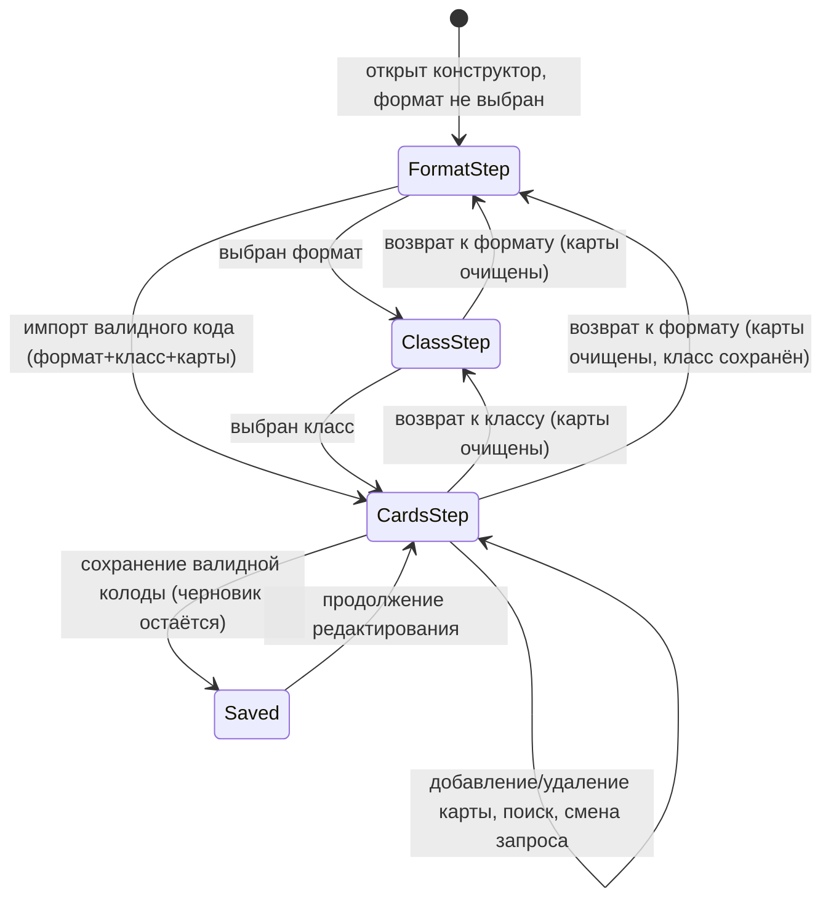
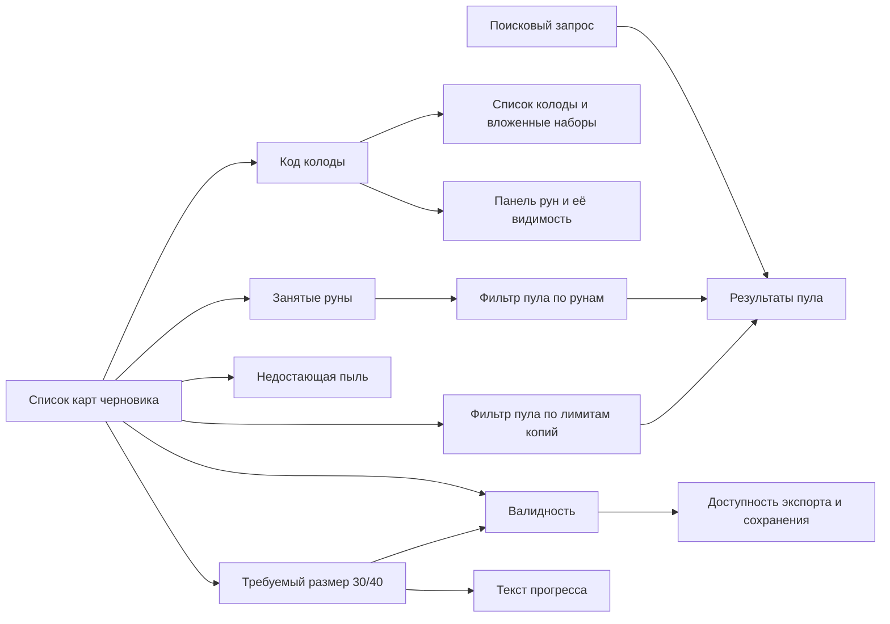

# Нейтральная функциональная спецификация HDMS — Функция № 2 «Визуальный конструктор колод» (Итерация 3)

Документ исследовательского контура. Описывает наблюдаемое поведение назначенного донора (DF) и требования к независимой реализации HDMS (HR). Не содержит исходного кода, внутренних имён сущностей донора, интерфейсных текстов и графики. Заполнен по шаблону `03_FUNCTION_SPEC_TEMPLATE.md`. Контрольная объединённая редакция: включает полные сценарии и тест-кейсы первой итерации и проверенные корректировки третьей. Подлежит финальной проверке реверс-инженером; не считать утверждённой реализационной спецификацией до этой проверки.

## Легенда типов утверждений

- **DF** — Donor Fact: поведение, фактически обнаруженное у донора, с доказательством.
- **HR** — HDMS Requirement: требование, уже заданное продуктовыми документами или прямым уточнением владельца.
- **HR-OC** — HR owner clarification: прямое продуктовое уточнение владельца в этом пакете.
- **DI** — Derived Implication: нейтральное техническое следствие/рекомендация, выведенная из DF и HR. Не является утверждённым требованием.
- **PR** — Proposal: необязательный вариант.
- **OD** — Owner Decision: крупное решение, которое нельзя вывести из документов и источников.

Наблюдение у донора не становится автоматически требованием HDMS. Отсутствие у донора не отменяет требование HDMS.

## 1. Паспорт

| Поле                   | Значение                                                                                     |
| ---------------------- | -------------------------------------------------------------------------------------------- |
| Название задания       | Функция № 2 — визуальный конструктор колод (Constructed). Итерация 3 (корректирующая)        |
| Номер функции          | Функция № 2 (только она; функции 1, 3–7 и физика игры не выполнялись)                        |
| Назначенный донор      | Firestone (единственный донор пакета)                                                        |
| Canonical URL          | https://github.com/Zero-to-Heroes/firestone                                                  |
| Ветка / tag            | master (tag на snapshot не создавался)                                                       |
| Commit SHA             | `0a30f066eb77a417637d95cec86444456f607ba1`                                                   |
| Дата коммита           | 2026-02-08T20:08:36Z                                                                         |
| Дата фиксации snapshot | 2026-11-17 (Итерация 1); подтверждение в Итерации 3 — 2026-11-25                             |
| Версия приложения      | 16.12.8                                                                                      |
| Лицензия               | Файл LICENSE/COPYING в дереве отсутствует; квалификация — не-OSS до подтверждения владельцем |
| Версия спецификации    | 3.0 (корректирующая редакция)                                                                        |
| Статус                 | Контрольная редакция — ожидает финального реверса                                                                             |

## 2. Назначение и границы

**Пользовательская задача.** Дать игроку возможность собрать колоду для Constructed-формата вне игрового клиента: выбрать формат и класс, набрать карты из легального пула, видеть состав и стоимость недостающих карт, получить переносимый код колоды и сохранить колоду в локальный список.

**Входит:** пошаговый мастер; пул допустимых карт; поиск/фильтрация/сортировка; добавление/удаление; счётчики и валидность; расчёт недостающих карт и пыли; экспорт кода; сохранение; импорт; возврат; состояния пустого результата и ошибок.

**Исключено (Out of scope):** мана-кривая (функция № 3); общие companion-паттерны (функция № 7); матчевая статистика, реплеи, архетипы; режимы Arena/Duels/Battlegrounds; игровая физика; управление уже сохранёнными колодами; серверная аналитика и закрытые сервисы.

**Уже заданные продуктовые рамки (входные требования, не вопросы владельцу):**

- **Формат колод — Standard** (HR-OC). Полноценный Wild не входит в задачу.
- **Wild-only карты/сущности** допускаются в базе карточных данных и симуляции, только когда их создаёт или призывает карта, легальная в Standard. Это не делает Wild-колоды допустимыми (HR-OC).
- **Drag-and-drop конструктора — требование** из списка возможностей (HR). Отсутствие этого способа у донора означает лишь, что донор не даёт референса; требование сохраняется.
- **Карточная база** предусмотрена; её полнота доводится итерациями до 100% поддерживаемого scope (HR-OC).
- **Стоимость создания карты выводится из редкости** через справочник/формулу; отдельный продуктовый атрибут стоимости не требуется (HR-OC).

## 3. Термины и сущности

| Термин                      | Нейтральное определение                                                                                                                | Связи                                 |
| --------------------------- | -------------------------------------------------------------------------------------------------------------------------------------- | ------------------------------------- |
| Формат                      | Правило набора допустимых дополнений                                                                                                   | определяет пул и код колоды           |
| Класс колоды                | Выбранный класс героя                                                                                                                  | определяет пул и героя в коде         |
| Черновик колоды             | Текущее редактируемое состояние: формат, класс, список идентификаторов карт (по записи на копию), вложенные наборы                     | источник кода, счётчиков, валидности  |
| Пул допустимых карт         | Множество карт, доступных для добавления сейчас                                                                                        | результат фильтров                    |
| Лимит копий                 | Максимум одинаковых карт: 1 легендарная, 2 прочие                                                                                      | ограничивает добавление и пул         |
| Размер колоды               | Требуемое число карт (минимум = максимум)                                                                                              | определяет валидность                 |
| Модификатор размера         | Карта, меняющая требуемый размер на 40                                                                                                 | меняет мин и макс                     |
| Код колоды                  | Переносимая строка: формат, герой, пары (числовой id, количество), вложенные наборы                                                    | экспорт/импорт/сохранение             |
| Вложенный набор (sideboard) | Привязанный к карте набор дополнительных карт                                                                                          | отображается под картой, входит в код |
| Ресурсные руны              | Ограничение класса: 3 слота, типы                                                                                                      | фильтрует пул, отдельная панель       |
| Карта-«турист»              | Карта, открывающая в колоде другой класс                                                                                               | расширяет пул одного набора           |
| Полный каталог карточек     | Список всех карточек всех наборов формата с количеством владения (в т.ч. нулевым) для каждой. Не равен сырому списку карт пользователя | источник для маркера и пыли           |
| Карточка коллекции          | Одна запись каталога: идентификатор + счётчики обычных/золотых/алмазных/сигнатурных копий                                              | единица владения                      |
| Альтернативные версии карты | Разные выпуски/«двойники» одной карты, связанные цепочкой                                                                              | используются агрегацией владения      |
| Владение                    | Количество экземпляров карты у пользователя                                                                                            | признак нехватки и пыль               |
| Пыль                        | Ресурс создания отсутствующих карт; стоимость по редкости                                                                              | итоговая сумма                        |
| Шаг мастера                 | «формат» / «класс» / «карты»                                                                                                           | производная от черновика              |

## 4. Входы и предусловия

| Вход                                    | Обязательность          | Поведение при ошибке                                                                        |
| --------------------------------------- | ----------------------- | ------------------------------------------------------------------------------------------- |
| Выбор формата (2 значения в интерфейсе) | обязателен              | вне списка не выбирается; иные форматы — только через импорте                               |
| Выбор класса                            | обязателен              | для «классических» форматов 2 класса исключены                                              |
| Поисковая строка (включая токен класса) | необязательна           | неизвестный токен трактуется как текст                                                      |
| Клик по карте пула                      | —                       | при лимите — молчаливый отказ                                                               |
| Клик по строке колоды                   | —                       | при отсутствии карты в доноре удаляется последняя запись (дефект)                           |
| Имя колоды                              | необязательно           | валидация/ограничение длины не обнаружены                                                   |
| Содержимое буфера обмена                | обязательно для импорта | при невалидном коде состояние не меняется, сообщения нет                                    |
| Каталог карточных данных                | обязателен              | при недоступности — ошибка, пул не строится                                                 |
| Конфиг наборов форматов                 | обязателен              | до загрузки пул не вычисляется                                                              |
| Коллекция пользователя                  | необязательна           | поведение по состояниям потока — см. §7 (правила потока коллекции) и §10 (граничные случаи) |
| Настройки отображения                   | необязательны           | масштаб плиток, показ связанных карт                                                        |

## 5. Основной сценарий

| Шаг | Действие системы                                                                                          | Результат                                       |
| --- | --------------------------------------------------------------------------------------------------------- | ----------------------------------------------- |
| 1   | Открыт раздел конструктора; черновик пуст                                                                 | шаг «формат»                                    |
| 2   | Формат не выбран                                                                                          | 2 варианта формата + кнопка импорта             |
| 3   | Клик по формату                                                                                           | шаг «класс», значок формата                     |
| 4   | Класс не выбран                                                                                           | 11 классов (9 для «классических» форматов)      |
| 5   | Клик по классу                                                                                            | шаг «карты»                                     |
| 6   | Вход на шаг «карты»: ожидание готовности каталога, конфига, состояния и потока коллекции; построение пула | рабочая область                                 |
| 7   | Ввод поиска                                                                                               | фильтрация и сортировка (окно агрегации 50 мс)  |
| 8   | Клик/Enter по карте пула                                                                                  | добавление копии при недостижении лимита        |
| 9   | Каждое изменение черновика                                                                                | пересборка кода, лимитов, валидности, пыли, рун |
| 10  | Колода валидна                                                                                            | разблокировка экспорта/сохранения               |
| 11  | Копирование кода                                                                                          | запись в буфер, подтверждение ~2 с              |
| 12  | Сохранение                                                                                                | запись личной колоды, подтверждение ~2 с        |

---

## 6. Альтернативные сценарии и исключения

| Сценарий | Условие запуска | Ожидаемое поведение | Результат/ошибка |
|---|---|---|---|
| A1. Импорт вместо ручного выбора | Шаг «формат», клик по кнопке импорта | Чтение буфера, поиск кода и имени, применение формата/класса/карт | сразу шаг «карты» с заполненной колодой; имя из буфера не применяется к полю имени (EV-093, EV-094, EV-095, EV-021) |
| A2. Импорт невалидного содержимого | В буфере нет декодируемой строки | Состояние не изменяется | остаётся шаг «формат»; пользовательского сообщения об ошибке в конструкторе нет (EV-095, EV-018) |
| A3. Возврат к выбору класса | Клик по значку класса в панели шагов | Класс сбрасывается, набранные карты очищаются, формат сохраняется | шаг «класс», колода пуста, без подтверждения и без отмены (EV-019) |
| A4. Возврат к выбору формата | Клик по значку формата | Формат сбрасывается, карты очищаются, класс сохраняется | шаг «формат»; кнопка импорта снова видна; повторный выбор формата ведёт сразу к картам с сохранённым классом (EV-019, EV-014, EV-018) |
| A5. Удаление карты | Клик по строке списка колоды | Удаляется одна копия той карты, по которой выполнен клик | счётчик уменьшается; при 0 строка исчезает; карта возвращается в пул (EV-061, EV-034) |
| A6. Клик по вложенной (sideboard) карте | Строка-«потомок» в списке колоды | Ожидание: удаление относится к этой карте | в доноре карта не найдена в черновике и удаляется последняя запись списка (дефект, EV-061, EV-063) |
| A7. Быстрый набор с клавиатуры | Фокус в поиске, Enter | Добавляется первый результат | при Shift+Enter поиск очищается; при единственном результате, достигшем лимита, поиск очищается автоматически (EV-051) |
| A8. Пустой результат поиска | Ни одна карта не подходит | Показ сообщения «нет результатов» с текстом запроса | сетка скрыта, показано пустое состояние (EV-049, EV-050) |
| A9. Пустой результат без запроса | Все карты исчерпаны/отфильтрованы, поиск пуст | Ожидание: объясняющее сообщение | в доноре область остаётся пустой без сообщения (EV-050) |
| A10. Колода не добрана | Число карт вне требуемого диапазона | Экспорт и сохранение недоступны | показывается текст прогресса «набрано/требуется» (EV-085, EV-067) |
| A11. Колода с модификатором размера | В колоде есть карта-модификатор (любая из 2 версий) | Требуемый размер повышается до 40 | прогресс и валидность считаются по 40 (EV-065) |
| A12. Класс с ресурсными рунами | Герой — «рыцарь смерти» либо в колоде есть «турист» в этот класс | Панель из 3 слотов рун, заполнение по максимуму требований карт | пул дополнительно фильтруется по совместимости рун (EV-037, EV-036) |
| A13. «Турист» в другой класс | В колоде есть карта, открывающая класс X | Пул расширяется картами класса X | расширение ограничено картами одного конкретного набора (EV-031) |
| A14. Коллекция не загружена | Данные коллекции отсутствуют (`null`) | Ожидание: явное состояние неопределённости | в доноре все карты списка считаются имеющимися, пыль = 0 (EV-080, EV-062, EV-075) |
| A15. Повторное сохранение того же кода | Колода с идентичным кодом уже сохранена | Ожидание: обновление существующей записи | в доноре существующая запись обновляется и дополнительно добавляется новая → дубли (EV-090) |
| A16. Переключение вкладки раздела и возврат | Пользователь уходит в другой раздел и возвращается | Черновик сохраняется в памяти состояния | шаг и колода восстанавливаются (EV-013, EV-021, EV-022) |
| A17. Импорт формата вне UI-списка | Код колоды содержит «классический»/twist-формат | Формат применяется из кода | пул строится по соответствующему списку наборов; при пустом списке наборов пул пуст (EV-095, EV-030, EV-039) |
| A18. Ошибка загрузки изображения карты | Изображение недоступно | Плитка списка скрывает изображение, оставляя текст/стоимость | список остаётся работоспособным (EV-064) |

---

## 7. Правила и ограничения

Колонка «Тип» указывает источник утверждения.

### 7.1. Мастер, форматы, классы, пул

| ID      | Формулировка                                                                                                                                                                                                                                            | Тип   | Статус      | Основание              |
| ------- | ------------------------------------------------------------------------------------------------------------------------------------------------------------------------------------------------------------------------------------------------------- | ----- | ----------- | ---------------------- |
| R-01    | Шаг мастера выводится из черновика: нет формата → «формат»; нет класса → «класс»; иначе «карты»                                                                                                                                                         | DF    | Confirmed   | EV-014, EV-018         |
| R-02    | В интерфейсе предлагаются ровно 2 формата (стандартный и вольный); третий присутствует как отключённая опция. Наличие кодовой ветви для иного формата не равно его полноценной поддержке: она зависит от фактического списка наборов во внешнем конфиге | DF    | Confirmed   | EV-015, EV-030, EV-039 |
| R-02-HR | Формат колод — Standard. Wild-only сущности допустимы в базе/симуляции только когда их создаёт/призывает Standard-карта                                                                                                                                 | HR-OC | Requirement | TZ §5                  |
| R-03    | 11 классов; для «классических» форматов исключаются 2                                                                                                                                                                                                   | DF    | Confirmed   | EV-016, EV-017         |
| R-04    | Пул = коллекционные карты наборов формата, класса или нейтральные, без «зачарований»                                                                                                                                                                    | DF    | Confirmed   | EV-030, EV-032         |
| R-05    | Карты-«туристы» добавляют свой класс в пул только для карт одного конкретного набора                                                                                                                                                                    | DF    | Confirmed   | EV-031                 |
| R-06    | Карты с одинаковым именем сворачиваются в одну запись: единственная допустимая → версия-«двойник» → версия базового набора → первая в группе                                                                                                            | DF    | Confirmed   | EV-033                 |

### 7.2. Лимиты, размер, валидность, добавление/удаление

| ID      | Формулировка                                                                                         | Тип | Статус                  | Основание              |
| ------- | ---------------------------------------------------------------------------------------------------- | --- | ----------------------- | ---------------------- |
| R-07    | Лимит копий: 1 легендарная, 2 прочие                                                                 | DF  | Confirmed               | EV-035, EV-060         |
| R-08    | Карта на лимите исключается из результатов                                                           | DF  | Confirmed               | EV-034                 |
| R-09    | Размер 30 (мин=макс); при модификаторе (любая из 2 версий) — 40                                      | DF  | Confirmed               | EV-065                 |
| R-10    | Валидность = число карт в [мин,макс] и каждая ≤2 раз; отдельной проверки «≤1 легендарной» нет        | DF  | Confirmed               | EV-066                 |
| R-11    | Добавление = +1 копия при недостижении лимита; иначе молчаливый отказ                                | DF  | Confirmed               | EV-060                 |
| R-12    | Клик по строке удаляет одну копию; при отсутствии карты в доноре удаляется последняя запись (дефект) | DF  | Confirmed (with defect) | EV-061, EV-107         |
| R-13    | Операция «заменить карту» одним действием отсутствует                                                | DF  | Not found               | EV-049, EV-060, EV-061 |
| R-13-HR | Drag-and-drop конструктора — обязательный способ взаимодействия                                      | HR  | Requirement             | Feature List; TZ §6    |

### 7.3. Поиск, сортировка, руны

| ID   | Формулировка                                                                                                  | Тип | Статус    | Основание      |
| ---- | ------------------------------------------------------------------------------------------------------------- | --- | --------- | -------------- |
| R-14 | Текстовый поиск — регистронезависимая подстрока в имени, тексте, школе, расах, редкости, тегах                | DF  | Confirmed | EV-047         |
| R-15 | Токен класса фильтрует по точному совпадению имени класса                                                     | DF  | Confirmed | EV-046, EV-047 |
| R-16 | Другие токены не поддерживаются; нераспознанные фрагменты → текстовый запрос                                  | DF  | Confirmed | EV-046         |
| R-17 | Пересчёт поиска агрегируется в окне 50 мс                                                                     | DF  | Confirmed | EV-045         |
| R-18 | Сортировка результатов: ранг класса (нейтральные в конце) → стоимость → имя; ранг класса грубый               | DF  | Confirmed | EV-048         |
| R-19 | Список колоды сортируется по стоимости, затем имени; вложенные — по стоимости                                 | DF  | Confirmed | EV-062, EV-063 |
| R-20 | Панель рун: 3 слота; заполнение = максимум требований по типам; карта допустима, если недостающие ≤ свободные | DF  | Confirmed | EV-036, EV-037 |
| R-21 | Панель рун видна только для соответствующего класса или «туриста» в этот класс                                | DF  | Confirmed | EV-037         |

### 7.4. Прогресс, код колоды, экспорт, сохранение, импорт

| ID   | Формулировка                                                                                                                                                     | Тип | Статус              | Основание              |
| ---- | ---------------------------------------------------------------------------------------------------------------------------------------------------------------- | --- | ------------------- | ---------------------- |
| R-22 | Прогресс «набрано/требуется» виден только при невалидной колоде                                                                                                  | DF  | Confirmed           | EV-067, EV-085         |
| R-23 | Кнопки копирования/сохранения видны только при валидной колоде                                                                                                   | DF  | Confirmed           | EV-085                 |
| R-24 | Код собирается из пар (числовой id, количество), героя по умолчанию, формата, вложенных наборов                                                                  | DF  | Confirmed           | EV-068, EV-069         |
| R-25 | Экспорт копирует код; предварительная обработка определения колоды в этом снимке тождественна; имя колоды не добавляется (не передаётся в компонент копирования) | DF  | Confirmed           | EV-085, EV-086, EV-087 |
| R-26 | Сохранение создаёт запись личной колоды: класс, формат, код, имя, время, признак «личная»                                                                        | DF  | Confirmed           | EV-089                 |
| R-27 | Список личных колод хранится локально и перезаписывается при изменении                                                                                           | DF  | Confirmed           | EV-090, EV-091         |
| R-28 | Повторное сохранение существующего кода обновляет запись и добавляет новую (дублирование)                                                                        | DF  | Confirmed (by code) | EV-090                 |
| R-29 | Импорт доступен только на шаге «формат», только из буфера обмена                                                                                                 | DF  | Confirmed           | EV-018, EV-093         |
| R-30 | Разбор буфера с конца: имя — строка с префиксом, код — первая декодируемая                                                                                       | DF  | Confirmed           | EV-094                 |
| R-31 | Импорт применяет формат/класс/карты из кода; имя из буфера не попадает в состояние                                                                               | DF  | Confirmed           | EV-095, EV-021         |
| R-32 | При ошибке декодирования состояние не меняется; сообщения в конструкторе нет                                                                                     | DF  | Confirmed           | EV-095, EV-096         |
| R-46 | Предварительная обработка определения колоды перед кодированием тождественна: возвращает исходное определение без изменений | DF | Confirmed | EV-126 | Гарантии внешней библиотеки кодирования/декодирования не подтверждены |

### 7.5. Возврат, черновик

| ID   | Формулировка                                                                 | Тип           | Статус               | Основание                      |
| ---- | ---------------------------------------------------------------------------- | ------------- | -------------------- | ------------------------------ |
| R-33 | Возврат безусловно очищает карты; подтверждения и отмены нет                 | DF            | Confirmed            | EV-019                         |
| R-34 | Смена формата не сбрасывает класс                                            | DF            | Confirmed            | EV-019, EV-020                 |
| R-39 | Черновик живёт в состоянии приложения; персистентного хранения не обнаружено | DF / Inferred | Confirmed (в памяти) | EV-013, EV-021, EV-022, EV-091 |

### 7.6. Поток коллекции, маркер нехватки, пыль — сквозная модель (исправлено в Итерации 3)

**Это центральный раздел. Разные состояния потока не объединяются в одно «коллекция пустая». Расчёт пыли не выводится из логики маркера.**

| ID    | Формулировка                                                                                                                                                                                                                                                                                                                                                                                              | Тип | Статус         | Основание                      |
| ----- | --------------------------------------------------------------------------------------------------------------------------------------------------------------------------------------------------------------------------------------------------------------------------------------------------------------------------------------------------------------------------------------------------------- | --- | -------------- | ------------------------------ |
| R-35  | **Поток расчёта недостающей пыли** независим от маркера: по каждой карте недостающие копии = max(0, требуемое − владение по точному идентификатору), умножаются на стоимость создания по редкости и суммируются. Агрегация по альтернативным версиям не применяется. Владение берётся как суммарное число копий карточки (все виды)                                                                       | DF  | Confirmed      | EV-136, EV-137, EV-075         |
| R-36  | **Маркер нехватки** в строке списка колоды агрегирует владение по всем альтернативным версиям карты и сравнивает с требуемым количеством                                                                                                                                                                                                                                                                  | DF  | Confirmed      | EV-134, EV-135, EV-062         |
| R-37  | **Нормализация входа коллекции в списке колоды:** пустой или отсутствующий массив → неизвестное состояние → все карты считаются обеспеченными; непустой массив → словарь владения по идентификаторам                                                                                                                                                                                                      | DF  | Confirmed      | EV-133, EV-134                 |
| R-47  | **Поток наборов** инициализируется пустым списком; построение каталога начинается при первой подписке на источник коллекции с окном агрегации (задержка). Это создаёт транзитивную пустую эмиссию                                                                                                                                                                                                         | DF  | Confirmed      | EV-128, EV-129                 |
| R-48  | **Полный каталог карточек** строится по всем наборам: для каждой карточки ищется запись коллекции по точному идентификатору; при наличии переносятся счётчики всех видов копий, при отсутствии — все четыре счётчика = 0. Результат — не сырой список карт пользователя, а полный список с количеством владения                                                                                           | DF  | Confirmed      | EV-130                         |
| R-49  | **Конструктор разворачивает наборы в единый плоский список карточек**; у этого потока есть собственная начальная пустая эмиссия, предшествующая построению полного каталога                                                                                                                                                                                                                               | DF  | Confirmed      | EV-131, EV-132                 |
| DI-01 | **Рекомендация проектирования (не требование):** в целевой системе целесообразен единый алгоритм владения для маркера и пыли, предпочтительно с учётом альтернативных версий, чтобы пользователь не видел одновременно «карта есть» и полную стоимость её создания. Обосновано расхождением у донора (противоречие C-02); источник — аналитический вывод, а не список возможностей и не наблюдение донора | DI  | Recommendation | C-02; Independent Review I2-03 |

**Стоимость создания по редкости (таблица донора, обычная версия):** обычная 40, редкая 100, эпическая 400, легендарная 1600 (подтверждено источником). Премиальный путь в этом алгоритме не используется.

### 7.7. Разное

| ID   | Формулировка                                                                                                   | Тип            | Статус                | Основание              |
| ---- | -------------------------------------------------------------------------------------------------------------- | -------------- | --------------------- | ---------------------- |
| R-38 | Размер плиток = базовый × (масштаб/100); показ связанных карт — настройка                                      | DF             | Confirmed             | EV-100, EV-101         |
| R-40 | Пустой результат: при непустом поиске — сообщение; при пустом — область пустая                                 | DF             | Confirmed             | EV-049, EV-050         |
| R-41 | Enter добавляет первый результат; Shift+Enter очищает; автоочистка при единственном результате на лимите       | DF             | Confirmed             | EV-051                 |
| R-42 | Индикатор загрузки на уровне раздела; отдельного состояния загрузки конструктора нет                           | DF / Not found | Confirmed             | EV-011, EV-030, EV-040 |
| R-43 | Аналитические события при открытии, переключении вкладки, копировании                                          | DF             | Confirmed             | EV-014, EV-010, EV-086 |
| R-44 | Вложенные наборы принимаются из импорта и передаются в код; создание/редактирование в конструкторе отсутствует | DF             | Confirmed / Not found | EV-118, EV-021, EV-068 |
| R-45 | Отображаемая стоимость из справочника; для одной модульной карты = сумма стоимостей вложенных                  | DF             | Confirmed             | EV-119, EV-062         |

---

## 8. Состояния и переходы

**Состояния мастера (по черновику):**

**Состояния рабочей области (ортогональные подсистемы):**

| Подсистема | Состояния | Переходы | Невозможные/непокрытые состояния |
|---|---|---|---|
| Пул карт | «предусловия не готовы» → «готов» → «пуст после фильтров» | готовность каталога/конфига/формата/класса; изменение колоды, рун, поиска | явное «загрузка» и «ошибка загрузки» отсутствуют (R-42) |
| Черновик | пуст → частичный → полный валидный → невалидный (например, после импорта) | добавление/удаление/импорт/возврат | «переполненный» вручную недостижим (лимиты блокируют добавление), но достижим импортом |
| Сохранение | покой → подтверждение (~2 с) → покой | клик при валидной колоде | «ошибка сохранения» не обнаружена |
| Экспорт | покой → подтверждение (~2 с) → покой | клик при валидной колоде | «ошибка буфера» в браузерном пути молчалива (EV-086) |
| Импорт | покой → применён / молчаливый отказ | клик на шаге формата | «ошибка импорта» как состояние UI отсутствует (R-32) |
| Коллекция | неизвестна (`null`) → загружена (в т.ч. пустая) | обновление источника коллекции | «ошибка коллекции» не отображается в конструкторе |

**Восстановление после ошибки:** предусмотрен только повтор действия пользователем; автоматических повторов на уровне конструктора нет (повторы есть в инфраструктуре готовности каталога карт, EV-040).

### Сквозная модель потока коллекции (уточнение третьей итерации)

Состояния мастера сохраняются из Итерации 1. Добавляется сквозная модель потока коллекции.

**Поток коллекции (обязательная модель, проверена по исходникам):**

Источник коллекции пользователя
→ менеджер наборов: окно агрегации; null/undefined нормализуются в пустой массив оператором ??
→ построение полного каталога карточек по всем наборам (отсутствующим — нулевое владение)
→ публикация наборов
→ конструктор: разворот в единый плоский список карточек (собственная начальная пустая эмиссия)
→ передача в компонент списка колоды
→ нормализация входа: пустой массив → неизвестное состояние; непустой → словарь владения
→ независимо: маркер нехватки (агрегация по версиям) И поток пыли (точный идентификатор)

Состояния потока и их наблюдаемые следствия сведены в таблицу §10 (граничные случаи). Внутренние/транзитивные состояния не объявляются видимыми пользователю без рантайм-подтверждения.

Источник коллекции пользователя изначально имеет значение null; это подтверждено по base-is.ts L10 и передаче потока в CollectionManager L125. Подписка SetsManager начинается при первой подписке и использует debounceTime(1000). Фактическая последовательность рендеров и видимость промежуточного состояния не подтверждены без runtime.

---

## 9. Взаимодействия и контракты

**Входящие события (от пользователя/платформы):** выбор формата; выбор класса; возврат к шагу; импорт из буфера; сохранение колоды; ввод поиска; клик по карте пула; клик по строке колоды; изменение имени; изменение настроек отображения; обновление коллекции.

**Исходящие эффекты:** запись кода в буфер обмена; запись списка личных колод в локальное хранилище; аналитические события; переключение вида раздела.

**Зависимые данные:** каталог карт (идентификаторы, числовые id, классы, стоимость, редкость, теги, наборы, «двойники», «туристы», дополнительные стоимости рун); удалённый конфиг наборов форматов; коллекция пользователя; настройки; строки интерфейса из удалённого источника локализации.

**Синхронизация (единый источник истины — список карт черновика):**

**Контракты вовне:** сохранённая личная колода должна быть пригодна для отображения в списке колод (код декодируется, класс/формат заполнены) — EV-092; экспортированный код должен декодироваться сторонними инструментами (формат кода — внешний стандарт, реализация кодирования/декодирования в репозитории донора отсутствует, см. § 15).

**Границы:** конструктор не изменяет игровое состояние, не пишет в статистику матчей и не управляет оверлеем.

### Дополнение третьей итерации

Поток каталога коллекции является зависимыми данными конструктора. Полный список карточек проходит через менеджер наборов и плоский список в дочерний список колоды. Маркер нехватки и расчёт пыли — два независимых потребителя с различными правилами владения: маркер агрегирует альтернативные версии, пыль использует точный ID. Источники EV-128…EV-137 приведены в полном Evidence Register.

---

## 10. Граничные случаи и ошибки

| ID | Начальное состояние | Действие/событие | Ожидаемый результат (требование HDMS) | Почему сценарий важен |
|---|---|---|---|---|
| E-01 | Колода из N карт; в списке есть вложенная карта, отсутствующая в черновике | Клик по вложенной карте | Ничего не удаляется; удаление применяется только к карте, присутствующей в колоде | В доноре удаляется последняя карта колоды (потеря данных). Confirmed: EV-061, EV-063 + проверка семантики языка (EV-107) |
| E-02 | Шаг «формат», в буфере произвольный текст | Клик «импорт» | Явное сообщение «код не распознан», состояние не меняется | В доноре отказ молчаливый (EV-095, EV-096) |
| E-03 | Буфер содержит имя и валидный код | Импорт | Имя из буфера предлагается в поле имени | В доноре имя теряется (EV-095, EV-021) |
| E-04 | Личная колода с кодом X уже сохранена | Повторное сохранение кода X | Одна запись на код (идемпотентность) | В доноре появляются дубли (EV-090) |
| E-05 | Импортирована колода с 2 копиями легендарной карты | Проверка валидности | Колода помечается невалидной | В доноре критерий валидности проверяет только «≤2» (EV-066) |
| E-06 | набрано 25 карт | Возврат к классу/формату | Подтверждение или возможность отмены | В доноре карты удаляются без подтверждения (EV-019) |
| E-07 | Формат «вольный», класс — рыцарь смерти | Возврат к формату и выбор «классического» формата | Класс сбрасывается или помечается недопустимым | В доноре класс сохраняется, пул строится по недопустимой паре (EV-019, EV-016) |
| E-08 | Пул содержит карты 3+ классов с одинаковой первой буквой | Сортировка результатов | Детерминированный порядок классов | В доноре ранг класса грубый, порядок внутри группы определяется стоимостью/именем (EV-048) |
| E-09 | Все карты пула исчерпаны, поиск пуст | Отрисовка результатов | Объсняющее пустое состояние («все доступные карты добавлены») | В доноре пустая область без текста (EV-050) |
| E-10 | Коллекция не загружена | Расчёт нехватки/пыли | Явное состояние «данные коллекции недоступны», без ложного «всё есть» | В доноре `null` трактуется как «всё есть» (EV-080) |
| E-11 | Коллекция загружена, но пуста | Расчёт нехватки/пыли | Все карты помечены отсутствующими, пыль = полная стоимость создания | Подтверждено (EV-079, EV-075) |
| E-12 | Конфиг формата содержит пустой список наборов (наблюдается для twist) | Импорт колоды этого формата | Понятное сообщение «формат не поддерживается» | В доноре пул просто пуст (EV-039, EV-030) |
| E-13 | Каталог карт недоступен (сеть/блокировка) | Открытие конструктора | Явная ошибка загрузки с инструкцией | Пул не строится; ошибка только в журнале; отдельная инструкция есть в документации донора (EV-040, EV-005) |
| E-14 | В колоде 30 карт, добавляется карта-модификатор размера | Пересчёт | Требуемый размер 40, колода снова невалидна, экспорт блокируется | Подтверждено (EV-065, EV-066, EV-085) |
| E-15 | Колода с 3 рунами одного типа | Поиск карты с требованием другого типа | Карта исключается из пула | Подтверждено (EV-036) |
| E-16 | В колоде карта с 2 рунами разных типов, свободен 1 слот | Поиск карты с требованием 2 рун третьего типа | Карта исключается (не хватает 2 > 1 свободного) | Подтверждено (EV-036) |
| E-17 | Достигнут лимит копий единственного результата поиска | Enter | Копия не добавляется, запрос очищается | Подтверждено (EV-051, EV-035) |
| E-18 | Пустое имя колоды | Сохранение | Валидация имени или подстановка значения по умолчанию | В доноре валидации не обнаружено (EV-089, EV-103) |
| E-19 | Изображение карты недоступно | Отрисовка списка/сетки | Сохранение читаемой строки (имя, стоимость, количество) | В списке колоды подтверждено; в сетке результатов изображение просто не отображается (EV-064, EV-049) |
| E-20 | Пользователь уходит из раздела и возвращается | Восстановление | Черновик восстановлен (в рамках сессии) | Подтверждено для переключения вкладок; после перезапуска — Unknown (EV-013, EV-022) |
| E-21 | Один и тот же card-name в нескольких наборах формата | Формирование пула | Одна запись на имя, версия выбирается детерминированно | Подтверждено, но последний fallback зависит от порядка справочника (EV-033) |
| E-22 | Колода содержит карту-«туриста» | Формирование пула | Карты открытого класса доступны только из разрешённого набора | Подтверждено; жёсткая привязка к набору — риск устаревания (EV-031) |
| E-23 | Импортирована колода со вложенным набором (модульная карта) | Осмотр списка колоды, клик по вложенной карте, экспорт | Вложенные карты отображаются под родительской, клик по ним не изменяет колоду, экспорт сохраняет вложенный набор; редактирование вложенных наборов либо реализовано, либо явно недоступно | В доноре вложенные наборы нельзя создать/изменить в конструкторе, а клик по вложенной карте удаляет последнюю карту колоды (EV-118, EV-061, EV-063) |

### Дополнения и исправления третьей итерации

| E-26      | Транзитивная пустая эмиссия потока коллекции (первоначальное состояние до построения каталога), непустая колода | Маркер: внутренне «всё есть»; пользовательская видимость не подтверждена. Пыль: полная стоимость недостающих копий по точному ID | Подтверждено по коду; рантайм-видимость — Unknown (EV-131, EV-132, EV-133, EV-136) |
| E-27      | Установившееся состояние при пустой/незагруженной коллекции: полный каталог карточек с нулевым владением, непустая колода с известной редкостью | Маркер: карты считаются отсутствующими при отсутствии владения у всех альтернативных версий. Пыль: полная стоимость требуемых копий по редкости. Пыль не равна 0 | Подтверждено по коду (EV-130, EV-134, EV-136, EV-137) |
| E-28      | Альтернативная версия карты имеет владение, точный идентификатор в колоде — нет | Маркер может считать карту имеющейся по агрегации версий; пыль начисляется по точному ID. Это подтверждённое расхождение донора | Подтверждено; единый алгоритм остаётся DI-01, не требованием (EV-134, EV-135, EV-136) |

E-26 — транзитивная пустая эмиссия; E-27 — полный каталог с нулевым владением; E-28 — владение только альтернативной версией. Эти идентификаторы продолжают E-01…E-23 и не переопределяют E-24/E-25 из черновика второй итерации.

---

## 11. Тест-кейсы

> Все тест-кейсы ниже сформулированы нейтрально и выведены из прочитанных исходников. **Автоматизированных тестов конструктора у донора не обнаружено** (EV-003), поэтому ни один кейс не имеет статуса «Confirmed by test». Колонка Pass/fail заполняется при проверке реализации HDMS; сейчас — `Not executed`.

| Test ID | Входные данные | Начальные условия | Последовательность действий | Ожидаемый результат | Pass/fail |
|---|---|---|---|---|---|
| TC-01 | — | Конструктор открыт, черновик пуст | Открыть раздел | Шаг «формат»; предлагаются 2 формата; кнопка импорта видна (R-01, R-02, R-29) | Not executed |
| TC-02 | формат = стандартный | Шаг «формат» | Выбрать формат | Шаг «класс»; в панели шагов значок формата (R-01) | Not executed |
| TC-03 | формат = стандартный | Шаг «класс» | Подсчитать варианты классов | 11 классов (R-03) | Not executed |
| TC-04 | формат «классический» (через импорт) | Шаг «класс» | Подсчитать варианты классов | 9 классов, 2 исключены (R-03) | Not executed |
| TC-05 | класс = маг, формат = стандартный | Шаг «карты», каталог и конфиг загружены | Проверить пул | Только коллекционные карты наборов формата, класса «маг» + нейтральные, без зачарований (R-04) | Not executed |
| TC-06 | имя карты встречается в 2 наборах формата | Шаг «карты» | Найти карту по имени | Одна запись пула, версия выбрана по цепочке приоритетов (R-06) | Not executed |
| TC-07 | нейтральная не-легендарная карта | Пустая колода | Кликнуть карту 3 раза | В колоде 2 копии; третий клик не меняет состояние; после 2-й копии карта исчезает из результатов (R-07, R-08, R-11) | Not executed |
| TC-08 | легендарная карта | Пустая колода | Кликнуть карту 2 раза | В колоде 1 копия; карта исчезает из результатов (R-07, R-08) | Not executed |
| TC-09 | колода: 2 копии карты A | Шаг «карты» | Кликнуть строку A в списке колоды | 1 копия A; карта A снова в пуле (R-12) | Not executed |
| TC-10 | колода из 5 карт; в списке есть вложенная карта B, отсутствующая в колоде | Шаг «карты» | Кликнуть строку B | Колода не изменилась (E-01; в доноре — удаляется последняя карта) | Not executed |
| TC-11 | 29 карт | Шаг «карты» | Проверить элементы управления | Экспорт/сохранение скрыты; виден прогресс «29/30» (R-22, R-23) | Not executed |
| TC-12 | 30 карт, лимиты соблюдены | Шаг «карты» | Проверить элементы управления | Валидность = true; видны копирование и сохранение; прогресс скрыт (R-10, R-23) | Not executed |
| TC-13 | 30 карт + карта-модификатор размера (31 карта) | Шаг «карты» | Проверить требуемый размер | Требуется 40; колода невалидна; экспорт скрыт (R-09, E-14) | Not executed |
| TC-14 | импорт колоды с 2 копиями легендарной карты, всего 30 | Шаг «формат» | Импортировать | HDMS: колода невалидна (E-05; в доноре — валидна) | Not executed |
| TC-15 | запрос = подстрока имени | Шаг «карты» | Ввести запрос | Все результаты содержат подстроку в одном из поддерживаемых полей (R-14) | Not executed |
| TC-16 | запрос = подстрока текста карты («провокация») | Шаг «карты» | Ввести запрос | В результатах карты с этим текстом/тегом (R-14) | Not executed |
| TC-17 | запрос = `class:mage` | Класс колоды = рыцарь смерти (пул содержит нейтральные) | Ввести запрос | Только карты класса «маг», если они есть в пуле; текстовое условие пусто (R-15) | Not executed |
| TC-18 | запрос = `mana:3` | Шаг «карты» | Ввести запрос | Токен не распознан → трактуется как текст; результаты соответствуют буквальному поиску (R-16) | Not executed |
| TC-19 | запрос = несуществующая строка | Шаг «карты» | Ввести запрос | Сетка скрыта, показано «нет результатов» с текстом запроса (R-40) | Not executed |
| TC-20 | все карты пула добавлены до лимитов, запрос пуст | Шаг «карты» | Осмотреть область результатов | HDMS: объясняющее пустое состояние (E-09; в доноре — пусто без текста) | Not executed |
| TC-21 | ≥2 результата поиска | Фокус в поиске | Enter | Добавлена 1 копия первого результата; запрос сохранён (R-41) | Not executed |
| TC-22 | ≥1 результат поиска | Фокус в поиске | Shift+Enter | Добавлена 1 копия первого результата; запрос очищен (R-41) | Not executed |
| TC-23 | единственный результат — карта с 1 оставшейся копией | Фокус в поиске | Enter | Копия добавлена, запрос очищен автоматически (R-41) | Not executed |
| TC-24 | колода класса «рыцарь смерти» с картой, требующей 3 рун крови | Шаг «карты» | Осмотреть панель рун и пул | 3 слота заполнены кровью; карты с требованием других рун отсутствуют в пуле (R-20, R-21, E-15) | Not executed |
| TC-25 | колода с картой на 2 руны крови; свободен 1 слот | Шаг «карты» | Найти карту, требующую 2 руны мороза | Карта отсутствует в пуле (E-16) | Not executed |
| TC-26 | колода не-рыцаря смерти без «туриста» | Шаг «карты» | Осмотреть панель рун | Панель скрыта (R-21) | Not executed |
| TC-27 | коллекция: 0 копий легендарной карты (1600) и 1 копия редкой из 2 (100) | Колода содержит эти карты | Проверить сумму пыли | 1700 (R-35) | Not executed |
| TC-28 | коллекция = `null` | Колода из 30 карт | Проверить отметки нехватки и пыль | HDMS: явное состояние неопределённости (E-10; в доноре — всё «есть», пыль 0) | Not executed |
| TC-29 | коллекция = пустой список | Колода из 30 карт | Проверить отметки нехватки | Все строки помечены отсутствующими; пыль = сумма стоимостей создания (E-11) | Not executed |
| TC-30 | валидная колода, имя по умолчанию | Шаг «карты» | Клик «сохранить», подождать 3 с | Запись личной колоды создана (класс, формат, код, имя, время); подпись кнопки вернулась к исходной (R-26, R-27) | Not executed |
| TC-31 | та же колода уже сохранена | Шаг «карты» | Клик «сохранить» повторно | HDMS: одна запись на код (E-04; в доноре — дубли) | Not executed |
| TC-32 | валидная колода | Шаг «карты» | Клик «скопировать код», прочитать буфер | Буфер содержит декодируемый код той же колоды; подтверждение ~2 с (R-25) | Not executed |
| TC-33 | буфер: строка имени с префиксом `### ` + валидный код | Шаг «формат» | Клик «импорт» | Формат/класс/карты применены; шаг «карты»; HDMS: имя предложено в поле имени (R-30, R-31, E-03) | Not executed |
| TC-34 | буфер: произвольный текст без кода | Шаг «формат» | Клик «импорт» | Состояние не изменилось; HDMS: сообщение об ошибке (R-32, E-02) | Not executed |
| TC-35 | буфер: несколько строк, из которых 2 декодируются | Шаг «формат» | Клик «импорт» | Выбрана первая с конца декодируемая строка (R-30) | Not executed |
| TC-36 | набрано 20 карт | Шаг «карты» | Возврат к классу | Карты очищены; HDMS: подтверждение/отмена (R-33, E-06) | Not executed |
| TC-37 | формат «вольный», класс «рыцарь смерти», 10 карт | Шаг «карты» | Возврат к формату, выбрать «классический» формат | Карты очищены; HDMS: класс сброшен/помечен (R-34, E-07) | Not executed |
| TC-38 | черновик: формат+класс+15 карт | Шаг «карты» | Перейти в другую вкладку раздела и вернуться | Черновик и шаг восстановлены (R-39) | Not executed |
| TC-39 | масштаб карточек = 150 % | Шаг «карты» | Изменить настройку | Плитки увеличены в 1.5 раза относительно базового размера (R-38) | Not executed |
| TC-40 | конфиг формата с пустым списком наборов | Импорт колоды этого формата | Импортировать | HDMS: понятное сообщение о неподдерживаемом формате (E-12; в доноре — пустой пул) | Not executed |
| TC-41 | буфер с валидным кодом колоды, содержащей вложенный набор | Шаг «формат» | Импортировать, осмотреть список, экспортировать код | Вложенные карты отображены под родительской; клик по вложенной карте не меняет колоду; экспортированный код содержит тот же вложенный набор (R-44, E-23) | Not executed |
| TC-42 | колода с модульной картой и вложенными картами | Шаг «карты» | Проверить отображаемую стоимость родительской карты | Стоимость равна сумме стоимостей вложенных карт по правилу HDMS для модульных карт (R-45; в доноре правило действует только для одной конкретной карты) | Not executed |

### Дополнительные тест-кейсы третьей итерации

| TC-43   | Каталог карточных данных недоступен                                             | Открытие конструктора           | Попытаться построить пул        | Явное состояние ошибки загрузки с инструкцией; пул не строится; данные о владении не показываются                                                                                                       | Целевой (закрывает пробел Итерации 1)                        |
| TC-44   | Колода содержит карту-«туриста», открывающую класс                              | Шаг «карты»                     | Проверить пул                   | Пул расширен картами открытого класса только из разрешённого набора; правила рун не являются подтверждением этого кейса                                                                                 | Подтверждающий правило пула                                  |
| TC-45   | Альтернативная версия карты имеет владение; точный идентификатор в колоде — нет | Установившееся состояние потока | Проверить маркер и пыль         | Донор: расхождение (маркер «есть», пыль начисляется). Целевое поведение: единый алгоритм владения — это рекомендация проектирования, источник не утверждён как требование                               | Подтверждающий расхождение; целевое поведение — рекомендация |
| TC-46   | Валидная колода                                                                 | Шаг «карты»                     | Экспорт кода → повторный импорт | Целевое поведение: семантическая эквивалентность (карты, количества, герой, формат, вложенные наборы), а не побайтовое равенство строк. Гарантии внешней библиотеки кодирования донором не подтверждены | Целевой; гарантии внешней библиотеки — Unknown               |

TC-01…TC-42 сохранены полностью из первой итерации. TC-43…TC-46 добавлены после них; TC-44 проверяет туриста отдельно от рун, TC-45 фиксирует расхождение донора без превращения DI-01 в требование, TC-46 является целевым семантическим тестом HDMS.

---

## 12. Критерии приёмки

Реализация HDMS считается соответствующей спецификации, если наблюдаемо выполняются все пункты:

1. **AC-01.** Мастер проходит последовательность «формат → класс → карты», шаг определяется заполненностью черновика (TC-01…TC-04).
2. **AC-02.** Пул содержит только карты, легальные для пары (формат, класс) с учётом нейтральных карт и исключений (TC-05, TC-06).
3. **AC-03.** Лимиты копий соблюдаются при любом способе добавления, карты на лимите не предлагаются (TC-07, TC-08, TC-23).
4. **AC-04.** Удаление уменьшает количество ровно той карты, по которой выполнен клик; никакие другие карты не изменяются (TC-09, TC-10).
5. **AC-05.** Требуемый размер колоды и валидность пересчитываются на каждое изменение, включая карты-модификаторы размера (TC-11…TC-14).
6. **AC-06.** Экспорт и сохранение доступны только для валидной колоды; экспортированный код декодируется и описывает ту же колоду (TC-12, TC-32, TC-46).
7. **AC-07.** Сохранение идемпотентно по коду колоды и создаёт запись с именем, классом, форматом и отметкой времени (TC-30, TC-31).
8. **AC-08.** Поиск поддерживает текстовые поля и структурный фильтр класса; неизвестные токены не приводят к ошибке (TC-15…TC-18).
9. **AC-09.** Все состояния пустого результата объясняются пользователю, включая случай «все доступные карты добавлены» (TC-19, TC-20).
10. **AC-10.** Ошибки импорта и недоступность данных (каталог, конфиг, коллекция) отображаются явно и не приводят к ложным данным о владении (TC-28, TC-34, TC-40).
11. **AC-11.** Ресурсные ограничения класса (руны) работают по правилам R-20…R-22 (TC-24…TC-26).
12. **AC-12.** Маркер нехватки и расчёт пыли следуют явно заданной семантике владения HDMS. Расхождение алгоритмов Firestone документировано и не переносится как обязательное требование; DI-01 остаётся рекомендацией (TC-27…TC-29, TC-45).
13. **AC-13.** Деструктивные действия (возврат назад, смена формата) либо подтверждаются, либо обратимы (TC-36, TC-37).
14. **AC-14.** Черновик восстанавливается при навигации внутри приложения; поведение при перезапуске соответствует решению владельца (TC-38, вопрос Q-06).
15. **AC-15.** Клавиатурные сценарии набора работают без мыши (TC-21…TC-23).
16. **AC-16.** Колоды со вложенными наборами корректно принимаются, отображаются и экспортируются; поведение при клике по вложенной карте безопасно, а возможность их редактирования соответствует решению владельца (TC-41, TC-42, вопрос Q-15).
17. **AC-17.** Карта-«турист» расширяет пул картами открытого класса в рамках разрешённого набора (R-05; TC-44).

### Уточнения третьей итерации к трассировке критериев

| Критерий                                                                                                                      | Тест-кейсы                                                 | Исправление                                                                             |
| ----------------------------------------------------------------------------------------------------------------------------- | ---------------------------------------------------------- | --------------------------------------------------------------------------------------- |
| Лимиты копий соблюдаются при любом способе добавления; карты на лимите не предлагаются                                        | Копийные кейсы и кейс автоочистки единственного результата | Убраны ссылки на кейс токена класса и кейс импорта — они не подтверждают лимит копий    |
| Ошибки импорта и недоступность данных (каталог, конфиг, коллекция) отображаются явно и не приводят к ложным данным о владении | Кейсы коллекции + кейс недоступности каталога              | Добавлен отдельный кейс недоступности каталога                                          |
| Ресурсные ограничения класса (руны)                                                                                           | Кейсы панели рун и совместимости                           | Отделены от «туриста»                                                                   |
| Расширение пула через «туриста»                                                                                               | Отдельный кейс «туриста»                                   | Не смешивается с кейсами рун; обычный пул класса не считается подтверждением «туриста»  |
| Расчёт недостающих карт и пыли согласован с отметками нехватки                                                                | Кейсы пыли/маркера + кейс альтернативных версий            | Расхождение донора зафиксировано; целевая согласованность — рекомендация проектирования |

---

## 13. Покрытие и пробелы

| Область / сценарий / механика | Статус | Доказательства | Что не покрыто |
|---|---|---|---|
| Мастер шагов, навигация, возврат | Supported partially (подтверждено кодом) | EV-010…EV-023 | нет тестов донора; рантайм не наблюдался |
| Форматы и наборы | Supported partially | EV-015, EV-030, EV-038, EV-039 | «классические»/twist не выбираются в UI; список наборов — внешние изменяемые данные |
| Классы и герой по умолчанию | Confirmed (source) | EV-016, EV-017, EV-069 | скины/альтернативные герои не поддерживаются конструктором |
| Пул карт, дедупликация, «туристы» | Confirmed (source) | EV-030…EV-034 | нет тестов; жёсткая привязка «туриста» к набору |
| Лимиты копий и валидность | Supported partially | EV-035, EV-060, EV-065, EV-066 | валидность не проверяет легендарный лимит; нет проверки классовых ограничений при импорте |
| Добавление/удаление/замена | Supported partially | EV-060, EV-061 | замены одним действием нет; дефект удаления (E-01) |
| Поиск и фильтры | Supported partially | EV-045…EV-048, EV-052 | нет фильтров по стоимости/атаке/здоровью/типу/редкости как отдельных элементов UI; нет фильтра «только моя коллекция» |
| Сортировка | Supported partially | EV-048, EV-062 | нет пользовательского выбора сортировки; грубый ранг класса |
| Счётчики и прогресс | Confirmed (source) | EV-064, EV-067 | прогресс виден только при невалидной колоде |
| Руны и ресурсные ограничения | Confirmed (source) | EV-036, EV-037 | нет тестов; поведение при >3 занятых слотах после импорта не проверено |
| Коллекция, нехватка, пыль | Supported partially | EV-075…EV-080; EV-128…EV-137 | раздельные алгоритмы маркера и пыли; промежуточное неизвестное состояние и полный каталог с нулевым владением различаются (E-26…E-28) |
| Экспорт кода | Supported partially | EV-085, EV-086, EV-087 | нормализация — no-op; имя не включается; ошибки буфера частично молчаливы |
| Сохранение и хранение | Supported partially | EV-088…EV-092 | дубли при повторном сохранении; нет валидации имени |
| Импорт | Supported partially | EV-093…EV-096 | нет файлового импорта; нет UI-ошибки; имя теряется |
| Состояния загрузки/ошибки/пустоты | Supported partially | EV-011, EV-040, EV-049, EV-050 | нет отдельных состояний загрузки/ошибки конструктора |
| Восстановление состояния | Supported partially / Unknown | EV-013, EV-021, EV-022 | персист черновика не найден; поведение после перезапуска не проверено |
| Доступность и клавиатура | Supported partially | EV-051, EV-102, EV-103 | навигация по сетке карт с клавиатуры не обнаружена; полноценный аудит — функция № 7 |
| Вложенные наборы (модульные карты): приём из импорта и экспорт | Confirmed (source) | EV-118, EV-063, EV-068 | создание/редактирование вложенных наборов в конструкторе отсутствует |
| Вложенные наборы: создание и редактирование | **Not found** | EV-118 | нет обработчиков и элементов UI; правило отображаемой стоимости модульной карты зашито для одной карты (EV-119) |
| Автоматизированные тесты функции | **Not found** | EV-003 | в snapshot 30 тестовых файлов на весь репозиторий, ни один не относится к конструктору колод |
| Визуальная композиция, стили, анимации | Out of scope (частично просмотрено) | EV-104 | фирменный стиль не переносится; проверены только наличие состояний в стилях |
| Мана-кривая | Out of scope (функция № 3) | EV-104 | в конструкторе snapshot график не отображается |
| Другие режимы (Arena/Duels/BG) | Out of scope | EV-052 | во внешних строках локализации есть ключи иного конструктора; код в snapshot не найден |

---

## 14. Решения владельца

| Вопрос | Варианты | Последствия | Рекомендация аналитика | Решение владельца |
|---|---|---|---|---|
| Q-01. Какие форматы поддерживает HDMS на старте? | Решено владельцем: Standard сейчас; Wild deckbuilding позднее. Wild-only сущности допустимы только как создаваемые/призываемые Standard-легальными картами | Определяет пул и валидацию | Не переоткрывать решение | Решено |
| Q-02. Насколько строгой должна быть валидация колоды? | как у донора (размер + ≤2); полная (лимит легендарных, классовая легальность, руны, запреты формата) | строгая валидация блокирует экспорт «неправильных» импортированных колод | полная валидация с отдельным «предупреждением» вместо жёсткого блока для импорта | — |
| Q-03. Поведение при клике по вложенной/связанной карте в списке | игнорировать; удалять родительскую карту; отдельное меню | риск потери данных vs. предсказуемость | игнорировать удаление для карт, отсутствующих в колоде (устраняет E-01) | — |
| Q-04. Идемпотентность сохранения | одна запись на код; версионирование; разрешить дубли | влияет на список колод и статистику | одна запись на код + явное «сохранить как копию» | — |
| Q-05. Хранение черновика | только в памяти; локальный автосейв; несколько черновиков | потеря работы при перезапуске vs. сложность | локальный автосейв одного черновика | — |
| Q-06. Восстановление после перезапуска | сбрасывать; восстанавливать; спрашивать | UX и приватность локальных данных | восстанавливать с явной кнопкой «начать заново» | — |
| Q-07. Деструктивный возврат назад | как у донора (мгновенная очистка); подтверждение; отмена действия | скорость vs. безопасность | подтверждение при ≥1 карте либо undo | — |
| Q-08. Владение и пыль: единый алгоритм | Требует сверки с утверждёнными правилами HDMS; DI-01 — рекомендация, не требование | влияет на согласованность маркера и стоимости создания | Не выбирать алгоритм только по поведению Firestone | Не утверждено в рамках реверса |
| Q-09. Фильтры и сортировка пула | как у донора (поиск + фиксированная сортировка); расширенные фильтры и выбор сортировки | объём работ и сложность UI | минимум: фильтр «только имеющиеся», числовые фильтры, выбор сортировки | — |
| Q-10. Сортировка классов | грубый ранг как у донора; фиксированный канонический порядок; алфавитный | детерминированность выдачи | канонический детерминированный порядок, нейтральные в конце | — |
| Q-11. Включение имени колоды в экспортируемый текст | не включать (как у донора); включать строкой имени | совместимость с внешними инструментами и с импортом | включать имя отдельной строкой, поддержанной собственным импортом | — |
| Q-12. Ошибки импорта и загрузки данных | молчаливо (как у донора); явные состояния с действием «повторить» | доверие пользователя, поддержка | явные состояния ошибки/загрузки для пула, коллекции и импорта | — |
| Q-13. Замена карты и undo | не делать; «заменить на…» с сохранением позиции; общий undo/redo | сложность vs. скорость редактирования | общий undo/redo как базовая возможность | — |
| Q-14. Источник правил форматов | внешние данные донора; собственный справочник; ручной конфиг | юридические и актуальностные риски (лицензия донора не подтверждена) | собственный справочник правил, не копировать данные донора | — |
| Q-15. Вложенные наборы (модульные карты) | не поддерживать в конструкторе; только приём/экспорт как у донора; полноценное редактирование | объём работ и полнота поддержки современных карт | как минимум приём/экспорт + обобщённое правило стоимости; редактирование — отдельным решением | — |

**Дополнительно решено владельцем:** Drag-and-drop остаётся требованием Feature List; его отсутствие у Firestone не меняет scope HDMS. Карточная база предусмотрена; полнота повышается итерациями до 100% поддерживаемого scope. Стоимость создания выводится из редкости по справочнику/формуле; отдельное поле стоимости не требуется. Эти вопросы не должны повторно попадать в список открытых решений.

---

## 15. Ограничения исследования и итог

**Подтверждено источником:** сквозная цепь коллекции и пыли (инициализация потока наборов, нормализация источника коллекции, построение полного каталога с нулевым владением, разворот в плоский список, передача в список колоды, нормализация входа, маркер с агрегацией по версиям, независимый расчёт пыли по точному идентификатору, таблица стоимости по редкости); форматы в интерфейсе и кодовые ветви; тождественность предварительной обработки кода колоды; отсутствие реализации перетаскивания в исследованном объёме.

**Осталось гипотезой/неизвестным:** рантайм-тайминг эмиссий и пользовательская видимость промежуточного состояния; гарантии внешней библиотеки кодирования/декодирования кода колоды; фактическая полнота внешних списков наборов на дату реализации. Начальное значение источника коллекции известно и равно null (EV-128).

**Что реально просмотрено в Итерации 3:** менеджер наборов, утилиты коллекции, статический список колоды, компонент рабочей области конструктора, компонент выбора формата, модель конфига форматов, утилиты кода колоды, компонент копирования кода — все по закреплённому коммиту. Диапазоны строк сверены с реестром Итерации 1 и повторной верификацией контролёра.

**Остаточные пробели этого сеанса:** повторная загрузка внешнего конфига наборов (внешний источник не привязан к snapshot); runtime-тайминг и пользовательская видимость промежуточного состояния коллекции. Начальное значение потока установлено как null (EV-128) и больше не относится к Unknown. Для внешнего конфига используется снимок первой итерации с зафиксированными временем, размером и префиксом хеша.

**Готовность:** контрольная объединённая редакция готова для финального прохода реверс-инженера; не является окончательно утверждённой реализационной спецификацией.